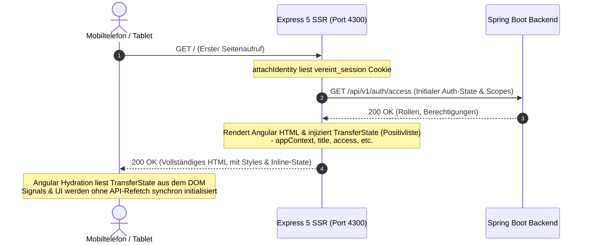

# Frontend-Architektur: Angular 22 SSR, BFF & PWA

Das Web-Frontend von **Vereint** kombiniert serverseitiges Rendering (Angular SSR auf Express 5), eine reaktive Standalone-Komponentenarchitektur und eine robuste Progressive Web App (PWA) für Theken- und Mobilgeräte. Die detaillierte technische Dokumentation des Express-BFF-Servers befindet sich unter [Backend-for-Frontend](../backend-for-frontend/README.md).

---

## 🏗️ Express BFF & SSR-Hydration

### 1. TransferState & Flicker-Free Hydration
- Serverseitig ermittelte Sitzungsdaten und UI-Konfigurationen werden via Angular `TransferState` in das generierte HTML eingebettet.
- **Sicherheitsfilterung**: Zur Vermeidung von Datenlecks sanitisiert der BFF (`transfer-state.ts`) den State auf eine feste Positivliste unkritischer Felder (`appContext`, `title`, `description`, `access`, `locale`, `theme`, `buildVersion`, `featureFlags`). Siehe dazu [02. Request-Pipeline & Transfer-State](../backend-for-frontend/02-request-pipeline.md).
- Der Client greift beim Bootstrapping synchron auf diese Daten zu. Dadurch entfallen Lade-Spinner oder unschöne Layoutverschiebungen beim ersten Laden.

### 2. App Shell & Responsive Breakpoints
- **`AppShellComponent`**: Globaler Rahmen mit adaptiver Navigation:
  - **Mobile (< 768px)**: Fixierte Bottom-Navigation-Leiste mit Schnellzugriff auf Dashboard, Kasse, Events und Chat.
  - **Tablet / Kiosk (768px – 1024px)**: Touch-optimierte Darstellung mit vergrößerten Touch-Zielen für Thekenbetrieb.
  - **Desktop (> 1024px)**: Seitliche Sidebar-Navigation mit erweiterter Vorstands- und Administrationsübersicht.
- **`breakpoint.service.ts`**: Reaktive Signals für Breakpoint-Änderungen (`isMobile`, `isTablet`, `isDesktop`).

---

## 📱 PWA & Service Worker Caching-Strategien

Die Progressive Web App (`pwa/`) gewährleistet Installationsfähigkeit (A2HS - *Add to Home Screen*) und Ausfallsicherheit:

### 1. Caching-Richtlinien
| Ressourcentyp | Caching-Strategie | Begründung |
| :--- | :--- | :--- |
| **Statische Bundles (JS, CSS)** | `Cache-First` (Cache-Busting via Hash) | Maximale Ladegeschwindigkeit bei wiederholten Aufrufen. |
| **Bilder & Icons (SVG, WebP)** | `Network-First` mit Cache-Fallback | Vereinslogo und Icons bleiben offline sichtbar. |
| **API-Anfragen (`/api/*`)** | `Network-Only` (kein Caching) | Kassen- und Transaktionsdaten dürfen niemals veraltet sein. |
| **SSR-Seitenanfragen** | `Network-Only` mit `/offline.html` als Fallback | Seiten enthalten persönliche Daten und werden deshalb nie gecacht; ohne Netz erscheint die Offline-Seite. |

### 2. VAPID Web Push im Service Worker
- Der Service Worker registriert einen `push`-Event-Listener.
- Der Server sendet Pushes **ohne Nutzlast**; beim Push-Dienst (Google, Mozilla, Apple) landen also keine Inhalte. Der Service Worker lädt die neueste ungelesene Mitteilung über `/api/v1/notifications` mit der Sitzung nach und zeigt sie als Systembenachrichtigung. Ohne gültige Sitzung erscheint nur „Du hast eine neue Mitteilung.“
- Ein Klick öffnet `/notifications`. Die Zahl ungelesener Mitteilungen erscheint als App-Badge, wo das Betriebssystem es unterstützt.
- Opt-in pro Gerät im Profil und auf der Mitteilungsseite (`PwaSettingsComponent`, `PushNotificationsService`). Beim App-Start wird ein bestehendes Abo erneut beim Server angemeldet und bei geändertem VAPID-Schlüssel ersetzt.
- iPhone/iPad: Web Push gibt es nur in der installierten App (Home-Bildschirm, iOS 16.4+). Das Profil zeigt dafür die Installationsanleitung.

### 3. Installation
- Manifest mit Icons (inkl. maskable), Shortcuts (Events, Chat, Guthaben, Mitteilungen) und `start_url` `/dashboard`.
- `InstallPromptService` fängt `beforeinstallprompt` ab; das Profil zeigt dann „Installieren“. Auf iOS erscheint die Anleitung „Teilen → Zum Home-Bildschirm“.
