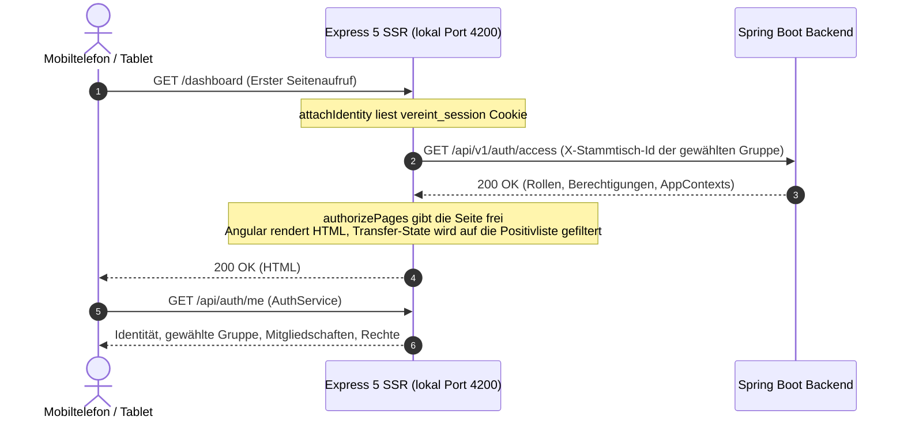

# Frontend-Architektur: Angular 22 SSR, BFF & PWA

Das Web-Frontend von **Vereint** kombiniert serverseitiges Rendering (Angular SSR auf Express 5), eine reaktive Standalone-Komponentenarchitektur und eine robuste Progressive Web App (PWA) für Theken- und Mobilgeräte. Die detaillierte technische Dokumentation des Express-BFF-Servers befindet sich unter [Backend-for-Frontend](../backend-for-frontend/README.md).

---

## 🏗️ Express BFF & SSR-Hydration

### 1. Transfer-State & Hydration
- Die App nutzt `provideClientHydration()`; der Angular-Transfer-State wird für private Seiten vor der Auslieferung gefiltert.
- **Sicherheitsfilterung**: Zur Vermeidung von Datenlecks reduziert der BFF (`transfer-state.ts`) den State auf eine feste Positivliste unkritischer Felder (`appContext`, `title`, `description`, `access`, `locale`, `theme`, `buildVersion`, `featureFlags`). Siehe dazu [02. Request-Pipeline & Transfer-State](../backend-for-frontend/02-request-pipeline.md).
- Identität, Rechte und gewählte Gruppe lädt der `AuthService` im Browser über `/api/auth/me` nach; die Sprache legt `I18nService` vor dem ersten Rendern fest, damit SSR und Hydration denselben Text zeigen.

### 2. App Shell & Responsive Breakpoints
- **`AppShellComponent`**: Globaler Rahmen mit adaptiver Navigation (`BreakpointService`, Signal `Viewport`: `mobile`, `tablet`, `web`):
  - **Mobile (≤ 640px)**: Untere Navigationsleiste mit Start, Events, Chat, Guthaben und **Mehr**.
  - **Tablet (641px bis 1024px)**: Beschriftete Icon-Leiste mit denselben Zielen plus **Mehr**.
  - **Desktop (> 1024px)**: Gruppierte Seitenleiste und Kopfzeile.
- SSR rendert die Desktop-Variante; im Browser schaltet `BreakpointService` per `matchMedia` um.
- Die Shell zeigt außerdem die gewählte Gruppe mit Gruppenwechsel, ein Banner, wenn die Gruppe wegen offener Zahlung nur lesbar ist (`readOnlyInterceptor`), und die Sperre im Kiosk-Modus.

---

## 📱 PWA & Service Worker Caching-Strategien

Die Progressive Web App (`pwa/`, Service Worker `public/vereint-sw.js`, Regeln gespiegelt in `service-worker-cache-policy.ts`) gewährleistet Installationsfähigkeit (A2HS - *Add to Home Screen*) und Ausfallsicherheit:

### 1. Caching-Richtlinien
| Ressourcentyp | Caching-Strategie | Begründung |
| :--- | :--- | :--- |
| **Gehashte Build-Dateien (JS, CSS, Schriften)** | `Cache-First` (Cache-Busting via Hash) | Maximale Ladegeschwindigkeit bei wiederholten Aufrufen. |
| **Übrige öffentliche Assets (Bilder, Icons)** | `Network-First` mit Cache-Fallback (höchstens 150 Einträge) | Logo und Icons bleiben offline sichtbar. |
| **API-Anfragen (`/api/*`), Nicht-GET, fremde Ursprünge, Antworten mit `private`/`no-store`** | `Network-Only` (kein Caching) | Kassen- und Transaktionsdaten dürfen niemals veraltet sein. |
| **SSR-Seitenanfragen** | `Network-Only` mit `/offline.html` als Fallback | Seiten enthalten persönliche Daten und werden deshalb nie gecacht; ohne Netz erscheint die Offline-Seite. |

### 2. VAPID Web Push im Service Worker
- Der Service Worker registriert einen `push`-Event-Listener.
- Der Server sendet Pushes **ohne Nutzlast**; beim Push-Dienst (Google, Mozilla, Apple) landen also keine Inhalte. Der Service Worker lädt die neueste ungelesene Mitteilung über `/api/v1/notifications` mit der Sitzung nach und zeigt sie als Systembenachrichtigung. Ohne gültige Sitzung erscheint nur „Du hast eine neue Mitteilung.“
- Bei Event-Einladungen bietet die Benachrichtigung die Aktionen „Zusagen“ und „Absagen“, die direkt `PUT /api/v1/events/{id}/rsvp` aufrufen.
- Ein Klick öffnet den Link der Mitteilung (z. B. das Event), sonst `/notifications`.
- Die Mitteilungen gehören zu einer Gruppe; der Service Worker lädt sie über den API-Proxy und damit für die im Browser gewählte Gruppe. Die Zahl ungelesener Mitteilungen erscheint als App-Badge, wo das Betriebssystem es unterstützt.
- Opt-in pro Gerät im Profil und auf der Mitteilungsseite (`PwaSettingsComponent`, `PushNotificationsService`). Beim App-Start wird ein bestehendes Abo erneut beim Server angemeldet und bei geändertem VAPID-Schlüssel ersetzt.
- iPhone/iPad: Web Push gibt es nur in der installierten App (Home-Bildschirm, iOS 16.4+). Das Profil zeigt dafür die Installationsanleitung.

### 3. Installation
- Manifest mit Icons (inkl. maskable), Shortcuts (Events, Chat, Guthaben, Mitteilungen) und `start_url` `/dashboard`.
- `InstallPromptService` fängt `beforeinstallprompt` ab; das Profil zeigt dann „Installieren“. Auf iOS erscheint die Anleitung „Teilen → Zum Home-Bildschirm“.
