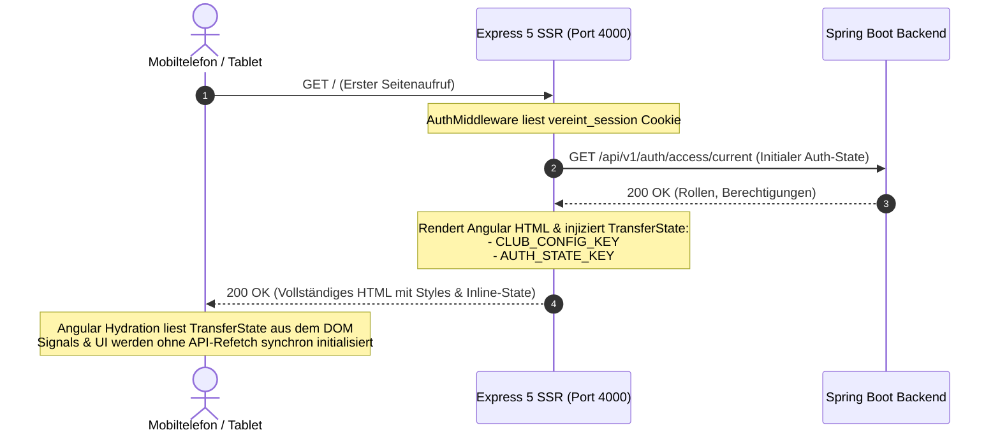

# Frontend-Architektur: Angular 19 SSR, BFF & PWA

Das Web-Frontend von **Vereint** kombiniert serverseitiges Rendering (Angular SSR auf Express 5), eine reaktive Standalone-Komponentenarchitektur und eine robuste Progressive Web App (PWA) für Theken- und Mobilgeräte.

---

## 🏗️ Express BFF & SSR-Hydration

### 1. TransferState & Flicker-Free Hydration
- Serverseitig ermittelte Sitzungsdaten und Vereins-Branding-Konfigurationen werden via Angular `TransferState` (`transfer-state.ts`) in das generierte HTML eingebettet.
- Der Client greift beim Bootstrapping synchron auf diese Daten zu. Dadurch entfallen Lade-Spinner oder unschöne Layoutverschiebungen beim ersten Laden.

### 2. App Shell & Responsive Breakpoints
- **`AppShellComponent`**: Globaler Rahmen mit adaptiver Navigation:
  - **Mobile (< 768px)**: Fixierte Bottom-Navigation-Leiste mit Schnellzugriff auf Dashboard, Kasse, Events und Chat.
  - **Tablet / Kiosk (768px – 1024px)**: Touch-optimierte Darstellung mit vergrößerten Touch-Zielen für Thekenbetrieb.
  - **Desktop (> 1024px)**: Seitliche Sidebar-Navigation mit erweiterter Vorstands- und Administrationsübersicht.
- **`breakpoint.service.ts`**: Reaktive Signals für Breakpoint-Änderungen (`isMobile`, `isTablet`, `isDesktop`).

---

## 📱 PWA & Service Worker Caching-Strategien

Die Progressive Web App (`pwa/`) gewährleistet Installationsfähigkeit (A2HS - *Add to Home Screen*) und Ausfallsicherheit:

### 1. Caching-Richtlinien
| Ressourcentyp | Caching-Strategie | Begründung |
| :--- | :--- | :--- |
| **Statische Bundles (JS, CSS)** | `Cache-First` (Cache-Busting via Hash) | Maximale Ladegeschwindigkeit bei wiederholten Aufrufen. |
| **Bilder & Icons (SVG, WebP)** | `Stale-While-Revalidate` | Schnelle Offline-Verfügbarkeit von Vereinslogo und Getränkebildern. |
| **API-Anfragen (`/api/*`)** | `Network-Only` (kein Caching) | Kassen- und Transaktionsdaten dürfen niemals veraltet sein. |
| **SSR-Seitenanfragen** | `Network-First` mit Offline-Fallback | Liefert stets aktuelle Seiteninhalte; Offline-Screen bei Verbindungsverlust. |

### 2. VAPID Web Push im Service Worker
- Der Service Worker registriert einen `push`-Event-Listener.
- Bei Eintreffen einer verschlüsselten VAPID-Push-Nachricht zeigt der Service Worker eine native Systembenachrichtigung mit Titel, Nachrichtentext, Vereins-Icon und Klick-Routing direkt in die jeweilige Ansicht (z. B. Event-Details oder Chat).
