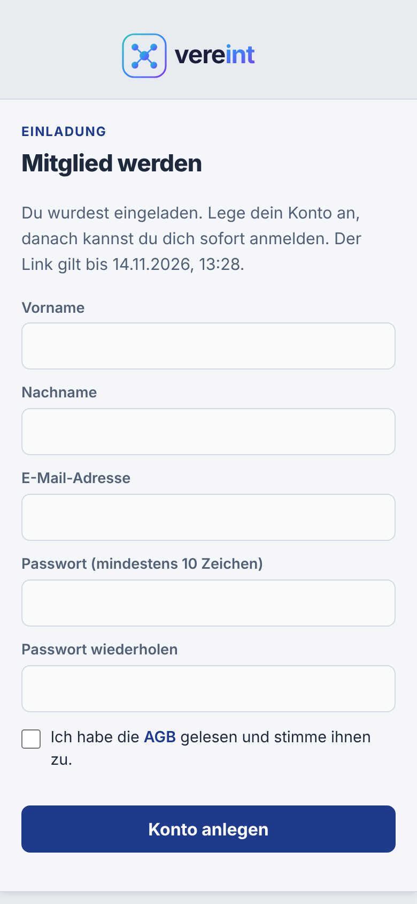
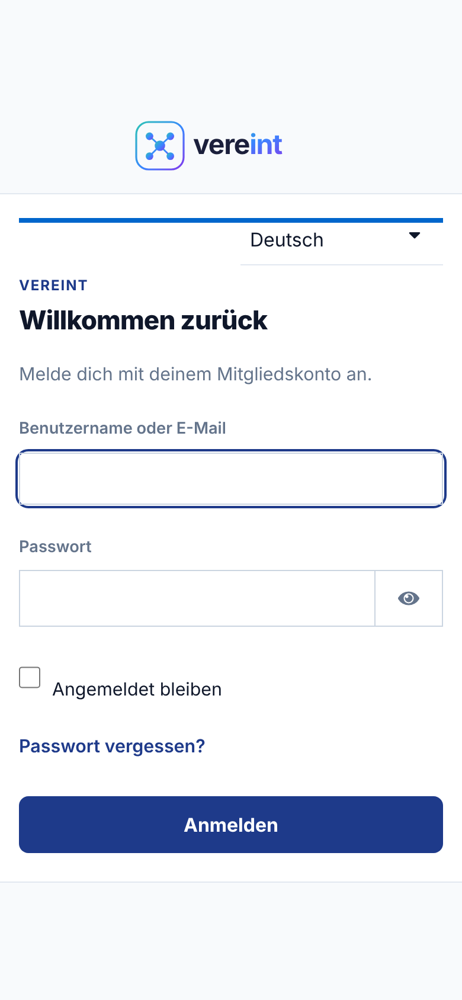
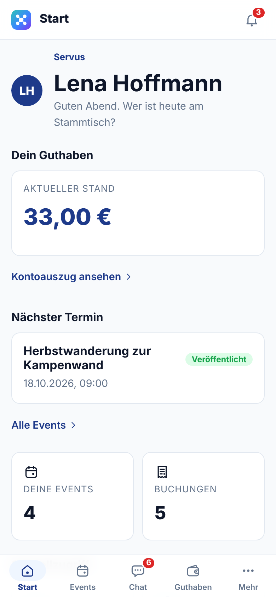
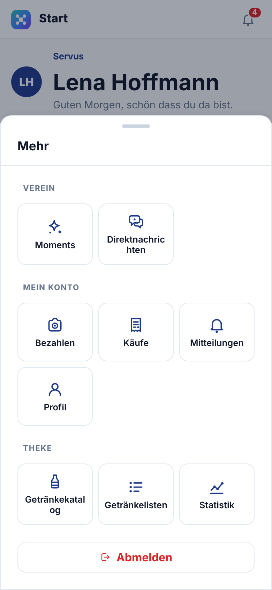
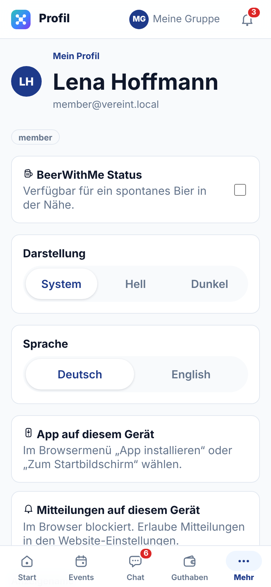
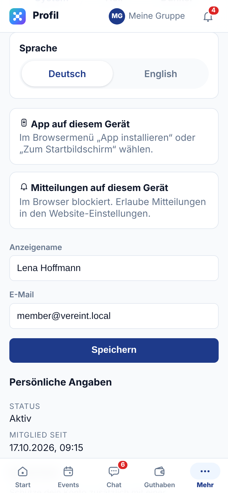

# Erste Schritte

Dieser Teil gilt für alle, die ein Vereinskonto haben. Gäste ohne Konto lesen den [Leitfaden Gast](06-gast.md).

## Mit einem Einladungslink registrieren

Neu im Verein? Dann bekommst du vom Vorstand einen **Einladungslink**.

1. Den Link öffnen. Vereint prüft ihn und zeigt, bis wann er gilt.
2. **Vorname**, **Nachname** und **E-Mail-Adresse** eintragen.
3. Ein **Passwort** mit mindestens 10 Zeichen wählen und wiederholen.
4. **Konto anlegen** tippen, danach **Jetzt anmelden** und mit E-Mail-Adresse und Passwort anmelden.

Funktioniert der Link nicht, ist er abgelaufen, schon verwendet oder zurückgezogen. Bitte den Vorstand um einen neuen. Gibt es für deine E-Mail-Adresse schon ein Konto, melde dich damit an oder setze dein Passwort zurück.

 

## Anmelden

1. Öffne die Adresse eures Vereins im Browser, am Handy oder am Rechner.
2. Gib deinen **Benutzernamen oder deine E-Mail-Adresse** und dein **Passwort** ein.
3. Tippe auf **Anmelden**.

Weitere Möglichkeiten auf dieser Seite:

- **Angemeldet bleiben**: Du musst dich auf diesem Gerät nicht jedes Mal neu anmelden. Nur auf deinem eigenen Gerät anhaken.
- **Passwort vergessen?** Vereint verschickt keine E-Mails. Melde dich bei der Administration; sie setzt dir ein neues, vorläufiges Passwort, das du beim nächsten Anmelden änderst.
- Oben kannst du die Sprache der Anmeldeseite wählen.

Nach der Anmeldung landest du auf der Startseite.

 

## Die Startseite

Die Startseite zeigt auf einen Blick:

- dein **Guthaben** mit dem Link zum Kontoauszug,
- deinen **nächsten Termin** mit Zu- oder Absage,
- wie viele **Events** und **Buchungen** du hast,
- einen **Schnellzugriff** auf Getränk bezahlen, Moments, Getränkekatalog, Käufe und Mitteilungen.

Die **Glocke** oben rechts führt zu deinen Mitteilungen. Die rote Zahl zeigt, wie viele davon noch ungelesen sind. Auch am Reiter **Chat** zeigt eine rote Zahl ungelesene Nachrichten.

 

## Sich zurechtfinden

**Am Handy** steht unten eine Leiste mit den vier wichtigsten Bereichen: **Start**, **Events**, **Chat** und **Guthaben**. Alles andere findest du unter **Mehr**, sortiert nach:

- **Verein**: Moments, Direktnachrichten
- **Mein Konto**: Bezahlen, Käufe, Mitteilungen, Profil
- **Theke**: Getränkekatalog, Getränkelisten, Statistik
- **Verwaltung**: nur für Vorstand, Administration und Theke

Ganz unten im Mehr-Menü meldest du dich mit **Abmelden** ab.

**Am Tablet und am Rechner** stehen dieselben Bereiche in einer Seitenleiste links (siehe Bilder im [Leitfaden Administration](04-administration.md)). Abmelden geht dort über deinen Namen oben rechts.

 

## Profil, Darstellung und Sprache

Unter **Mehr → Profil** siehst du deine Kontodaten und deine Rollen.

- **Anzeigename**: So sehen dich die anderen, etwa im Chat, in Teilnehmerlisten und am Thekenterminal. Ändern und **Speichern** tippen.
- **Darstellung**: **System** folgt der Einstellung deines Geräts, **Hell** und **Dunkel** legen das Aussehen fest.
- **Sprache**: **Deutsch** oder **English**. Die Wahl gilt sofort für die ganze App und auch für die Anmeldeseite. Hast du nichts gewählt, nimmt Vereint die Sprache deines Browsers.
- **Sicherheit**: **Zwei-Faktor-Anmeldung einrichten** öffnet die Kontoverwaltung. Dort hinterlegst du eine Authenticator-App (z. B. Google Authenticator); danach fragt die Anmeldung nach Passwort und einem 6-stelligen Code. Das ist freiwillig, für Vorstand und Administration aber empfohlen.
- **BeerWithMe Status** ist eine Vorschau und wird noch nicht an andere übertragen.

 

## Vereint als App auf dem Handy

Vereint lässt sich wie eine App auf den Startbildschirm legen. Sie startet dann ohne Browserleiste und lädt schneller. Im Profil steht unter **App auf diesem Gerät**, wie es auf deinem Gerät geht:

- **Android und Rechner**: Gibt es einen Knopf **Installieren**, tippe darauf. Sonst im Browsermenü **App installieren** oder **Zum Startbildschirm** wählen.
- **iPhone und iPad**: In Safari unten auf **Teilen** tippen, dann **Zum Home-Bildschirm**.

Ist Vereint installiert, steht dort „Vereint ist installiert.“

## Mitteilungen aufs Handy (Push)

Unter **Mitteilungen auf diesem Gerät** schaltest du Push-Nachrichten ein. Dann bekommst du Mitteilungen des Vereins, Einladungen und Erinnerungen zu Events auch, wenn Vereint geschlossen ist.

1. Schalter einschalten.
2. Das Handy fragt einmal, ob Vereint Mitteilungen senden darf. Mit **Erlauben** bestätigen.

Gut zu wissen:

- Die Einstellung gilt je Gerät. Auf Handy und Rechner schaltest du sie getrennt ein.
- Auf **iPhone und iPad** geht Push erst, wenn Vereint auf dem Home-Bildschirm installiert ist.
- Steht dort „Im Browser blockiert“ (wie im Bild), hast du die Erlaubnis früher abgelehnt. Erlaube Mitteilungen dann in den Website-Einstellungen deines Browsers und lade die Seite neu.

 
