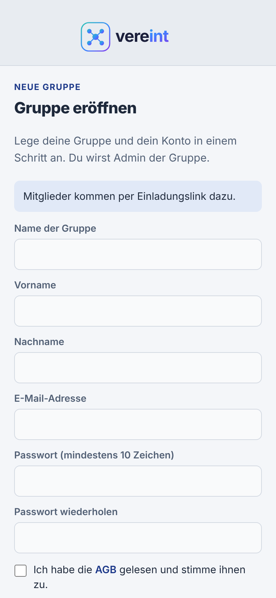

# Erste Schritte

Dieser Teil gilt für alle, die ein Konto bei Vereint haben. Gäste ohne Konto lesen den [Leitfaden Gast](06-gast.md).

## Mit einem Einladungslink registrieren

Neu in einer Gruppe? Dann bekommst du vom Vorstand einen **Einladungslink**.

1. Den Link öffnen. Vereint prüft ihn und zeigt, bis wann er gilt.
2. **Vorname**, **Nachname** und **E-Mail-Adresse** eintragen.
3. Ein **Passwort** mit mindestens 10 Zeichen wählen und wiederholen.
4. Den Haken bei „Ich habe die **AGB** gelesen und stimme ihnen zu.“ setzen. Ohne Zustimmung legt Vereint kein Konto an.
5. **Konto anlegen** tippen, danach **Jetzt anmelden** und mit E-Mail-Adresse und Passwort anmelden.

Funktioniert der Link nicht, ist er abgelaufen, schon verwendet oder zurückgezogen. Bitte den Vorstand um einen neuen. Gibt es für deine E-Mail-Adresse schon ein Konto, melde dich damit an und öffne den Link danach noch einmal (siehe unten). Passwort vergessen? Siehe [Anmelden](#anmelden).

 

## Mit einem bestehenden Konto beitreten

Du hast schon ein Konto, etwa weil du in einer anderen Gruppe bist? Dann brauchst du kein neues.

1. Melde dich in diesem Browser an.
2. Öffne den Einladungslink. Vereint zeigt **Gruppe beitreten**.
3. Tippe auf **Dieser Gruppe beitreten**.

Du bist sofort Mitglied und landest auf der Startseite der neuen Gruppe. Dein Konto, dein Name und deine Einstellungen bleiben gleich.

## Anmelden

1. Öffne die Adresse von Vereint im Browser, am Handy oder am Rechner.
2. Unter **Benutzername oder E-Mail** deinen Benutzernamen oder deine E-Mail-Adresse eintragen, dazu dein **Passwort**.
3. Tippe auf **Anmelden**.

Weitere Möglichkeiten auf dieser Seite:

- **Angemeldet bleiben**: Du musst dich auf diesem Gerät nicht jedes Mal neu anmelden. Nur auf deinem eigenen Gerät anhaken.
- Einen Link „Passwort vergessen?“ gibt es nicht, weil Vereint keine E-Mails verschickt. Hast du dein Passwort vergessen, melde dich beim Admin deiner Gruppe. Ein neues, vorläufiges Passwort setzt, wer Zugang zur Keycloak-Verwaltung hat (meist der Betreiber von Vereint); du änderst es beim nächsten Anmelden.
- Oben kannst du die Sprache der Anmeldeseite wählen.

Nach der Anmeldung landest du auf der Startseite. Bist du in mehreren Gruppen, wählst du vorher eine aus (siehe [Gruppe wählen und wechseln](#gruppe-wählen-und-wechseln)).

Unter der Anmeldung steht außerdem „Noch keine Gruppe? **Eigene Gruppe eröffnen**“ (siehe [Eine eigene Gruppe eröffnen](#eine-eigene-gruppe-eröffnen)). Ganz unten führen **Impressum** und **AGB** zu den Rechtstexten.

 

## Die Startseite

Die Startseite zeigt auf einen Blick:

- dein **Guthaben** mit **Bezahlen** (Getränk scannen) und dem Link zum **Kontoauszug**,
- deinen **nächsten Termin** mit Zu- oder Absage; ein Tipp auf die Karte öffnet das Event,
- wie viele **Events** und **Buchungen** du hast.

Die **Glocke** oben rechts führt zu deinen Mitteilungen. Die rote Zahl zeigt, wie viele davon noch ungelesen sind. Auch am Reiter **Chat** zeigt eine rote Zahl ungelesene Nachrichten.

 

## Sich zurechtfinden

**Am Handy** steht unten eine Leiste mit den vier wichtigsten Bereichen: **Start**, **Events**, **Chat** und **Guthaben**. Alles andere findest du unter **Mehr**, sortiert nach:

- **Gruppe**: Moments, Direktnachrichten, Statistik
- **Mein Konto**: Kalender, Freunde, Bezahlen, Käufe, Mitteilungen, Profil, Gruppeneinstellungen
- **Theke**: Getränkekatalog, Getränkelisten, Thekenterminal
- **Verwaltung**: nur für Vorstand und Administration (dort stehen dann auch die Gruppeneinstellungen)

Auf Unterseiten wie „Event verwalten“ oder „Kasse & Finanzen“ führt der **Pfeil** oben links zurück.

Ganz unten im Mehr-Menü meldest du dich mit **Abmelden** ab. Darunter stehen **Impressum** und **AGB**.

Das Mehr-Menü schließt du, indem du es mit dem Finger nach unten wischst, daneben tippst oder einen Eintrag wählst. Fenster wie „Mitglied einladen“ füllen am Handy den ganzen Bildschirm; oben rechts schließt sie das **×**.

**Am Tablet** steht links eine schmale Leiste mit denselben vier Bereichen und **Mehr**. **Am Rechner** stehen alle Bereiche in einer Seitenleiste links, unten mit **Impressum** und **AGB** (siehe Bilder im [Leitfaden Administration](04-administration.md)). Auf beiden öffnet dein Name oben rechts ein Menü mit **Profil**, **Guthaben** und **Abmelden**.

 

## Gruppe wählen und wechseln

Vereint kann mehrere Gruppen tragen, zum Beispiel einen Stammtisch, einen Verein oder ein Team. Mit einem Konto kannst du Mitglied in mehreren Gruppen sein. Events, Chat, Guthaben, Katalog und Mitteilungen gehören immer zu genau einer Gruppe. Du siehst immer nur die Daten der Gruppe, die gerade offen ist.

- Bist du nur in einer Gruppe, öffnet Vereint sie von selbst.
- Bist du in mehreren, zeigt Vereint nach der Anmeldung die Seite **Gruppe wählen**. Dort stehen alle deine Gruppen mit deinen Rollen. Tippe auf die gewünschte Gruppe. Die offene Gruppe ist blau umrandet und trägt das Kennzeichen **Aktuell**.
- Oben rechts stehen Bild und Name der offenen Gruppe. Bist du in mehreren Gruppen, führt ein Tipp darauf zurück zur Auswahl. Dasselbe geht unter **Gruppeneinstellungen** mit **Gruppe wechseln**.

Die Auswahl erreichst du auch direkt unter der Adresse `/gruppen`. Bist du noch in keiner Gruppe, steht dort „Noch keine Gruppe“. Bitte dann den Vorstand um einen Einladungslink oder eröffne eine eigene Gruppe.

Wie du eine Gruppe verlässt, steht im [Leitfaden Mitglied](02-mitglied.md#eine-gruppe-verlassen).

## Eine eigene Gruppe eröffnen

Jede Person kann selbst eine Gruppe gründen und ist dann ihr Admin. Den Weg dorthin findest du auf der Anmeldeseite unter **Eigene Gruppe eröffnen**, auf der Seite **Gruppe wählen** oder direkt unter `/gruppe-eroeffnen`.

**Ohne Konto**: **Name der Gruppe**, **Vorname**, **Nachname**, **E-Mail-Adresse** und ein **Passwort** eintragen, den AGB zustimmen und **Gruppe eröffnen** tippen. Vereint legt Konto und Gruppe in einem Schritt an. Danach mit **Jetzt anmelden** anmelden. Hast du schon ein Konto, tippe auf **Erst anmelden, dann eröffnen**.

**Mit Konto**: Bist du schon angemeldet, reicht der **Name der Gruppe** und der Haken bei den AGB. Nach **Gruppe eröffnen** öffnet sich die neue Gruppe gleich.

In beiden Fällen gilt:

- Vereint ist kostenlos, ohne Grenzen für Mitglieder oder Speicher.
- Nach der Anmeldung landest du in den **Gruppeneinstellungen**. Mitglieder lädst du per Einladungslink ein (siehe [Neue Mitglieder einladen](04-administration.md#neue-mitglieder-einladen)).
- Pro Person sind höchstens drei eigene Gruppen möglich.
- Hat der Betreiber das Eröffnen abgeschaltet, meldet Vereint „Die Registrierung ist gerade nicht möglich“. In eine bestehende Gruppe kommst du dann weiter per Einladungslink.

## Profil, Darstellung und Sprache

Unter **Mehr → Profil** siehst du deine Kontodaten und deine Rollen.

- **Anzeigename**: So sehen dich die anderen, etwa im Chat, in Teilnehmerlisten und am Thekenterminal. Ändern und **Speichern** tippen.
- **Darstellung**: **System** folgt der Einstellung deines Geräts, **Hell** und **Dunkel** legen das Aussehen fest.
- **Sprache**: **Deutsch** oder **English**. Die Wahl gilt sofort für die ganze App und auch für die Anmeldeseite. Hast du nichts gewählt, nimmt Vereint die Sprache deines Browsers.
- **Sicherheit**: **Zwei-Faktor-Anmeldung einrichten** öffnet die Kontoverwaltung. Dort hinterlegst du eine Authenticator-App (z. B. Google Authenticator); danach fragt die Anmeldung nach Passwort und einem 6-stelligen Code. Das ist freiwillig, für Vorstand und Administration aber empfohlen.
- **BeerWithMe Status** ist eine Vorschau und wird noch nicht an andere übertragen.

 

## Vereint als App auf dem Handy

Vereint lässt sich wie eine App auf den Startbildschirm legen. Sie startet dann ohne Browserleiste und lädt schneller. Im Profil steht unter **App auf diesem Gerät**, wie es auf deinem Gerät geht:

- **Android und Rechner**: Gibt es einen Knopf **Installieren**, tippe darauf. Sonst im Browsermenü **App installieren** oder **Zum Startbildschirm** wählen.
- **iPhone und iPad**: In Safari unten auf **Teilen** tippen, dann **Zum Home-Bildschirm**.

Ist Vereint installiert, steht dort „Vereint ist installiert.“

## Mitteilungen aufs Handy (Push)

Unter **Mitteilungen auf diesem Gerät** schaltest du Push-Nachrichten ein. Dann bekommst du Mitteilungen der Gruppe, Einladungen und Erinnerungen zu Events auch, wenn Vereint geschlossen ist.

1. Schalter einschalten.
2. Das Handy fragt einmal, ob Vereint Mitteilungen senden darf. Mit **Erlauben** bestätigen.

Gut zu wissen:

- Die Einstellung gilt je Gerät. Auf Handy und Rechner schaltest du sie getrennt ein.
- Auf **iPhone und iPad** geht Push erst, wenn Vereint auf dem Home-Bildschirm installiert ist.
- Steht dort „Im Browser blockiert“ (wie im Bild), hast du die Erlaubnis früher abgelehnt. Erlaube Mitteilungen dann in den Website-Einstellungen deines Browsers und lade die Seite neu.

 
