# Leitfaden Mitglied

Für alle Mitglieder einer Gruppe. Anmeldung, Navigation und Profil stehen in den [Ersten Schritten](01-erste-schritte.md).

Jeden Mitglieder-Bildschirm einzeln erklärt [Die App Bildschirm für Bildschirm](07-alle-screens.md#mitglied). Dort stehen auch die geplanten Statistiken (Getränke, Kalorien, Zusagen).

## Auf einen Blick

| Ich möchte … | So geht's |
| :--- | :--- |
| zu einem Termin zusagen | **Events** → **Zusagen** bei der Einladung, oder direkt in der Push-Nachricht |
| selbst ein Event planen | **Events** → **Event anlegen** |
| mit allen in der Gruppe schreiben | **Chat** → **Gruppenchat** |
| jemandem persönlich schreiben | **Mehr → Direktnachrichten** → **+** |
| alle Termine aus allen meinen Gruppen sehen | **Mehr → Kalender** |
| jemanden als Freund hinzufügen | **Mehr → Freunde** → **Anfragen** |
| sehen, wer am meisten Striche hat | **Mehr → Statistik** |
| mein Guthaben sehen | **Guthaben** (untere Leiste) |
| eine Runde ausgeben | Im laufenden Event **Runde ausgeben** → Personen anhaken → **Runde für … ausgeben** |
| ein Getränk selbst bezahlen | **Bezahlen** auf der Startseite oder unter **Guthaben** (oder **Mehr → Bezahlen**) → Strichcode scannen |
| prüfen, was mir an der Theke angeschrieben wurde | **Mehr → Käufe** |
| Guthaben aufladen | Bargeld beim Kassenwart abgeben, er bucht es ein |
| beim gemeinsamen Anstoßen mitmachen | **Mehr → Moments**, oder im Event auf **Moments** |
| ein neues Getränk vorschlagen | **Mehr → Getränkekatalog** → **Getränk vorschlagen** oder **Barcode scannen** |
| die Gruppe wechseln | Gruppenname oben rechts antippen, oder **Mehr → Gruppeneinstellungen** → **Gruppe wechseln** |
| eine Gruppe verlassen | **Mehr → Gruppeneinstellungen** → **Gruppe verlassen** |

## Einladungen und Zusagen

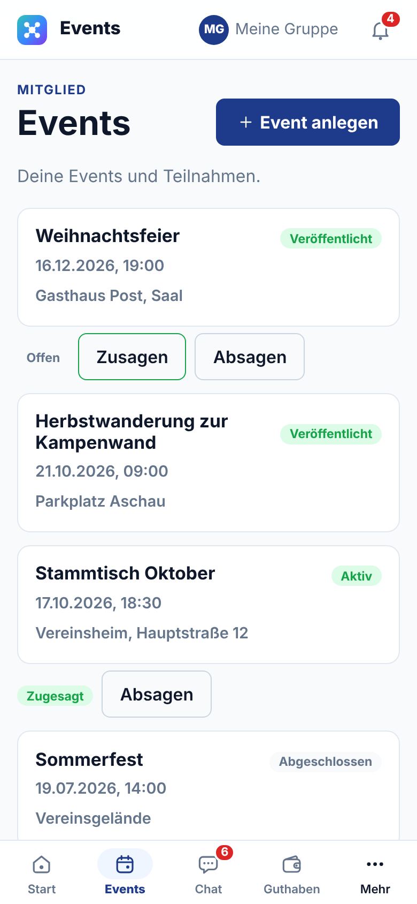

Wirst du zu einem Event eingeladen, bekommst du eine Mitteilung, mit eingeschaltetem Push auch aufs Handy. Wann die Einladung verschickt wird, legt der Gastgeber fest; manche Events schicken vorher noch eine Erinnerung.

Antworten kannst du an drei Stellen:

- direkt in der **Push-Nachricht** mit **Zusagen** oder **Absagen**,
- unter **Events**: Bei offenen Einladungen steht „Offen“ mit **Zusagen** und **Absagen**. Oben wechselst du zwischen **Kommend** und **Vergangen**,
- auf der Eventseite mit **Zusagen**, **Vielleicht** oder **Absagen**.

Deine Antwort kannst du bis zum Event jederzeit ändern. Die Karten zeigen außerdem den Stand des Events:

- **Veröffentlicht**: Der Termin steht fest, du kannst antworten.
- **Aktiv**: Der Abend läuft gerade, die Theke ist geöffnet.
- **Abgeschlossen**: Der Termin ist vorbei.

 

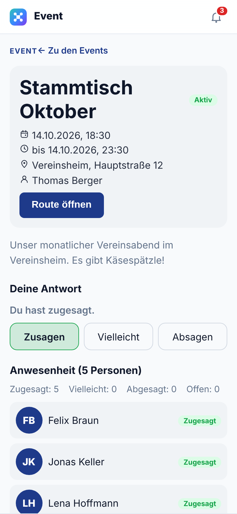

Tippe auf ein Event, um die Details zu sehen:

- Datum, Uhrzeit, Ort und wer das Event organisiert. **Route** startet die Navigation zum Treffpunkt.
- Darunter führen **Event-Chat** und **Moments** (mit der Zahl laufender Moments) weiter. Läuft das Event, steht dort auch **Runde ausgeben** (siehe [Eine Runde ausgeben](#eine-runde-ausgeben)); Gastgeber und Vorstand sehen zusätzlich **Verwalten**.
- **Deine Antwort**: Deine aktuelle Wahl ist hervorgehoben.
- **Anwesenheit**: wie viele zugesagt, vielleicht gesagt, abgesagt oder noch nicht geantwortet haben, darunter die Eingeladenen nach ihrer Antwort gruppiert.

Auf der **Startseite** steht außerdem immer dein nächster Termin.

 

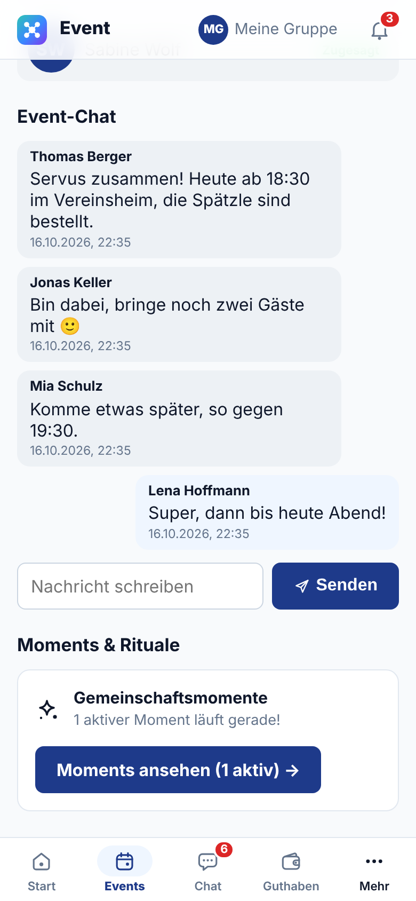

**Event-Chat**: Alle Eingeladenen eines Events können hier miteinander schreiben, zum Beispiel für Fahrgemeinschaften. Nachricht unten eintippen und **Senden**. Den Chat findest du auch unter **Chat** in der Liste der Event-Chats.

 

## Selbst ein Event anlegen

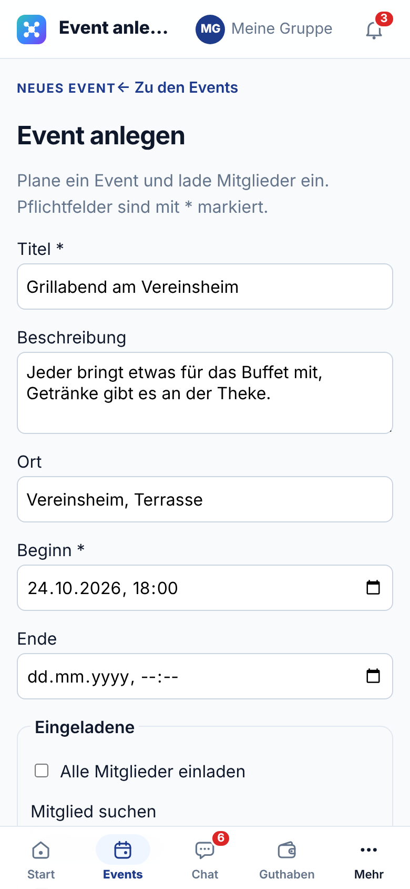

Jedes Mitglied kann ein Event planen, etwa eine Wanderung oder einen Grillabend. Du bist dann der Gastgeber.

1. **Events** → **Event anlegen**.
2. **Titel** und **Beginn** eintragen (Pflicht), dazu Beschreibung, Ort und Ende.

 

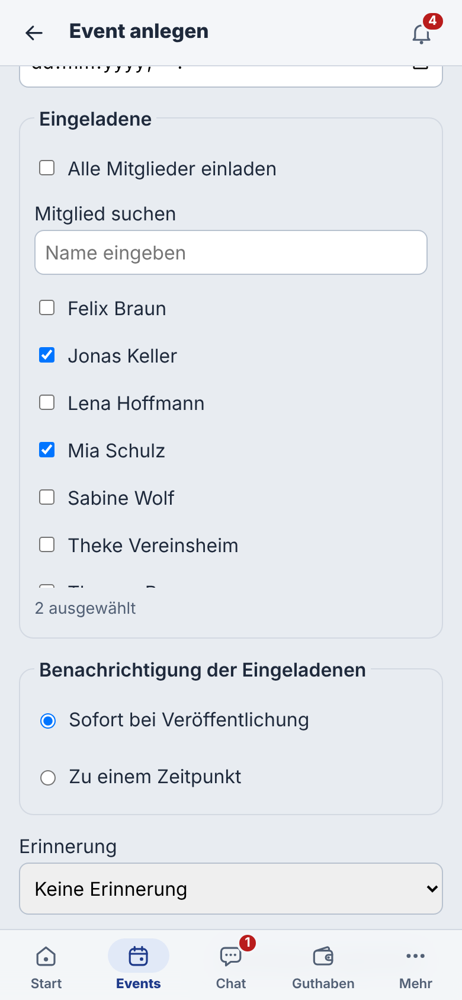

3. **Eingeladene**: Mitglieder per Namen suchen und anhaken, oder **Alle Mitglieder einladen**.
4. **Benachrichtigung der Eingeladenen**: **Sofort bei Veröffentlichung** oder **Zu einem Zeitpunkt**, etwa eine Woche vorher.
5. **Erinnerung**: optional eine Erinnerung vor dem Beginn.
6. **Veröffentlichen und einladen** verschickt die Einladungen. Mit **Als Entwurf speichern** bleibt das Event noch unsichtbar.

Danach verwaltest du dein Event wie im [Leitfaden Vorstand](03-vorstand.md#ein-event-vorbereiten) beschrieben.

 

## Chat

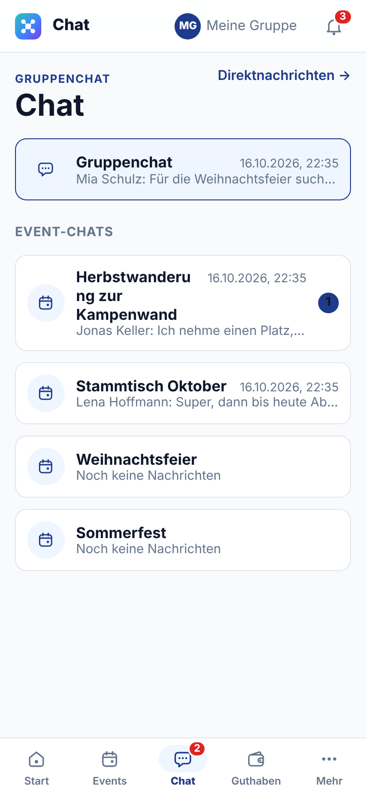

Unter **Chat** (untere Leiste) stehen oben der **Gruppenchat** für alle Mitglieder und darunter die **Event-Chats** deiner Events. Jede Zeile zeigt die letzte Nachricht; eine Zahl rechts steht für ungelesene Nachrichten.

 

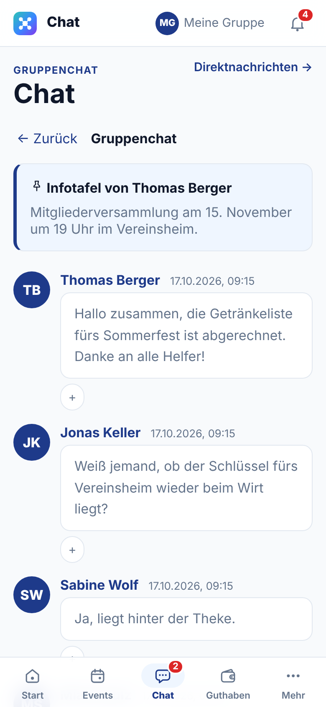

Tippe auf eine Unterhaltung, um sie zu öffnen. Oben im Gruppenchat kann der Vorstand eine **Infotafel** anheften, etwa einen wichtigen Termin.

- Unten Nachricht eintippen und senden.
- Mit **+** unter einer Nachricht reagierst du mit einem Emoji.
- **← Zurück** führt zur Liste.

 

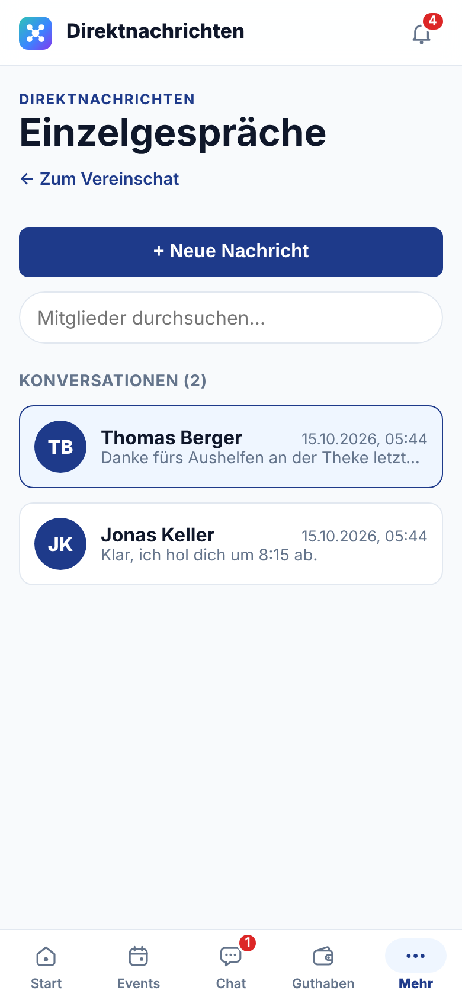

**Direktnachrichten** (über **Mehr** oder oben im Chat) sind Gespräche zu zweit, die nur ihr beide seht. Sie gelten über alle Gruppen: Mit jeder Person gibt es genau ein Gespräch, egal in welcher Gruppe du gerade bist.

- **+** (neben dem Suchfeld): Person wählen und losschreiben. Zur Auswahl stehen alle aus deinen Gruppen und deine Freunde. Unter dem Namen siehst du eure gemeinsamen Gruppen.
- Bestehende Gespräche stehen unter **Gespräche**; mit dem Suchfeld findest du sie schnell. **Freunde** oben rechts führt zur Freundesliste.
- Seid ihr weder befreundet noch in einer gemeinsamen Gruppe, bleibt das Gespräch lesbar, neue Nachrichten gehen aber nicht mehr.
- Mit eingeschaltetem Push bekommst du neue Direktnachrichten aufs Handy, egal welche Gruppe gerade gewählt ist. Ein Tipp darauf öffnet das Gespräch.

 

## Kalender

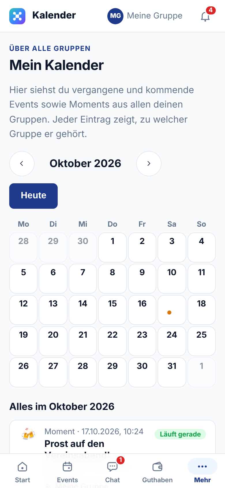

Unter **Mehr → Kalender** siehst du alle Termine aus allen deinen Gruppen an einem Ort: vergangene und kommende Events sowie die Moments dazu.

- Mit **‹** und **›** blätterst du durch die Monate, **Heute** springt zurück.
- Punkte in einem Tag zeigen Einträge an. Tippe auf den Tag, um nur diesen Tag zu sehen; **Ganzen Monat zeigen** hebt das wieder auf.
- Jeder Eintrag nennt seine Gruppe. Bist du in mehreren Gruppen, filterst du oben mit **Gruppe**.
- Ein Tipp auf einen Eintrag öffnet das Event bzw. seine Moments. Gehört er zu einer anderen Gruppe, wechselt die App vorher in diese Gruppe.

Du siehst dieselben Events wie auf der Event-Seite der jeweiligen Gruppe: deine eigenen und die, zu denen du eingeladen bist.

 

## Freunde

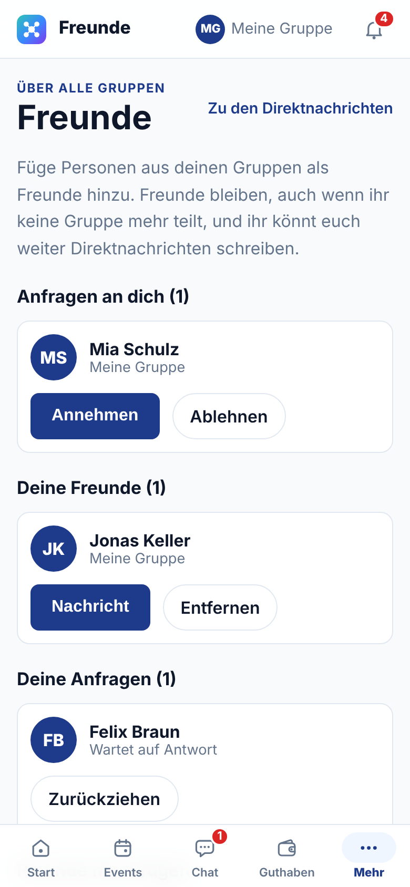

Unter **Mehr → Freunde** führst du deine Freundesliste. Sie gilt über alle Gruppen.

- **Freunde hinzufügen**: Person aus einer deiner Gruppen suchen und **Anfragen** tippen. Du kannst nur Personen anfragen, mit denen du eine Gruppe teilst.
- **Anfragen an dich** nimmst du mit **Annehmen** an oder mit **Ablehnen** ab. Eigene Anfragen ziehst du mit **Zurückziehen** zurück.
- **Nachricht** öffnet das Direktgespräch mit diesem Freund.
- Freunde bleiben, auch wenn ihr keine Gruppe mehr teilt. Ihr könnt euch dann weiter Direktnachrichten schreiben.
- **Entfernen** und dann **Wirklich entfernen** beendet eine Freundschaft.
- Mit eingeschaltetem Push erfährst du auf dem Handy, wenn dich jemand anfragt oder deine Anfrage annimmt.

 

## Guthaben

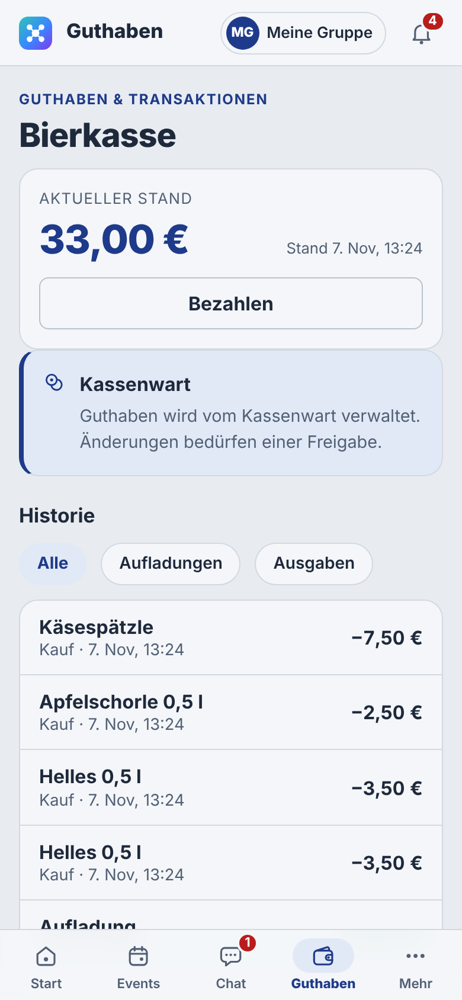

Vereint führt für dich ein Guthabenkonto, die „Bierkasse“. Alles, was an der Theke auf deinen Namen angeschrieben wird, wird davon abgezogen.

- Oben steht der **aktuelle Stand**. **Bezahlen** öffnet direkt den Strichcode-Scanner.
- In der **Historie** siehst du jede Buchung. Mit **Alle**, **Aufladungen** und **Ausgaben** filterst du die Liste.

**Aufladen**: Gib das Geld beim Kassenwart ab. Er bucht den Betrag ein, danach erscheint er hier als „Aufladung“. Selbst aufladen kannst du nicht.

Ein Guthaben kann auch ins Minus gehen. Dann bitte zeitnah beim Kassenwart ausgleichen.

 

## Getränk selbst bezahlen

Steht keine Theke bereit, etwa am Kühlschrank, bezahlst du ein Getränk selbst mit deinem Guthaben. Das geht während eines laufenden Events, zu dem du gehörst.

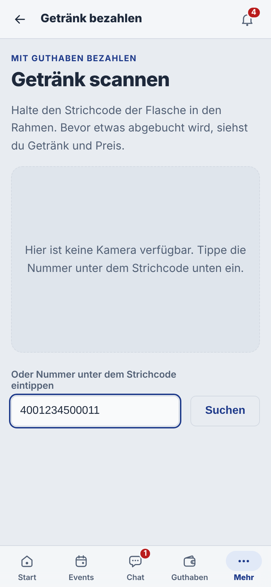

1. **Mehr → Bezahlen** oder auf der Startseite **Getränk bezahlen** öffnen.
2. Den **Strichcode** der Flasche in den Rahmen halten. Beim ersten Mal fragt das Handy, ob Vereint die Kamera benutzen darf.
3. Klappt das Scannen nicht, die Nummer unter dem Strichcode eintippen und **Suchen** tippen.

 

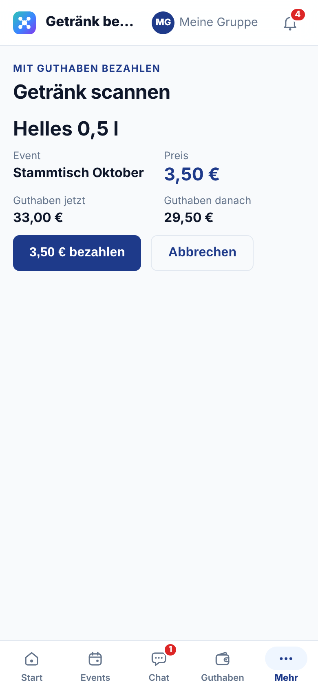

4. Vereint zeigt Getränk, Event, Preis und dein Guthaben vorher und nachher. Laufen mehrere Events, wählst du unter **Bei welchem Event?** das richtige.
5. Erst mit **… bezahlen** wird abgebucht. **Abbrechen** bucht nichts.

Reicht dein Guthaben nicht, warnt Vereint dich vorher. Du kannst trotzdem bezahlen; gleiche das Minus dann bald beim Kassenwart aus.

 

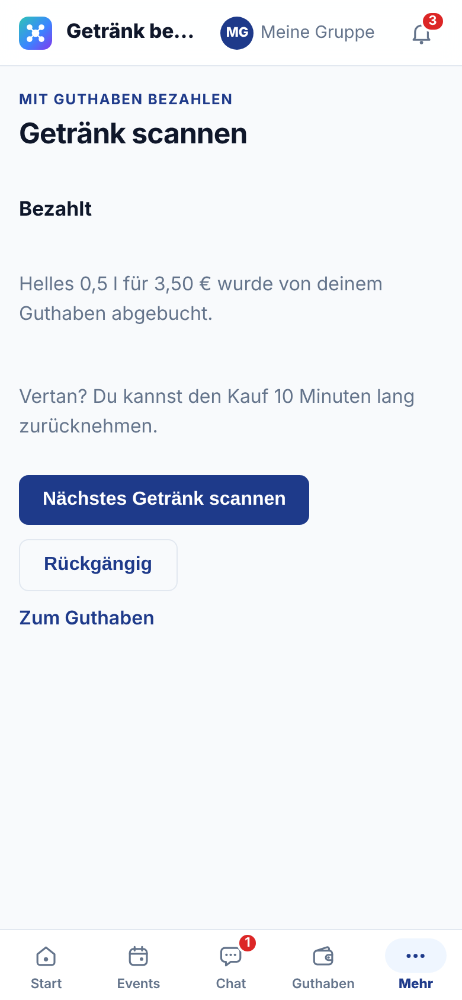

6. **Bezahlt**: Der Betrag ist von deinem Guthaben abgebucht und steht unter **Käufe**.

Vertippt oder das falsche Getränk erwischt? Mit **Rückgängig** nimmst du den Kauf innerhalb von **10 Minuten** selbst zurück. Danach hilft der Kassenwart. **Nächstes Getränk scannen** startet gleich den nächsten Kauf.

Wird ein Strichcode nicht erkannt, ist das Getränk noch nicht im Katalog oder hat noch keinen Strichcode. Sag dem Vorstand Bescheid.

 

## Eine Runde ausgeben

Eine Runde gibst du **an deinem eigenen Handy** aus, bezahlt wird **von deinem Guthaben**. Das geht, solange ein Event läuft, zu dem du gehörst. Öffne das Event und tippe auf **Runde ausgeben**.

1. Oben steht das Event und **Von deinem Guthaben** mit deinem aktuellen Stand.
2. Wähle **Eine Runde** (jede eingeladene Person bekommt ein Getränk) oder **Ganzen Abend** (alles, bis die Höchstsumme erreicht ist; die Höchstsumme trägst du selbst ein).
3. **Getränk**: ein bestimmtes Getränk oder **Alle Getränke**. Eine Runde auf ein Getränk gilt auch für die anderen Getränke derselben Spalte der Strichliste, etwa alle Biere.
4. **Gültig**: **30 Minuten**, **1 Stunde** oder **Bis Event-Ende**.
5. **Für wen?**: Personen anhaken. Neben dem Namen steht „zugesagt“ oder „vor Ort“ (hatte heute schon einen Strich).
6. Unten steht, wie viel **höchstens** von deinem Guthaben abgehen kann. **Runde für … ausgeben** startet die Runde.

Abgebucht wird nur, was die Eingeladenen an der Theke wirklich nehmen: Bekommt eine eingeladene Person einen Strich, geht der Betrag von deinem Guthaben ab statt von ihrem. Dein Guthaben darf dabei ins Minus gehen. Die Eingeladenen bekommen eine Mitteilung, und das Thekenterminal zeigt deine Runde an, bis sie aufgebraucht oder abgelaufen ist. Ist jemand in mehreren Runden eingeladen, gilt die zuerst gestartete.

Unter **Deine Runden in diesem Event** siehst du, wie viel schon verbraucht ist und wer eingelöst hat. **Beenden** stoppt eine Runde vorzeitig. In deinem **Guthaben** steht jeder eingelöste Strich als „Runde: Name · Getränk“.

 

## Käufe

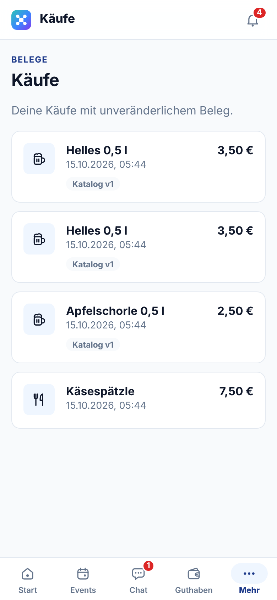

Unter **Mehr → Käufe** steht jeder Kauf einzeln, ob von der Theke oder selbst bezahlt, mit Artikel, Preis, Datum und Uhrzeit. So kannst du nach einem Abend nachprüfen, was für dich gebucht wurde.

Ein Kauf ist ein unveränderlicher Beleg: Der Preis bleibt so, wie er an diesem Abend galt, auch wenn sich der Preis im Katalog später ändert. Das Kennzeichen „Katalog v1“ zeigt die Preisliste, aus der der Preis stammt.

Stimmt etwas nicht, sprich den Thekendienst oder den Kassenwart an. Der Thekendienst kann einen falschen Strich innerhalb von 10 Minuten selbst zurücknehmen, danach korrigiert der Kassenwart.

 

## Mitteilungen

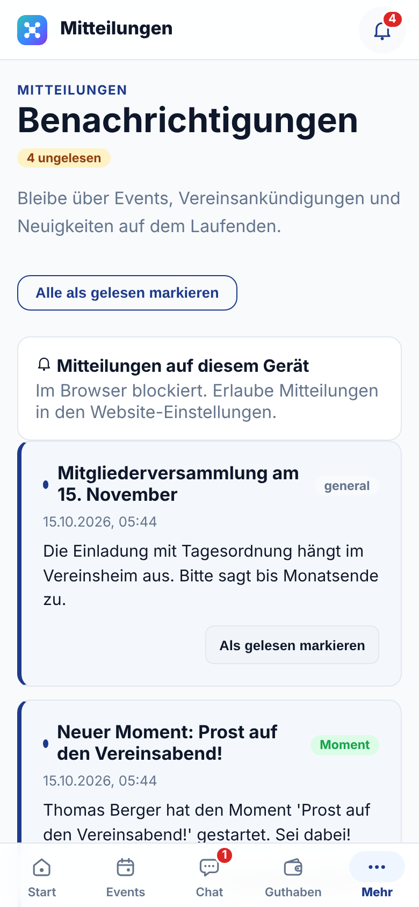

Die **Glocke** oben rechts (oder **Mehr → Mitteilungen**) sammelt alles, was die Gruppe dir mitteilt: Rundbriefe des Vorstands, Einladungen und Erinnerungen zu Events und neue Moments.

- Ungelesene Mitteilungen haben einen Punkt und einen farbigen Rand.
- **Als gelesen markieren** gilt für eine Mitteilung, **Alle als gelesen markieren** für alle.
- Oben kannst du unter **Mitteilungen auf diesem Gerät** Push einschalten, genauso wie im Profil (siehe [Erste Schritte](01-erste-schritte.md#mitteilungen-aufs-handy-push)).
- Push kommt außerdem für neue Direktnachrichten, Freundschaftsanfragen und angenommene Anfragen. Diese stehen nicht in der Glocke, sondern im Chat bzw. unter **Freunde**.

 

## Moments: gemeinsam anstoßen

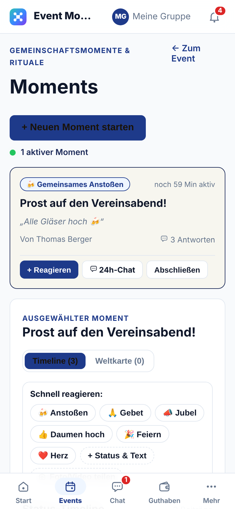

Ein **Moment** ist eine kurze gemeinsame Aktion während eines Events, zum Beispiel alle stoßen gleichzeitig an. Jemand startet ihn, alle anderen reagieren darauf.

- **Mehr → Moments** zeigt die Moments deiner aktiven Events. Aus einem Event kommst du über **Moments** direkt hierher.
- Eine Karte zeigt Art, Titel, wer ihn gestartet hat, wie lange er noch läuft und wie viele schon reagiert haben.
- **Neuen Moment starten** beginnt selbst einen Moment: Art wählen (z. B. Anstoßen), Titel und Nachricht eingeben, Dauer festlegen. Welche Arten es gibt, legt der Vorstand fest.

 

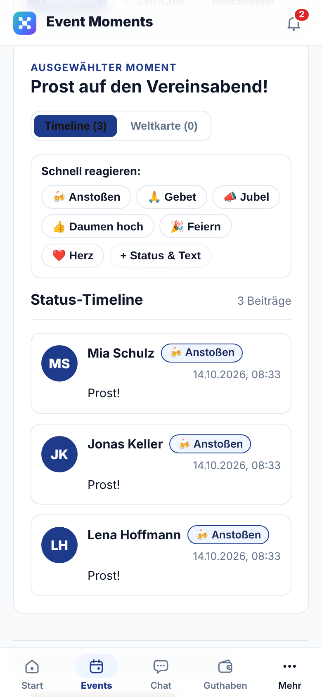

**Reagieren**: Tippe auf **Reagieren** oder unter **Schnell reagieren** direkt auf eine Reaktion wie **Anstoßen**, **Jubel** oder **Daumen hoch**. Mit **+ Status & Text** schreibst du einen eigenen Satz dazu.

 

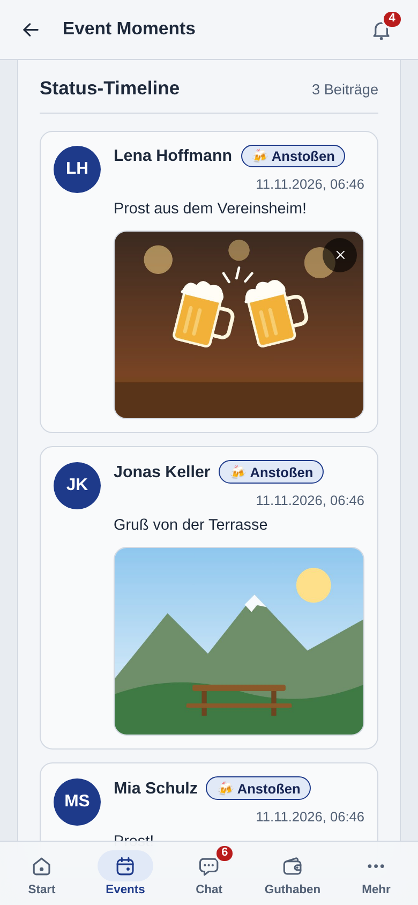

**Fotos und Videos teilen**: Beim Starten unter **Fotos & Videos (optional)** oder später im Moment mit **Foto/Video teilen** hängst du bis zu vier Bilder oder Videos an. Videos dürfen höchstens 60 Sekunden lang und 100 MB groß sein (MP4 oder MOV); zu große Videos am besten in 720p aufnehmen. Standort und Gerätedaten werden vor dem Speichern aus den Dateien entfernt. Eigene Bilder und Videos kannst du mit **Entfernen** wieder löschen.

Die **Timeline** zeigt alle Reaktionen, Bilder und Videos. Wer beim Reagieren den Standort freigibt, erscheint zusätzlich auf der **Weltkarte**. Das ist freiwillig.

Ist ein Moment vorbei, landet er unter **Archivierte Moments & Rituale**.

 

## Getränkekatalog

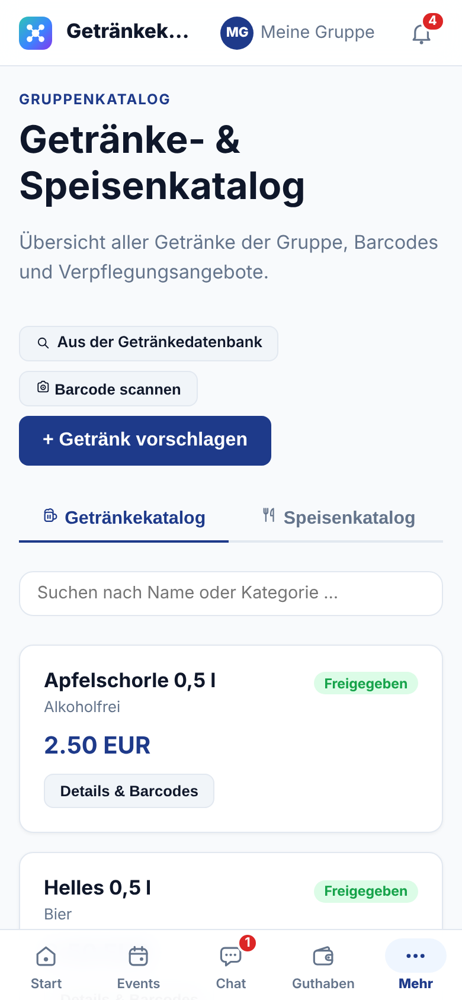

Unter **Mehr → Getränkekatalog** stehen alle Getränke und Speisen der Gruppe mit ihrem Standardpreis. Über die Reiter wechselst du zwischen **Getränkekatalog** und **Speisenkatalog**, das Suchfeld findet Getränke nach Name oder Kategorie. Jede Zeile zeigt Preis und Stand; ein Tipp darauf zeigt Preis, Beschreibung und die hinterlegten Strichcodes.

**Kamera-Knopf** (Barcode scannen): Scanne eine Flasche, um zu sehen, ob sie schon im Katalog ist. Kennt Vereint den Strichcode, öffnet sich das Getränk. Steht es in der gemeinsamen Getränkedatenbank, öffnet sich der Vorschlag mit Name, Sorte und Strichcodes schon ausgefüllt, du trägst nur noch den Preis ein. Sonst öffnet sich der leere Vorschlag mit dem Strichcode.

Fehlt dir ein Getränk? Mit **Getränk vorschlagen** schlägst du es mit Name, Kategorie, Preis und Strichcode vor. Vereint warnt dich, wenn es schon ein Getränk mit diesem Namen oder Strichcode gibt. Der Vorstand prüft den Vorschlag und gibt ihn frei; bis dahin steht er als „Vorgeschlagen“ in der Liste.

**Aus der Getränkedatenbank**: Viele Getränke gibt es schon in der gemeinsamen Getränkedatenbank aller Gruppen. Dort suchst du nach Name oder Strichcode, tippst auf **Übernehmen**, trägst einen Preis ein und tippst **In den Katalog übernehmen**. Bei dir wird daraus ein Vorschlag, den der Vorstand freigibt.

 

## Statistik

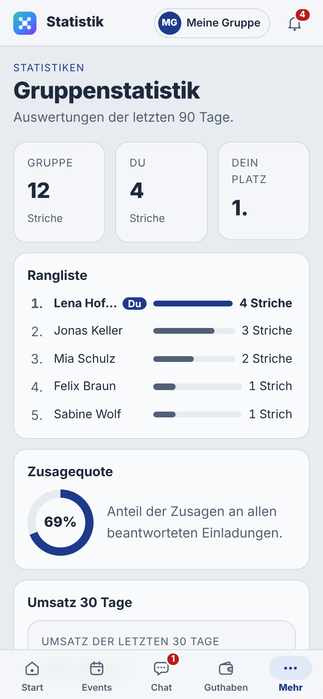

Unter **Mehr → Statistik** siehst du Auswertungen der letzten 90 Tage:

- **Rangliste**: Striche in der ganzen Gruppe, deine eigenen Striche und dein Platz.
- **Zusagequote**: wie viele Einladungen mit Zusage beantwortet wurden.
- **Umsatz 30 Tage** mit dem Verlauf der letzten acht Wochen.
- **Beliebteste Artikel** und **Events mit den meisten Strichen**.

 

## Eine Gruppe verlassen

Unter **Mehr → Gruppeneinstellungen** steht ganz unten **Gruppe verlassen**.

1. **Gruppe verlassen** tippen.
2. Die Rückfrage bestätigen.

Danach hast du in dieser Gruppe keine Rechte mehr. Deine Buchungen und Beiträge bleiben in der Gruppe erhalten. Dein Konto und deine anderen Gruppen bleiben unberührt. Wieder dabei bist du nur mit einem neuen Einladungslink.

Bist du die letzte Person, die Mitglieder und Rollen verwalten darf, geht das Verlassen nicht. Gib diese Rolle zuerst jemand anderem.
