# Leitfaden Mitglied

Für alle Mitglieder einer Gruppe. Anmeldung, Navigation und Profil stehen in den [Ersten Schritten](01-erste-schritte.md).

Jeden Mitglieder-Bildschirm einzeln erklärt [Die App Bildschirm für Bildschirm](07-alle-screens.md#mitglied).

## Auf einen Blick

| Ich möchte … | So geht's |
| :--- | :--- |
| zu einem Termin zusagen | **Events** → **Zusagen** bei der Einladung, oder direkt in der Push-Nachricht |
| selbst ein Event planen | **Events** → **Event anlegen** |
| mit allen in der Gruppe schreiben | **Chat** → Zeile mit dem Namen der Gruppe |
| jemandem persönlich schreiben | **Chat** → **+** → **Direktnachricht** |
| alle Termine aus allen meinen Gruppen sehen | **Mehr → Kalender** |
| jemanden als Freund hinzufügen | **Mehr → Freunde** → **Anfragen** |
| sehen, wer am meisten Striche hat | **Mehr → Statistik** |
| sehen, wer was getrunken hat, mit Litern und Kalorien | **Mehr → Statistik** → **Getränkestatistik** |
| mein Guthaben sehen | **Guthaben** (untere Leiste) |
| eine Runde ausgeben | Im laufenden Event **Runde ausgeben** → Personen anhaken → **Runde für … ausgeben** |
| ein Getränk selbst bezahlen oder nur für die Statistik erfassen | **Buchen** auf der Startseite oder unter **Guthaben** (oder **Mehr → Buchen**) → Strichcode scannen oder **Aus Katalog wählen** |
| prüfen, was mir an der Theke angeschrieben wurde | **Mehr → Käufe** |
| Guthaben aufladen | Bargeld beim Kassenwart abgeben, er bucht es ein |
| beim gemeinsamen Anstoßen mitmachen | **Mehr → Moments**, oder im Event auf **Moments** |
| ein neues Getränk vorschlagen | **Mehr → Getränkekatalog** → **Getränk vorschlagen** oder **Barcode scannen** |
| die Gruppe wechseln | Gruppenname oben rechts antippen, oder **Mehr → Gruppeneinstellungen** → **Gruppe wechseln** |
| eine Gruppe verlassen | **Mehr → Gruppeneinstellungen** → **Gruppe verlassen** |

## Einladungen und Zusagen

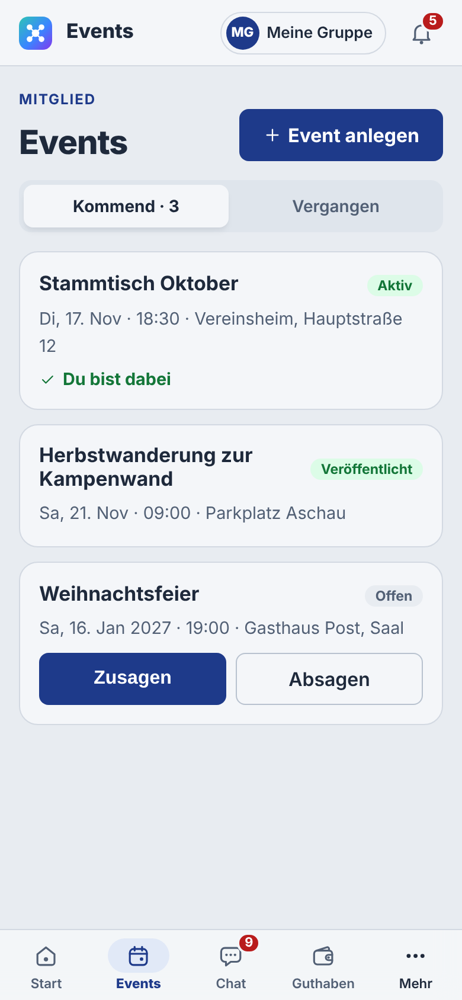

Wirst du zu einem Event eingeladen, bekommst du eine Mitteilung, mit eingeschaltetem Push auch aufs Handy. Wann die Einladung verschickt wird, legt der Gastgeber fest; manche Events schicken vorher noch eine Erinnerung.

Antworten kannst du an drei Stellen:

- direkt in der **Push-Nachricht** mit **Zusagen** oder **Absagen**,
- unter **Events**: Bei offenen Einladungen steht „Offen“ mit **Zusagen** und **Absagen**. Oben wechselst du zwischen **Kommend** und **Vergangen**,
- auf der Eventseite mit **Zusagen**, **Vielleicht** oder **Absagen**.

Deine Antwort kannst du bis zum Event jederzeit ändern. Die Karten zeigen außerdem den Stand des Events:

- **Veröffentlicht**: Der Termin steht fest, du kannst antworten.
- **Aktiv**: Der Abend läuft gerade, die Theke ist geöffnet.
- **Abgeschlossen**: Der Termin ist vorbei.

 

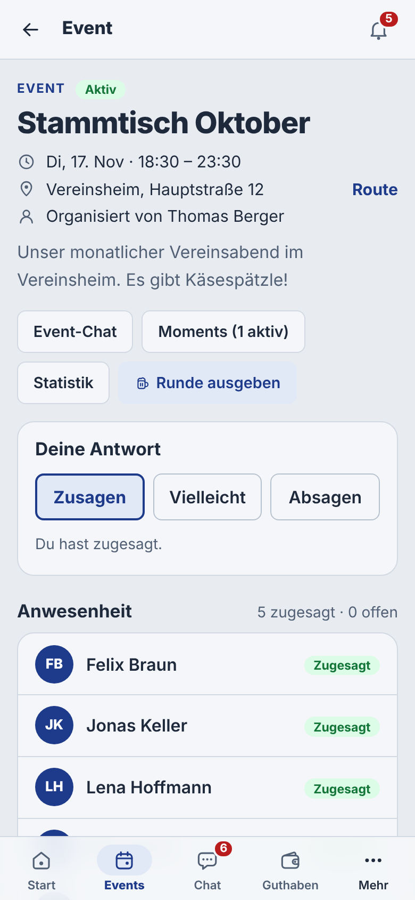

Tippe auf ein Event, um die Details zu sehen:

- Datum, Uhrzeit, Ort und wer das Event organisiert. **Route** startet die Navigation zum Treffpunkt.
- Darunter führen **Event-Chat** und **Moments** (mit der Zahl laufender Moments) weiter. Läuft das Event, steht dort auch **Runde ausgeben** (siehe [Eine Runde ausgeben](#eine-runde-ausgeben)); Gastgeber und Vorstand sehen zusätzlich **Verwalten**.
- **Deine Antwort**: Deine aktuelle Wahl ist hervorgehoben.
- **Anwesenheit**: wie viele zugesagt, vielleicht gesagt, abgesagt oder noch nicht geantwortet haben, darunter die Eingeladenen nach ihrer Antwort gruppiert.

Auf der **Startseite** steht außerdem immer dein nächster Termin.

 

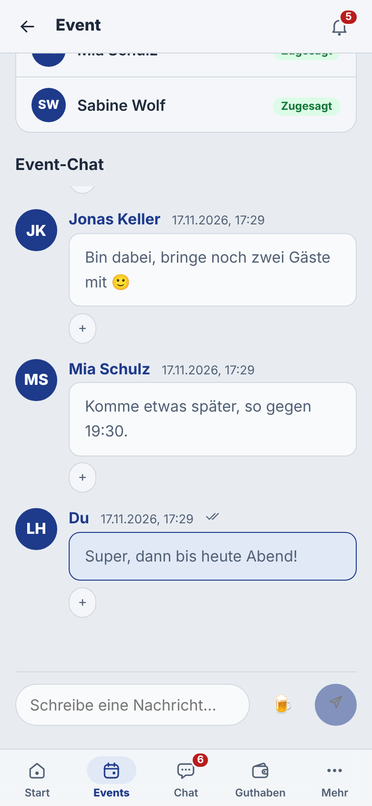

**Event-Chat**: Alle Eingeladenen eines Events können hier miteinander schreiben, zum Beispiel für Fahrgemeinschaften. Nachricht unten eintippen und senden. Es ist derselbe Chat wie unter **Chat** in der Liste der Event-Chats, mit Reaktionen, Haken und „schreibt…“ (siehe [Chat](#chat)).

 

## Selbst ein Event anlegen

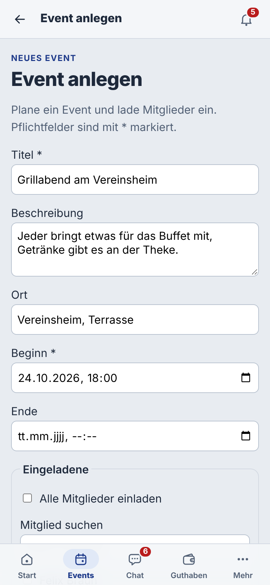

Jedes Mitglied kann ein Event planen, etwa eine Wanderung oder einen Grillabend. Du bist dann der Gastgeber.

1. **Events** → **Event anlegen**.
2. **Titel** und **Beginn** eintragen (Pflicht), dazu Beschreibung, Ort und Ende.

 

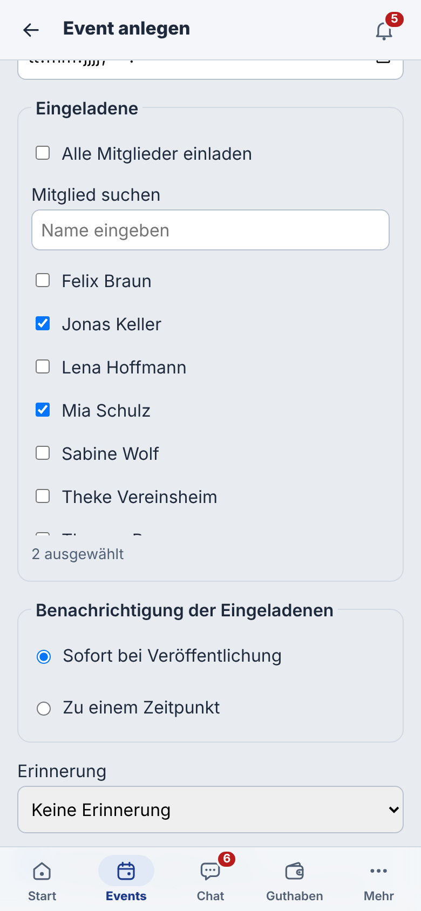

3. **Eingeladene**: Mitglieder per Namen suchen und anhaken, oder **Alle Mitglieder einladen**.
4. **Benachrichtigung der Eingeladenen**: **Sofort bei Veröffentlichung** oder **Zu einem Zeitpunkt**, etwa eine Woche vorher.
5. **Erinnerung**: optional eine Erinnerung vor dem Beginn.
6. **Veröffentlichen und einladen** verschickt die Einladungen. Mit **Als Entwurf speichern** bleibt das Event noch unsichtbar.

Danach verwaltest du dein Event wie im [Leitfaden Vorstand](03-vorstand.md#ein-event-vorbereiten) beschrieben.

 

### Wiederkehrende Events

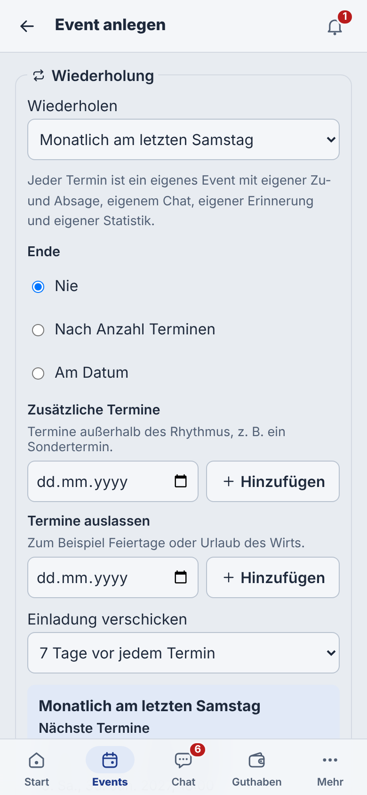

Der Stammtisch ist jeden Dienstag, der Wirt öffnet jeden letzten Samstag im Monat? Dann lege das Event einmal als Serie an.

1. Beim Anlegen **Beginn** auf den ersten Termin setzen.
2. Unter **Wiederholung** → **Wiederholen** eine Vorlage wählen, zum Beispiel **Wöchentlich am Dienstag**, **Alle 2 Wochen am Dienstag**, **Monatlich am letzten Samstag**, **Monatlich am 15.** oder **Jährlich am 24. November**. Die Vorlagen passen sich dem Beginn an.
3. **Benutzerdefiniert …** stellt alles frei ein: alle N Tage, Wochen, Monate oder Jahre, mehrere Wochentage, der wievielte Wochentag im Monat (1. bis 5. oder Letzter, auch mehrere, etwa 1. und 3. Donnerstag), ein Tag im Monat oder der letzte Tag und bei jährlichen Serien die Monate.
4. **Unregelmäßig: eigene Termine wählen** passt, wenn es keinen festen Rhythmus gibt: Füge die Tage einfach unter **Weitere Termine** hinzu.
5. **Ende**: **Nie**, **Nach Anzahl Terminen** oder **Am Datum**.
6. **Termine auslassen** für Feiertage oder den Urlaub des Wirts, **Zusätzliche Termine** für Sondertermine.
7. **Einladung verschicken**: wie viele Tage vor jedem Termin die Eingeladenen ihre Einladung bekommen (Standard 7 Tage).

Unten zeigt die Vorschau die Regel in Worten und die nächsten Termine. Jeder Termin ist danach ein eigenes Event mit eigener Zu- und Absage, eigenem Chat, eigener Erinnerung und eigener Statistik. Alle beginnen zur gleichen Uhrzeit, auch nach der Zeitumstellung.

 

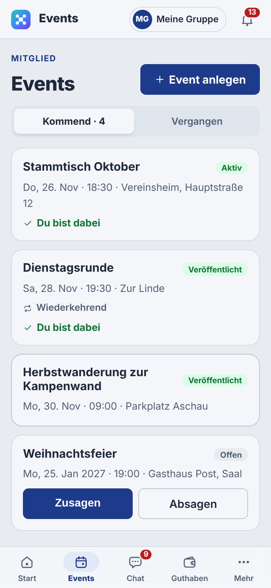

In der Eventliste steht von jeder Serie nur der nächste Termin, darunter **Weitere Termine** zum direkten Öffnen. Die Eventseite zeigt den Rhythmus (etwa „Wöchentlich am Dienstag“) und die nächsten Termine der Serie. Im Kalender trägt jeder Termin ein Wiederholungssymbol.

 

## Chat

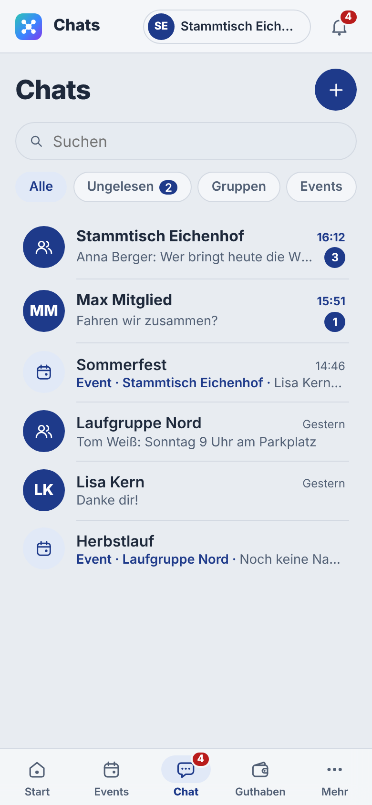

Unter **Chat** (untere Leiste) stehen alle deine Chats in einer Liste, so wie bei bekannten Messengern: die **Gruppenchats** aller deiner Gruppen, die **Event-Chats** der Events, zu denen du eingeladen bist, deine **Direktnachrichten** und die Chats laufender **Moments**. Oben steht der Chat mit der neuesten Nachricht.

- Jede Zeile zeigt den Namen (Gruppenchats heißen wie ihre Gruppe), die letzte Nachricht und die Uhrzeit. Eine Zahl rechts steht für ungelesene Nachrichten.
- Bei Event-Chats steht vor der Nachricht **Event** und die Gruppe des Events, bei Moment-Chats **Moment**. Ein Moment-Chat steht 24 Stunden nach dem Start in der Liste, danach verschwindet er.
- Hat jemand nur ein Foto oder Video geschickt, steht in der Vorschau **📷 Foto** bzw. **🎥 Video**.
- Mit dem **Suchfeld** findest du Chats nach Name, Gruppe oder Nachricht.
- Die Knöpfe **Alle**, **Ungelesen**, **Gruppen**, **Events**, **Direkt** und **Moments** grenzen die Liste ein.
- Chats aus anderen Gruppen öffnen sich direkt, du musst die Gruppe dafür nicht wechseln.

 

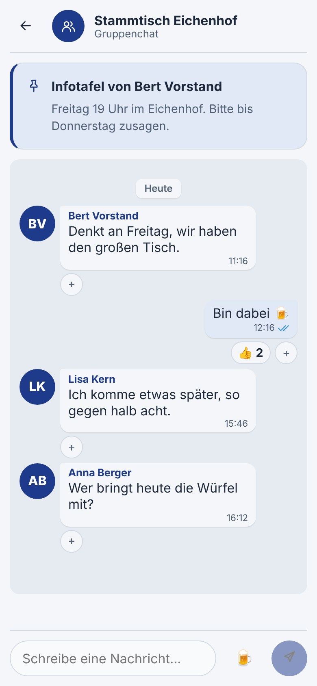

Tippe auf einen Chat, um ihn zu öffnen. Am Handy füllt er den ganzen Bildschirm, der Pfeil oben links führt zurück zur Liste. Am Rechner und Tablet stehen Liste und Chat nebeneinander. Oben im Gruppenchat kann der Vorstand eine **Infotafel** anheften, etwa einen wichtigen Termin.

- Unten Nachricht eintippen und senden. Neue Nachrichten und Reaktionen der anderen erscheinen sofort, ohne Neuladen.
- Haken neben deinen Nachrichten: **✓** gesendet, **✓✓** bei allen angekommen, **✓✓ blau** von allen gelesen. Im Gruppen- und Event-Chat zeigt ein Antippen bzw. Darüberfahren, bei wie vielen die Nachricht schon angekommen ist und wie viele sie gelesen haben.
- Tippt gerade jemand, steht über dem Eingabefeld zum Beispiel „Anna schreibt…“.
- Ohne Netz kannst du trotzdem schreiben: Die Nachricht steht mit einer **Uhr** da und geht von allein hinaus, sobald du wieder Netz hast, auch wenn du die App zwischendurch schließt. Klappt es nicht (zum Beispiel weil das Event abgesagt wurde), steht **Nicht gesendet** darunter, mit **Erneut senden** und **Verwerfen**. Beim Abmelden werden ungesendete Nachrichten gelöscht.
- Mit eingeschaltetem Push bekommst du neue Nachrichten aus allen deinen Chats aufs Handy, mit Name und Text. Je Chat gibt es eine Benachrichtigung, die neueste ersetzt die vorige. Ein Tipp darauf öffnet den Chat.
- **Fotos und Videos**: Die **Büroklammer** links neben dem Eingabefeld öffnet Kamera bzw. Galerie. Bis zu **4** Fotos oder Videos je Nachricht; Videos bis **60 Sekunden** und **100 MB** (MP4 oder MOV), Fotos werden vor dem Hochladen verkleinert. Die Anhänge laden sofort hoch und stehen mit Fortschrittsbalken über dem Eingabefeld; das **✕** nimmt einen wieder heraus. Text dazu ist freiwillig. Fotos öffnen sich mit einem Tipp in voller Größe, Videos spielen direkt im Chat. Sie sind verschlüsselt gespeichert und nur für alle im Chat sichtbar.
- **Emojis**: Das **😊** rechts neben dem Eingabefeld öffnet die Auswahl mit **allen** Emojis, nach Gruppen sortiert, mit **Zuletzt verwendet** und Suche (englische Namen, z. B. „beer“).
- Mit **+** unter einer Nachricht reagierst du mit einem Emoji. Die fünf häufigsten stehen gleich da, **…** öffnet die volle Auswahl.

 

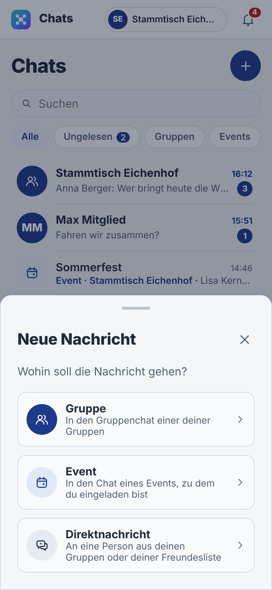

**Neue Nachricht**: Das **+** oben neben **Chats** fragt zuerst, wohin die Nachricht gehen soll, und dann, an wen:

- **Gruppe**: in den Gruppenchat einer deiner Gruppen.
- **Event**: in den Chat eines Events, zu dem du eingeladen bist (oder das du angelegt hast).
- **Direktnachricht**: an eine Person. Zur Auswahl stehen alle aus deinen Gruppen und deine Freunde; unter dem Namen siehst du eure gemeinsamen Gruppen.
- **Moment**: startet einen neuen Moment (siehe [Moments](#moments)). Nach dem Start öffnet sich gleich sein Chat.

Danach öffnet sich der Chat und du schreibst los. **Andere Art wählen** führt einen Schritt zurück.

**Direktnachrichten** sind Gespräche zu zweit, die nur ihr beide seht. Sie gelten über alle Gruppen: Mit jeder Person gibt es genau ein Gespräch, egal in welcher Gruppe du gerade bist. Seid ihr weder befreundet noch in einer gemeinsamen Gruppe, bleibt das Gespräch lesbar, neue Nachrichten gehen aber nicht mehr.

 

## Kalender

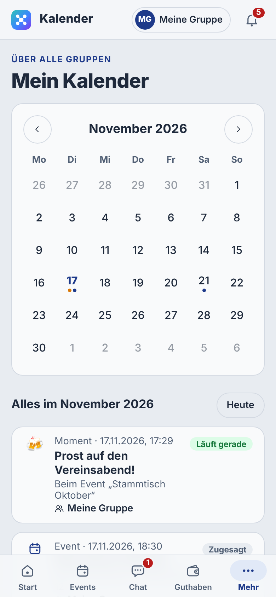

Unter **Mehr → Kalender** siehst du alle Termine aus allen deinen Gruppen an einem Ort: vergangene und kommende Events sowie die Moments dazu.

- Mit **‹** und **›** blätterst du durch die Monate, **Heute** springt zurück.
- Punkte in einem Tag zeigen Einträge an. Tippe auf den Tag, um nur diesen Tag zu sehen; **Ganzen Monat zeigen** hebt das wieder auf.
- Jeder Eintrag nennt seine Gruppe. Bist du in mehreren Gruppen, filterst du oben mit **Gruppe**.
- Ein Tipp auf einen Eintrag öffnet das Event bzw. seine Moments. Gehört er zu einer anderen Gruppe, wechselt die App vorher in diese Gruppe.

Du siehst dieselben Events wie auf der Event-Seite der jeweiligen Gruppe: deine eigenen und die, zu denen du eingeladen bist.

 

## Freunde

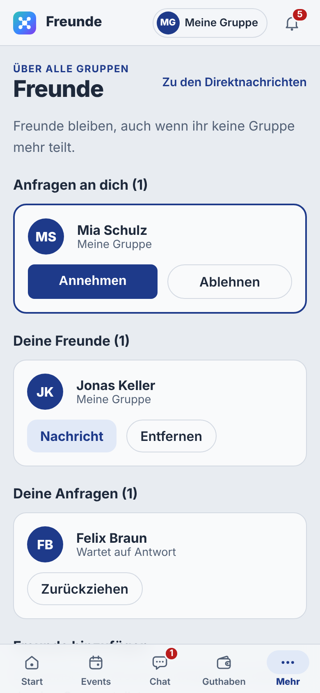

Unter **Mehr → Freunde** führst du deine Freundesliste. Sie gilt über alle Gruppen.

- **Freunde hinzufügen**: Person aus einer deiner Gruppen suchen und **Anfragen** tippen. Du kannst nur Personen anfragen, mit denen du eine Gruppe teilst.
- **Anfragen an dich** nimmst du mit **Annehmen** an oder mit **Ablehnen** ab. Eigene Anfragen ziehst du mit **Zurückziehen** zurück.
- **Nachricht** öffnet das Direktgespräch mit diesem Freund.
- Freunde bleiben, auch wenn ihr keine Gruppe mehr teilt. Ihr könnt euch dann weiter Direktnachrichten schreiben.
- **Entfernen** und dann **Wirklich entfernen** beendet eine Freundschaft.
- Mit eingeschaltetem Push erfährst du auf dem Handy, wenn dich jemand anfragt oder deine Anfrage annimmt.

 

## Guthaben

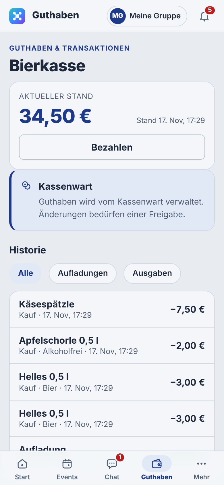

Vereint führt für dich ein Guthabenkonto, die „Bierkasse“. Alles, was an der Theke auf deinen Namen angeschrieben wird, wird davon abgezogen.

- Oben steht der **aktuelle Stand**. **Buchen** öffnet direkt den Strichcode-Scanner; dort kannst du auch **Aus Katalog wählen**.
- In der **Historie** siehst du jede Buchung. Mit **Alle**, **Aufladungen** und **Ausgaben** filterst du die Liste.

**Aufladen**: Gib das Geld beim Kassenwart ab. Er bucht den Betrag ein, danach erscheint er hier als „Aufladung“. Selbst aufladen kannst du nicht.

Hat der Kassenwart beim Ein- oder Auszahlen eine **Notiz** eingetragen (z. B. „Bareinzahlung beim Treffen“), steht sie klein unter der Buchung. Die Notiz siehst nur du und der Vorstand.

Ein Guthaben kann auch ins Minus gehen. Dann bitte zeitnah beim Kassenwart ausgleichen.

 

## Getränk selbst bezahlen

Steht keine Theke bereit, etwa am Kühlschrank, bezahlst du ein Getränk selbst mit deinem Guthaben. Du scannst den Strichcode oder wählst das Getränk aus dem Getränkekatalog (siehe [Aus dem Katalog wählen](#aus-dem-katalog-wählen)). Was danach passiert, hängt davon ab, ob du gerade bei einem Event bist:

- **Du nimmst an einem laufenden Event mit Selbstbedienung teil**: Das Getränk wird über das Event gebucht, zum Preis des Events. Eine andere Wahl gibt es dann nicht.
- **Sonst** entscheidest du selbst (siehe [Ohne laufendes Event](#ohne-laufendes-event-bezahlen-oder-nur-erfassen)): mit Guthaben bezahlen oder das Getränk nur in die Statistik aufnehmen.

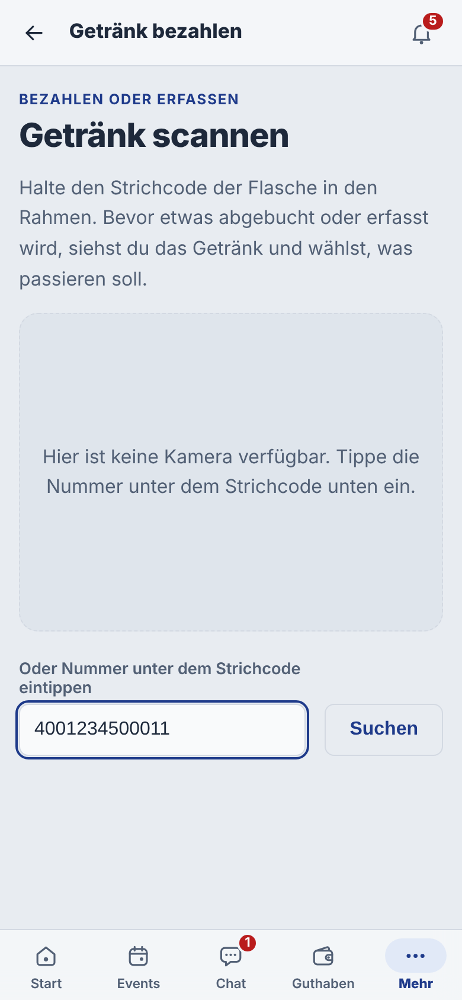

1. **Mehr → Buchen** oder auf der Startseite **Buchen** öffnen.
2. Den **Strichcode** der Flasche in den Rahmen halten. Beim ersten Mal fragt das Handy, ob Vereint die Kamera benutzen darf.
3. Klappt das Scannen nicht, die Nummer unter dem Strichcode eintippen und **Suchen** tippen. Hat die Flasche keinen Strichcode, wähle das Getränk aus dem Katalog (siehe unten).

 

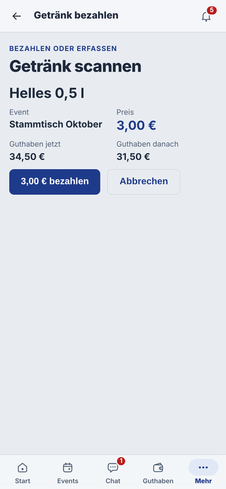

4. Vereint zeigt Getränk, Event, Preis und dein Guthaben vorher und nachher. Laufen mehrere Events, wählst du unter **Bei welchem Event?** das richtige.
5. Erst mit **… bezahlen** wird abgebucht. **Abbrechen** bucht nichts.

Reicht dein Guthaben nicht, warnt Vereint dich vorher. Du kannst trotzdem bezahlen; gleiche das Minus dann bald beim Kassenwart aus.

 

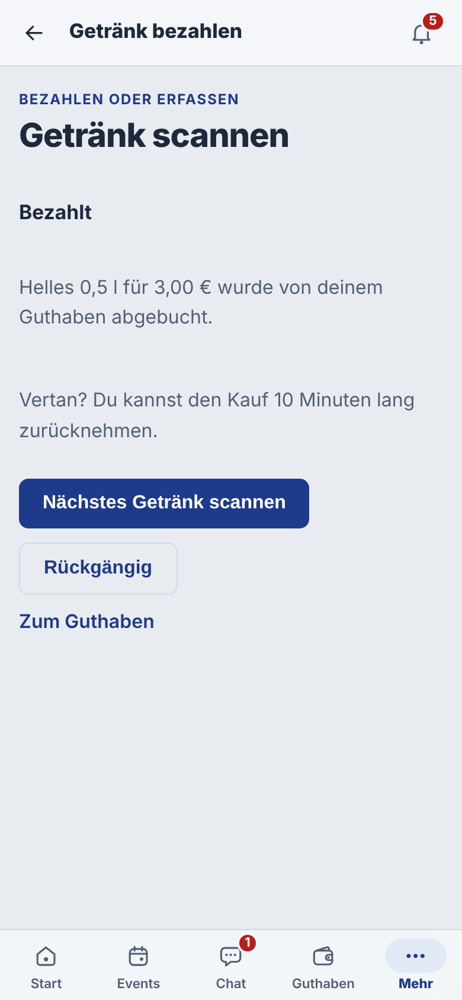

6. **Bezahlt**: Der Betrag ist von deinem Guthaben abgebucht und steht unter **Käufe**.

Vertippt oder das falsche Getränk erwischt? Mit **Rückgängig** nimmst du den Kauf innerhalb von **10 Minuten** selbst zurück. Danach hilft der Kassenwart. **Nächstes Getränk scannen** startet gleich den nächsten Kauf.

Wird ein Strichcode nicht erkannt, ist das Getränk weder im Katalog noch in der Getränkedatenbank oder hat noch keinen Strichcode. Wähle es dann aus dem Katalog oder sag dem Vorstand Bescheid.

### Aus dem Katalog wählen

Statt zu scannen kannst du das Getränk auch aus einer Liste antippen, etwa wenn die Kamera nicht will, das Etikett fehlt oder das Getränk keinen Strichcode hat.

1. Unter **Buchen** oben von **Scannen** auf **Aus Katalog wählen** wechseln.
2. Vereint zeigt die Getränke aus dem Getränkekatalog deiner Gruppe, die man bezahlen kann: freigegeben, im Sortiment und mit Preis. Im Feld **Getränk suchen** findest du ein Getränk nach Name oder Sorte.
3. Das Getränk antippen. Danach geht es **genau wie nach einem Scan** weiter: Bei einem laufenden Event mit Selbstbedienung zahlst du über das Event zu dessen Preis, sonst wählst du zwischen **Mit Guthaben bezahlen** und **Nur in die Statistik** (siehe unten). Erst die Bestätigung bucht, **Rückgängig** geht ebenso 10 Minuten lang.

Der Preis in der Liste ist der Katalogpreis. Läuft gerade ein Event mit Selbstbedienung, zeigt Vereint nach dem Antippen den Preis des Events. **Nächstes Getränk wählen** bringt dich zurück zur Liste. Fehlt ein Getränk in der Liste, hat es im Katalog keinen Preis oder ist nicht im Sortiment; dann hilft der Vorstand.

### Ohne laufendes Event: bezahlen oder nur erfassen

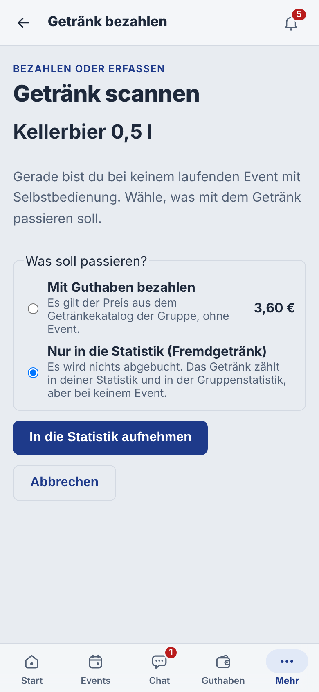

Bist du gerade bei keinem laufenden Event mit Selbstbedienung, fragt Vereint nach dem Scannen oder der Auswahl aus dem Katalog, was mit dem Getränk passieren soll:

- **Mit Guthaben bezahlen**: Es gilt der Preis aus dem Getränkekatalog der Gruppe. Vereint zeigt Preis und dein Guthaben vorher und nachher; erst **… bezahlen** bucht ab. Der Haken **In die Statistik aufnehmen** ist gesetzt. Nimmst du ihn weg, wird nur bezahlt und der Kauf zählt in keiner Statistik. Hat das Getränk im Katalog keinen Preis, kannst du es nicht bezahlen.
- **Nur in die Statistik (Fremdgetränk)**: Für ein Getränk, das du woanders gekauft hast. Es wird nichts abgebucht. Mit **In die Statistik aufnehmen** zählt es in deiner Statistik und in der Statistik der Gruppe, die du gerade gewählt hast, aber bei keinem Event. Das geht auch mit Getränken, die nur in der gemeinsamen Getränkedatenbank stehen.

Wie bei einem Kauf kannst du dich 10 Minuten lang korrigieren: **Rückgängig** nimmt einen Kauf zurück, **Entfernen** nimmt ein Fremdgetränk wieder aus der Statistik.

Hast du **Meine Statistik erfassen** ausgeschaltet oder hat die Gruppe ihre Statistik aus, gibt es **Nur in die Statistik** nicht. Bezahlen geht trotzdem; erfasst wird dann nichts.

 

## Eine Runde ausgeben

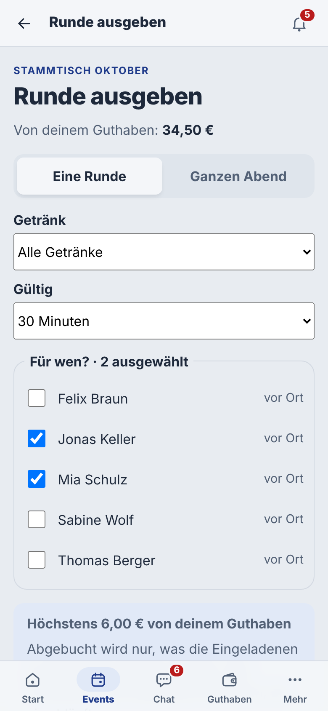

Eine Runde gibst du **an deinem eigenen Handy** aus, bezahlt wird **von deinem Guthaben**. Das geht, solange ein Event läuft, zu dem du gehörst. Öffne das Event und tippe auf **Runde ausgeben**.

1. Oben steht das Event und **Von deinem Guthaben** mit deinem aktuellen Stand.
2. Wähle **Eine Runde** (jede eingeladene Person bekommt ein Getränk) oder **Ganzen Abend** (alles, bis die Höchstsumme erreicht ist; die Höchstsumme trägst du selbst ein).
3. **Getränk**: ein bestimmtes Getränk oder **Alle Getränke**. Eine Runde auf ein Getränk gilt auch für die anderen Getränke derselben Spalte der Strichliste, etwa alle Biere.
4. **Gültig**: **30 Minuten**, **1 Stunde** oder **Bis Event-Ende**.
5. **Für wen?**: Personen anhaken. Neben dem Namen steht „zugesagt“ oder „vor Ort“ (hatte heute schon einen Strich).
6. Unten steht, wie viel **höchstens** von deinem Guthaben abgehen kann. **Runde für … ausgeben** startet die Runde.

Abgebucht wird nur, was die Eingeladenen an der Theke wirklich nehmen: Bekommt eine eingeladene Person einen Strich, geht der Betrag von deinem Guthaben ab statt von ihrem. Dein Guthaben darf dabei ins Minus gehen. Die Eingeladenen bekommen eine Mitteilung, und das Thekenterminal zeigt deine Runde an, bis sie aufgebraucht oder abgelaufen ist. Ist jemand in mehreren Runden eingeladen, gilt die zuerst gestartete.

Unter **Deine Runden in diesem Event** siehst du, wie viel schon verbraucht ist und wer eingelöst hat. **Beenden** stoppt eine Runde vorzeitig. In deinem **Guthaben** steht jeder eingelöste Strich als „Runde: Name · Getränk“.

 

## Käufe

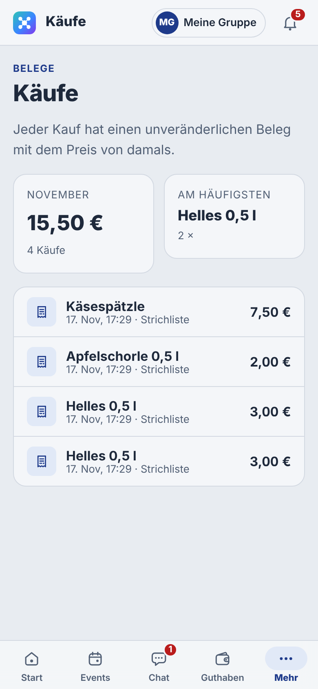

Unter **Mehr → Käufe** steht jeder Kauf einzeln, ob von der Theke oder selbst bezahlt, mit Artikel, Preis, Datum und Uhrzeit. So kannst du nach einem Abend nachprüfen, was für dich gebucht wurde.

Ein Kauf ist ein unveränderlicher Beleg: Der Preis bleibt so, wie er an diesem Abend galt, auch wenn sich der Preis im Katalog später ändert. Das Kennzeichen „Katalog v1“ zeigt die Preisliste, aus der der Preis stammt.

Stimmt etwas nicht, sprich den Thekendienst oder den Kassenwart an. Der Thekendienst kann einen falschen Strich innerhalb von 10 Minuten selbst zurücknehmen, danach korrigiert der Kassenwart.

 

## Mitteilungen

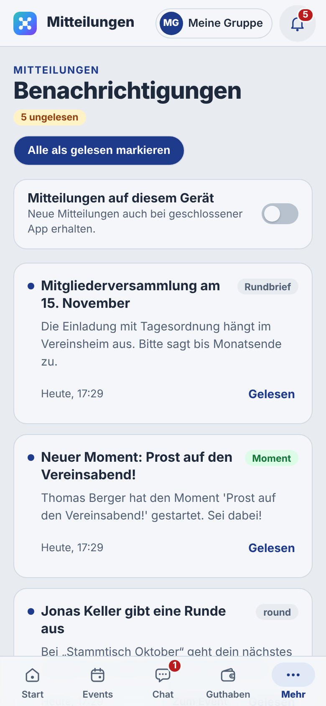

Die **Glocke** oben rechts (oder **Mehr → Mitteilungen**) sammelt alles, was die Gruppe dir mitteilt: Rundbriefe des Vorstands, Einladungen und Erinnerungen zu Events und neue Moments.

- Ungelesene Mitteilungen haben einen Punkt und einen farbigen Rand.
- **Als gelesen markieren** gilt für eine Mitteilung, **Alle als gelesen markieren** für alle.
- Oben kannst du unter **Mitteilungen auf diesem Gerät** Push einschalten, genauso wie im Profil (siehe [Erste Schritte](01-erste-schritte.md#mitteilungen-aufs-handy-push)).
- Push kommt außerdem für neue Direktnachrichten, Freundschaftsanfragen und angenommene Anfragen. Diese stehen nicht in der Glocke, sondern im Chat bzw. unter **Freunde**.

 

## Moments: gemeinsam anstoßen

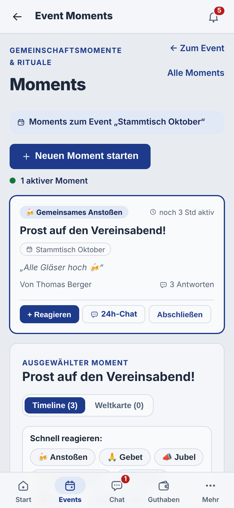

Ein **Moment** ist eine kurze gemeinsame Aktion während eines Events, zum Beispiel alle stoßen gleichzeitig an. Jemand startet ihn, alle anderen reagieren darauf.

- **Mehr → Moments** zeigt die Moments deiner aktiven Events. Aus einem Event kommst du über **Moments** direkt hierher.
- Eine Karte zeigt Art, Titel, wer ihn gestartet hat, wie lange er noch läuft und wie viele schon reagiert haben.
- **Neuen Moment starten** beginnt selbst einen Moment: Art wählen (z. B. Anstoßen), Titel und Nachricht eingeben, Dauer festlegen. Welche Arten es gibt, legt der Vorstand fest.

 

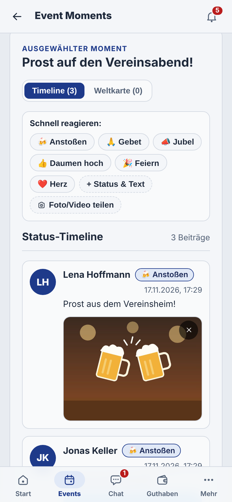

**Reagieren**: Tippe auf **Reagieren** oder unter **Schnell reagieren** direkt auf eine Reaktion wie **Anstoßen**, **Jubel** oder **Daumen hoch**. Mit **+ Status & Text** schreibst du einen eigenen Satz dazu.

 

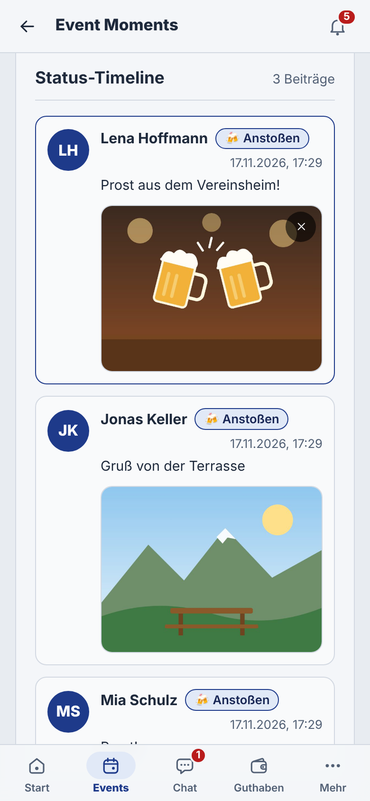

**Fotos und Videos teilen**: Beim Starten unter **Fotos & Videos (optional)** oder später im Moment mit **Foto/Video teilen** hängst du bis zu vier Bilder oder Videos an. Videos dürfen höchstens 60 Sekunden lang und 100 MB groß sein (MP4 oder MOV); zu große Videos am besten in 720p aufnehmen. Standort und Gerätedaten werden vor dem Speichern aus den Dateien entfernt. Eigene Bilder und Videos kannst du mit **Entfernen** wieder löschen.

Die **Timeline** zeigt alle Reaktionen, Bilder und Videos. Wer beim Reagieren den Standort freigibt, erscheint zusätzlich auf der **Karte** des Moments. Das ist freiwillig.

Ist ein Moment vorbei, landet er unter **Archivierte Moments & Rituale**.

 

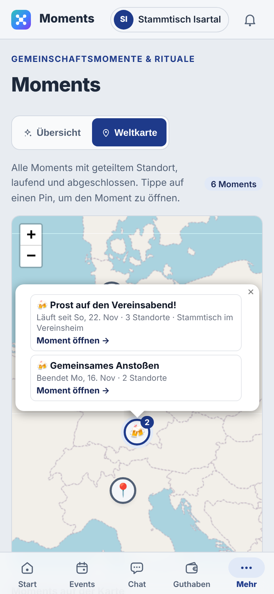

**Weltkarte**: Oben auf der Moments-Seite wechselst du zwischen **Übersicht** und **Weltkarte**. Die Weltkarte zeigt alle Moments mit Standort, laufende und vergangene, die du auch in der Liste sehen darfst. Jeder Moment steht dort, wo ihn jemand gestartet hat (oder, wenn der Starter keinen Standort geteilt hat, wo die erste Reaktion mit Standort herkam). Mehrere Moments am selben Ort teilen sich einen Pin mit einer Zahl. Ein Tipp auf den Pin zeigt die Moments, **Moment öffnen** springt zum Moment. Laufende Moments haben einen farbigen Rand. Unter der Karte stehen dieselben Moments noch einmal als Liste. Auf der Karte landet nur, wer seinen Standort beim Starten oder Reagieren freiwillig teilt.

 

## Getränkekatalog

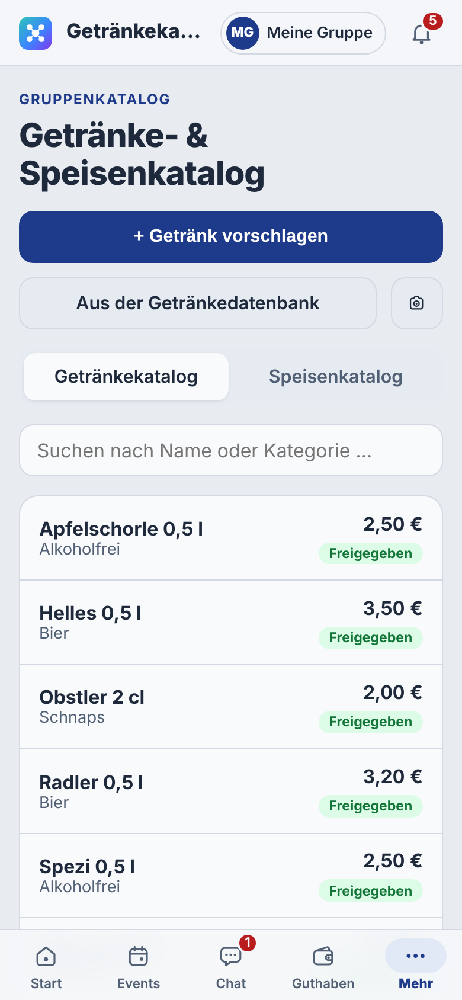

Unter **Mehr → Getränkekatalog** stehen alle Getränke und Speisen der Gruppe mit ihrem Standardpreis. Über die Reiter wechselst du zwischen **Getränkekatalog** und **Speisenkatalog**, das Suchfeld findet Getränke nach Name oder Kategorie. Jede Zeile zeigt Preis und Stand; ein Tipp darauf zeigt Preis, Beschreibung und die hinterlegten Strichcodes.

**Kamera-Knopf** (Barcode scannen): Scanne eine Flasche, um zu sehen, ob sie schon im Katalog ist. Kennt Vereint den Strichcode, öffnet sich das Getränk. Steht es in der gemeinsamen Getränkedatenbank, öffnet sich der Vorschlag mit Name, Sorte und Strichcodes schon ausgefüllt, du trägst nur noch den Preis ein. Sonst öffnet sich der leere Vorschlag mit dem Strichcode.

Fehlt dir ein Getränk? Mit **Getränk vorschlagen** schlägst du es mit Name, Kategorie, Preis und Strichcode vor. Vereint warnt dich, wenn es schon ein Getränk mit diesem Namen oder Strichcode gibt. Der Vorstand prüft den Vorschlag und gibt ihn frei; bis dahin steht er als „Vorgeschlagen“ in der Liste.

**Aus der Getränkedatenbank**: Viele Getränke gibt es schon in der gemeinsamen Getränkedatenbank aller Gruppen. Dort suchst du nach Name oder Strichcode, tippst auf **Übernehmen**, trägst einen Preis ein und tippst **In den Katalog übernehmen**. Bei dir wird daraus ein Vorschlag, den der Vorstand freigibt.

 

## Statistik

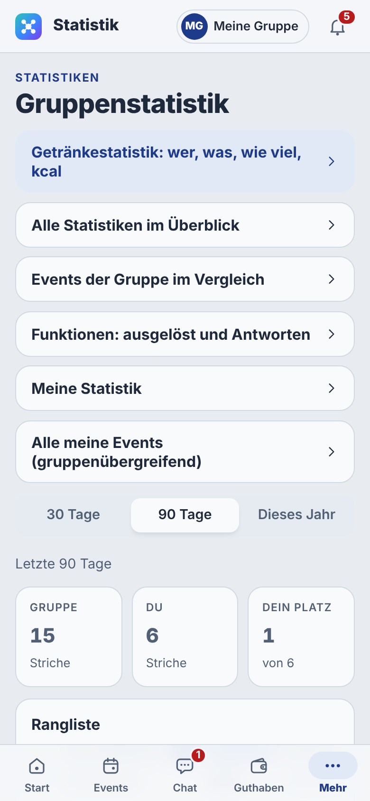

Unter **Mehr → Statistik** siehst du Auswertungen deiner Gruppe. Alle Mitglieder sehen dieselben Zahlen, mit Namen. Die Statistiken sind Spaß-Fakten, keine Gesundheitsangabe, und bleiben in der Gruppe (siehe AGB, Abschnitt „Statistiken“).

Oben wählst du den **Zeitraum**: **30 Tage**, **90 Tage** oder **Dieses Jahr** (das laufende Kalenderjahr ab 1. Januar). Er bleibt erhalten, wenn du zwischen den Statistikseiten wechselst.

- **Gruppe**, **Du** und **Dein Platz**: Striche der ganzen Gruppe, deine eigenen und dein Platz in der Rangliste.
- **Rangliste** mit Balken; dein Eintrag ist hervorgehoben.
- **Zusagequote**: wie viele Einladungen mit „Zusagen“ beantwortet wurden.

**Getränkestatistik: wer, was, wie viel, kcal** zeigt Getränke, Liter und Kalorien der Gruppe und den Durchschnitt je Event, Tag, Woche und Monat. Darunter wechselst du zwischen **Nach Mitglied** und **Nach Getränk** und sortierst **Nach Anzahl** oder **Nach Kalorien**. Ein Tipp auf ein Mitglied klappt seine Getränke mit Menge und Kalorien auf. Liter und Kalorien kommen aus den Angaben am Getränk im Katalog; Getränke ohne Angabe zählen dort nicht mit, die Seite nennt ihre Zahl.

**Alle Statistiken im Überblick** fasst alles auf einer Seite zusammen, am besten am Rechner: Mitglieder, Events, Zusagen je Event und je Mitglied (mit **Da gewesen**: Events mit mindestens einem Strich oder Kauf), Getränke je Woche, nach Wochentag und Uhrzeit, **Wer trinkt was?** nach Bier, Alkoholfrei, Schnaps, Wein & Sekt, die beliebtesten Getränke, Rundengeber, Moments, Chat und Rekorde. Den **Umsatz** sehen dort nur Vorstand und Kasse.

 

### Events der Gruppe und Event-Statistik

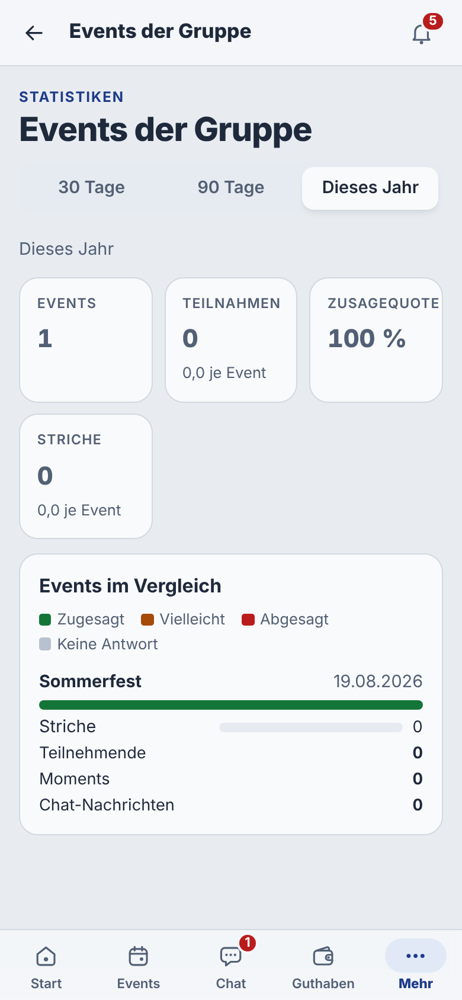

**Events der Gruppe im Vergleich** (unter **Weitere Statistiken**) vergleicht alle Events der Gruppe im Zeitraum, die du auch in deiner Eventliste siehst. Oben stehen Events, Teilnahmen, Zusagequote und Striche, jeweils mit dem Durchschnitt je Event. Unter **Events im Vergleich** zeigt je Event ein Balken die Antworten (Zugesagt, Vielleicht, Abgesagt, Keine Antwort), dazu Teilnehmende, Striche, Moments und Chat. Ein Tipp auf ein Event öffnet seine **Event-Statistik**.

 

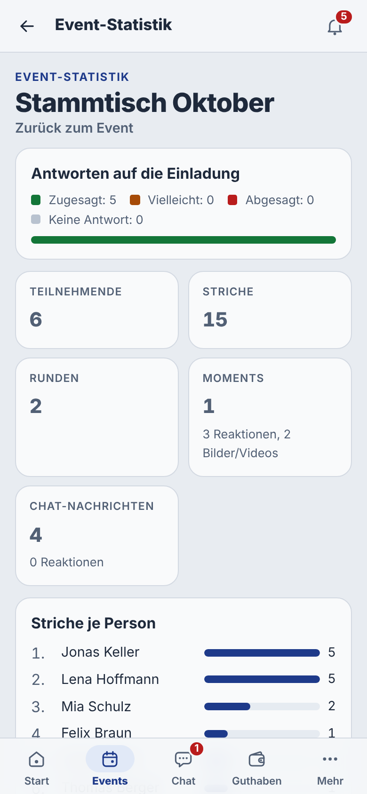

Die **Event-Statistik** erreichst du auch auf der Eventseite über **Statistik**. Sie zeigt für ein einzelnes Event die **Antworten auf die Einladung**, Teilnehmende, Striche, Runden, Moments mit Reaktionen und Bildern, Chat-Nachrichten mit Reaktionen und **Striche je Person**. Ist die Statistik für das Event ausgeschaltet, steht das oben auf der Seite.

 

### Funktionen

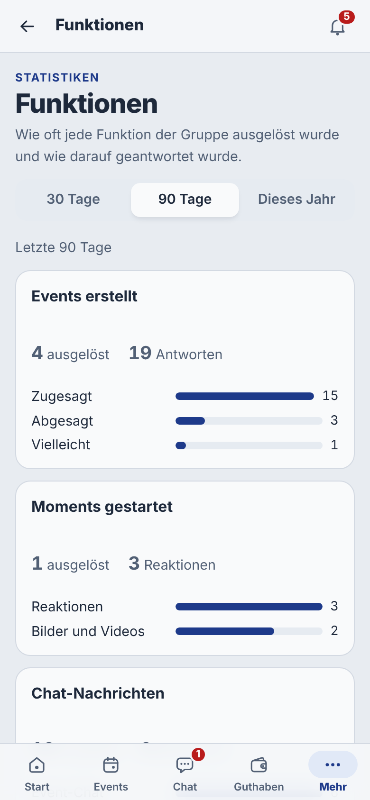

**Funktionen: ausgelöst und Antworten** zeigt je Funktion der Gruppe, wie oft sie im Zeitraum benutzt wurde und wie darauf geantwortet wurde: zum Beispiel Events und die Zusagen darauf, Moments und ihre Reaktionen, Chat-Nachrichten und Reaktionen, Runden und bedachte Personen, Einladungslinks und Beitritte, Striche und Käufe nach Herkunft (Strichliste, Barcode-Kauf) sowie Fremdgetränke.

 

### Meine Statistik

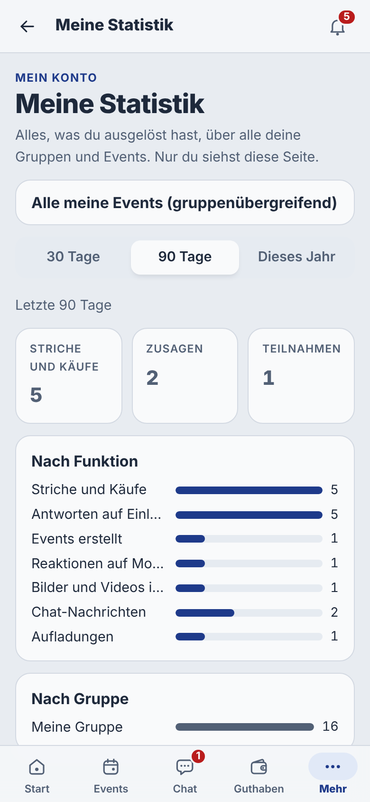

Unter **Mehr → Meine Statistik** siehst du nur für dich, was du ausgelöst hast, über alle deine Gruppen: Striche und Käufe, Zusagen, Teilnahmen, Moments, Chatnachrichten und mehr, aufgeschlüsselt **Nach Funktion** und **Nach Gruppe**. Niemand sonst sieht diese Seite. **Alle meine Events (gruppenübergreifend)** öffnet **Events übergreifend**: Es vergleicht alle Events deiner Gruppen, die du sehen darfst, mit Summen, Durchschnitten und deinen eigenen Werten. Namen anderer Personen stehen dort nicht.

 

### Statistik ausschalten oder löschen

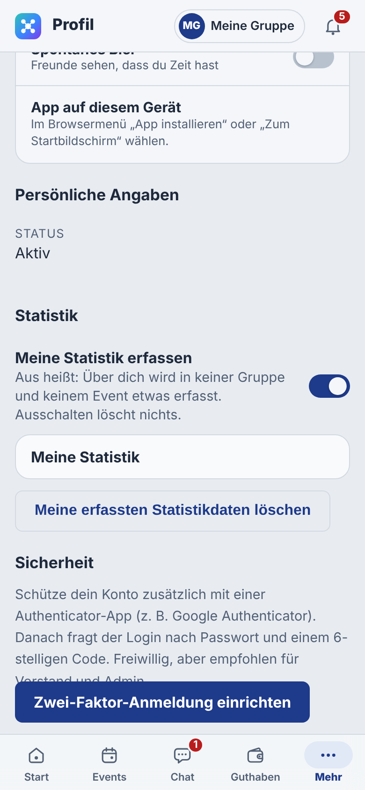

In **Mein Konto** steht der Abschnitt **Statistik**:

- **Meine Statistik erfassen**: Schaltest du ihn aus, wird über dich in keiner Gruppe und keinem Event mehr etwas erfasst. Das gilt auch, wenn die Gruppe ihre Statistik an hat. Ausschalten löscht nichts.
- **Meine erfassten Statistikdaten löschen**: löscht nach einer Rückfrage alles, was über dich erfasst wurde, in allen Gruppen. Deine Buchungen und dein Guthaben bleiben. Das Löschen steht im Protokoll der Gruppe.

Direktnachrichten werden nie erfasst. Ein storniertes Getränk verschwindet wieder aus der Statistik. Fremdgetränke (siehe [Ohne laufendes Event](#ohne-laufendes-event-bezahlen-oder-nur-erfassen)) zählen in deiner Statistik und in der Gruppenstatistik, aber in keiner Event-Statistik.

 

## Eine Gruppe verlassen

Unter **Mehr → Gruppeneinstellungen** steht ganz unten **Gruppe verlassen**.

1. **Gruppe verlassen** tippen.
2. Die Rückfrage bestätigen.

Danach hast du in dieser Gruppe keine Rechte mehr. Deine Buchungen und Beiträge bleiben in der Gruppe erhalten. Dein Konto und deine anderen Gruppen bleiben unberührt. Wieder dabei bist du nur mit einem neuen Einladungslink.

Bist du die letzte Person, die Mitglieder und Rollen verwalten darf, geht das Verlassen nicht. Gib diese Rolle zuerst jemand anderem.
