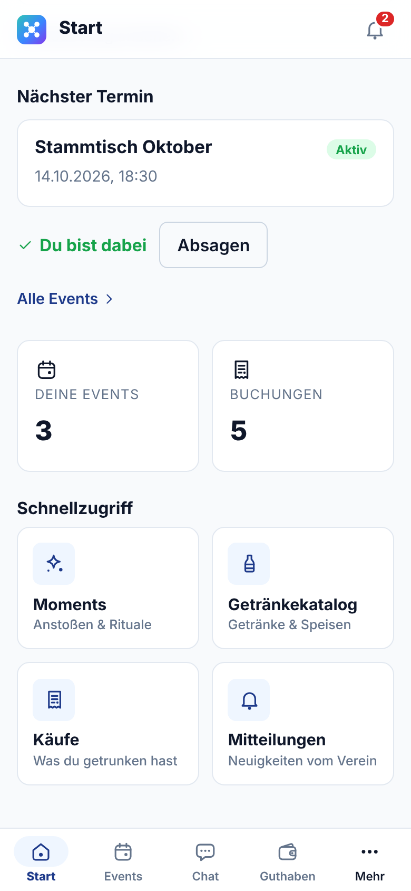

# Leitfaden Mitglied

Für alle Vereinsmitglieder. Anmeldung, Navigation und Profil stehen in den [Ersten Schritten](01-erste-schritte.md).

## Auf einen Blick

| Ich möchte … | So geht's |
| :--- | :--- |
| zu einem Termin zusagen | **Start** → Nächster Termin → **Zusagen**, oder **Events** → Event → **Zusagen** |
| mein Guthaben sehen | **Guthaben** (untere Leiste) |
| prüfen, was mir an der Theke angeschrieben wurde | **Mehr → Käufe** |
| Guthaben aufladen | Bargeld beim Kassenwart abgeben, er bucht es ein |
| beim gemeinsamen Anstoßen mitmachen | **Mehr → Moments**, oder im Event auf **Moments ansehen** |
| ein neues Getränk vorschlagen | **Mehr → Getränkekatalog** → **Getränk vorschlagen** |

## Termine und Zusagen

Auf der **Startseite** steht dein nächster Termin. Mit **Zusagen** meldest du dich an, mit **Absagen** wieder ab. Sobald du zugesagt hast, steht dort „Du bist dabei“.

 

Unter **Events** findest du alle Termine, zu denen du gehörst. Jede Karte zeigt Titel, Datum, Uhrzeit, Gastgeber und den Stand:

- **Veröffentlicht**: Der Termin steht fest, du kannst zusagen.
- **Aktiv**: Der Abend läuft gerade, die Theke ist geöffnet.
- **Abgeschlossen**: Der Termin ist vorbei.

 

Tippe auf ein Event, um die Details zu sehen:

- Datum, Ende und Ort. **Route öffnen** startet die Navigation zum Treffpunkt.
- **Deine Antwort**: **Zusagen**, **Vielleicht** oder **Absagen**. Deine aktuelle Wahl ist grün hinterlegt.
- **Anwesenheit**: wer dabei ist.
- **Moments & Rituale**: laufende und vergangene Gemeinschaftsmomente dieses Events.

 

## Guthaben

Vereint führt für dich ein Guthabenkonto, die „Bierkasse“. Alles, was an der Theke auf deinen Namen angeschrieben wird, wird davon abgezogen.

- Oben steht der **aktuelle Stand**.
- In der **Historie** siehst du jede Buchung. Mit **Alle**, **Aufladungen** und **Ausgaben** filterst du die Liste.

**Aufladen**: Gib das Geld beim Kassenwart ab. Er bucht den Betrag ein, danach erscheint er hier als „Aufladung“. Der Knopf **Aufladen** erinnert dich nur daran; selbst buchen kannst du nicht.

Ein Guthaben kann auch ins Minus gehen. Dann bitte zeitnah beim Kassenwart ausgleichen.

 

## Käufe

Unter **Mehr → Käufe** steht jeder Strich einzeln mit Artikel, Preis, Datum und Uhrzeit. So kannst du nach einem Abend nachprüfen, was für dich gebucht wurde.

Ein Kauf ist ein unveränderlicher Beleg: Der Preis bleibt so, wie er an diesem Abend galt, auch wenn sich der Preis im Katalog später ändert. Das Kennzeichen „Katalog v1“ zeigt die Preisliste, aus der der Preis stammt.

Stimmt etwas nicht, sprich den Thekendienst oder den Kassenwart an. Der Thekendienst kann einen falschen Strich innerhalb von 10 Minuten selbst zurücknehmen, danach korrigiert der Kassenwart.

 

## Mitteilungen

Die **Glocke** oben rechts (oder **Mehr → Mitteilungen**) sammelt alles, was der Verein dir mitteilt: Ankündigungen des Vorstands, neue Moments und Neuigkeiten zu deinen Events.

- Ungelesene Mitteilungen haben einen Punkt und einen farbigen Rand.
- **Als gelesen markieren** gilt für eine Mitteilung, **Alle als gelesen markieren** für alle.
- **Push aktivieren** schickt dir Mitteilungen auch dann aufs Handy, wenn Vereint geschlossen ist. Das Handy fragt einmal nach deiner Erlaubnis.

 

## Moments: gemeinsam anstoßen

Ein **Moment** ist eine kurze gemeinsame Aktion während eines Events, zum Beispiel alle stoßen gleichzeitig an. Jemand startet ihn, alle anderen reagieren darauf.

- **Mehr → Moments** zeigt die Moments deiner aktiven Events. Aus einem Event kommst du über **Moments ansehen** direkt hierher.
- Eine Karte zeigt Art, Titel, wer ihn gestartet hat, wie lange er noch läuft und wie viele schon reagiert haben.
- **Neuen Moment starten** beginnt selbst einen Moment: Art wählen (z. B. Anstoßen), Titel und Nachricht eingeben, Dauer festlegen.

 

**Reagieren**: Tippe auf **Reagieren** oder unter **Schnell reagieren** direkt auf eine Reaktion wie **Anstoßen**, **Jubel** oder **Daumen hoch**. Mit **+ Status & Text** schreibst du einen eigenen Satz dazu.

Die **Timeline** zeigt alle Reaktionen. Wer beim Reagieren den Standort freigibt, erscheint zusätzlich auf der **Weltkarte**. Das ist freiwillig.

Ist ein Moment vorbei, landet er unter **Archivierte Moments & Rituale**.

 

## Getränkekatalog

Unter **Mehr → Getränkekatalog** stehen alle Getränke und Speisen des Vereins mit ihrem Standardpreis. Über die Reiter wechselst du zwischen **Getränkekatalog** und **Speisenkatalog**, oben kannst du suchen.

Fehlt dir ein Getränk? Mit **Getränk vorschlagen** schlägst du es mit Name, Kategorie und Preis vor. Der Vorstand prüft den Vorschlag und gibt ihn frei. Bis dahin steht er als „Vorgeschlagen“ in der Liste.

 
