# Leitfaden Vorstand

Für Vorstandsmitglieder, zum Beispiel Kassenwart und Schriftwart. Als Vorstand bist du auch Mitglied; alles aus dem [Leitfaden Mitglied](02-mitglied.md) gilt für dich ebenso. Gastgeber eines Events finden hier außerdem den Abschnitt [Ein Event vorbereiten](#ein-event-vorbereiten).

Deine Vorstandsbereiche findest du am Handy unter **Mehr → Verwaltung**, am Rechner links unter **Verwaltung**: **Vorstand**, **Kasse & Finanzen** und **Kommunikation**.

## Auf einen Blick

| Ich möchte … | So geht's |
| :--- | :--- |
| Bargeld als Guthaben einbuchen | **Kasse & Finanzen** → Mitglied antippen → **Aufladen** |
| Guthaben auszahlen | **Kasse & Finanzen** → Mitglied antippen → **Auszahlen** |
| ein neues Event planen | **Events** → **Event anlegen** |
| sehen, was ein Abend eingebracht hat | **Kasse & Finanzen** → Event → **Abrechnung** |
| Titel, Ort oder Status eines Events ändern | **Vorstand** → Event → **Moderieren** |
| einen Gast einladen | Event moderieren → **Einladungen** → **Gasteinladung erzeugen** |
| ein vorgeschlagenes Getränk freigeben | **Getränkekatalog** → Vorschlag → **Freigeben** |
| ein Getränk anlegen oder den Preis ändern | **Getränkekatalog** → **Getränk anlegen** oder **Bearbeiten** |
| ein neues Mitglied einladen | **Vorstand** → **Mitglied einladen** (siehe [Leitfaden Administration](04-administration.md#neue-mitglieder-einladen)) |
| allen eine Nachricht schicken | **Kommunikation** → Meldung verfassen → **Alle Mitglieder** |
| einen Hinweis oben im Vereinschat anheften | **Kommunikation** → Infotafel → **Anpinnen** |
| ein Thekenterminal ohne PIN entsperren | **Vorstand** → **Kiosk-Geräte** → **Entsperren** |
| festlegen, welche Moments und Reaktionen es gibt | **Vorstand** → **Moments · Typen & Reaktionen** |

## Vorstandsübersicht

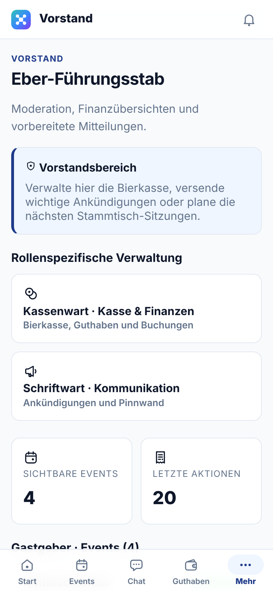

**Vorstand** ist dein Einstieg:

- **Rollenspezifische Verwaltung** führt zu **Kasse & Finanzen**, **Kommunikation**, **Moments · Typen & Reaktionen**, **Mitglied einladen** und **Kiosk-Geräte**.
- Die Kennzahlen zeigen, wie viele Events du siehst und wie viele Aktionen zuletzt protokolliert wurden.
- Unter **Gastgeber · Events** stehen alle Events mit **Moderieren**.
- **Letzte Aktionen** ist das Protokoll: wer wann was gebucht, geändert oder versendet hat, mit den Namen der beteiligten Mitglieder, Events und Artikel.

 

## Kasse & Finanzen

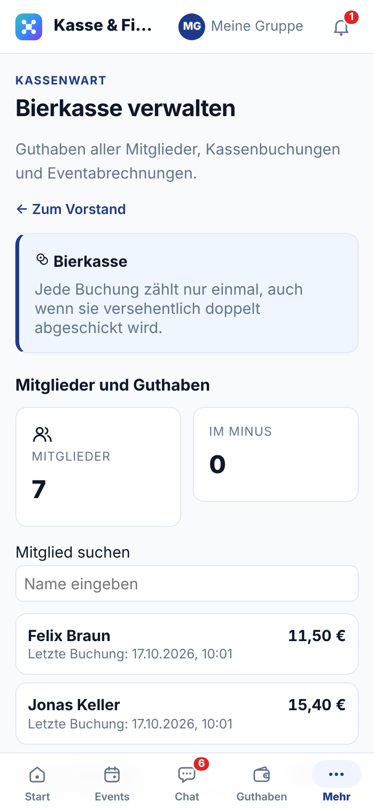

Hier verwaltet der Kassenwart die Bierkasse.

**Mitglieder und Guthaben**: Oben steht, wie viele Mitglieder es gibt und wie viele im Minus sind. Darunter die Liste aller Mitglieder mit Guthaben und letzter Buchung. Mit **Mitglied suchen** findest du jemanden schnell über den Namen.

 

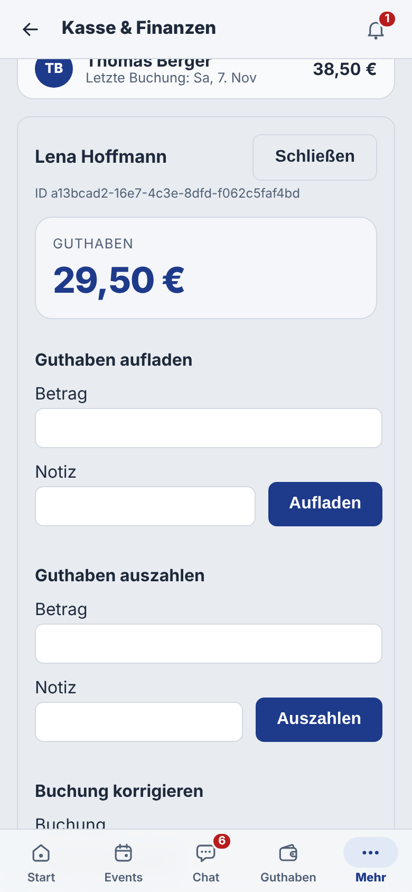

Tippe auf ein Mitglied. Es öffnen sich sein Guthaben, alle seine Buchungen und die Formulare zum Buchen:

1. **Guthaben aufladen**: Betrag und eine Notiz (z. B. „Bareinzahlung Stammtisch“) eintragen, **Aufladen** tippen. Das Mitglied sieht die Aufladung sofort in seinem Guthaben.
2. **Guthaben auszahlen**: genauso, wenn jemand Guthaben bar zurückbekommt, etwa beim Austritt.
3. **Buchung korrigieren**: Buchungen werden nie gelöscht. Eine falsche Buchung hebst du mit einer Gegenbuchung auf: Buchung in der Auswahl wählen (oder in der Liste darunter auf **Zur Korrektur wählen** tippen), einen Grund eintragen und **Korrigieren** tippen. Beide Buchungen bleiben sichtbar, so ist jede Änderung nachvollziehbar.

**Schließen** klappt das Mitglied wieder zu. Jede Buchung wird genau einmal ausgeführt, auch wenn du versehentlich doppelt tippst.

 

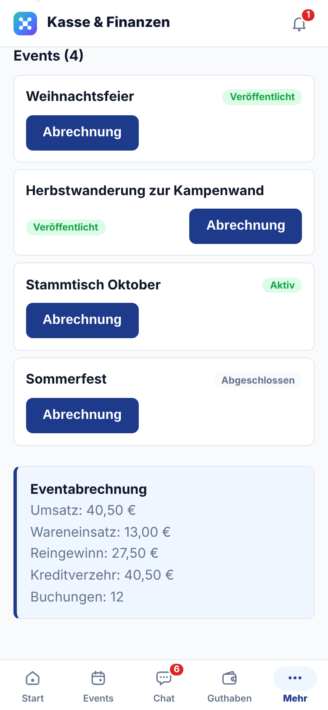

**Abrechnung eines Abends**: Tippe unter **Events** bei einem Event auf **Abrechnung**. Die Eventabrechnung zeigt:

- **Umsatz**: alles, was an diesem Abend gebucht wurde,
- **Wareneinsatz**: was die verkauften Artikel im Einkauf gekostet haben,
- **Reingewinn**: Umsatz minus Wareneinsatz,
- **Kreditverzehr**: der Teil, der von Guthaben abgebucht wurde,
- **Buchungen**: Anzahl der Einzelbuchungen.

 

## Ein Event vorbereiten

Ein neues Event legst du unter **Events** → **Event anlegen** an, wie im [Leitfaden Mitglied](02-mitglied.md#selbst-ein-event-anlegen) beschrieben. Bestehende Events moderierst du über **Vorstand** → **Moderieren**. Gastgeber eines Events kommen auch über die Eventseite dorthin.

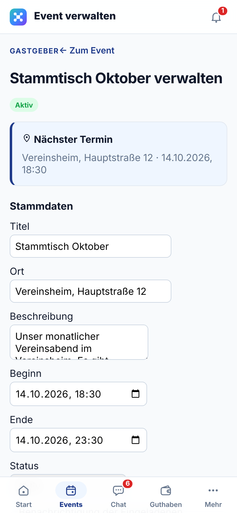

**Stammdaten**: Titel, Ort, Beschreibung, Beginn und Ende ändern, dazu wann die Eingeladenen benachrichtigt werden und ob es eine Erinnerung gibt. Dann **Stammdaten speichern**.

Über **Status** steuerst du den Ablauf:

- **Entwurf**: noch in Vorbereitung,
- **Veröffentlicht**: Mitglieder sehen den Termin und können zusagen,
- **Aktiv**: der Abend läuft, das Thekenterminal kann Striche buchen,
- **Abgeschlossen**: der Abend ist vorbei,
- **Abgesagt** oder **Archiviert**.

Stelle ein Event am Abend selbst auf **Aktiv**, sonst erscheint es nicht am Thekenterminal.

 

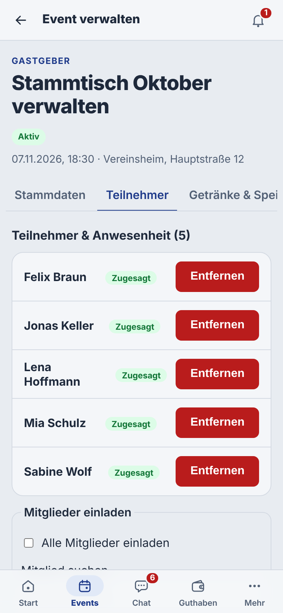

**Teilnehmer & Anwesenheit**: alle Eingeladenen mit ihrer Antwort (Zugesagt, Vielleicht, Abgesagt, Offen). **Entfernen** nimmt jemanden heraus.

**Mitglieder einladen**: Namen suchen und anhaken, oder **Alle Mitglieder einladen**, dann **Einladen**. Die neuen Eingeladenen bekommen eine Mitteilung.

 

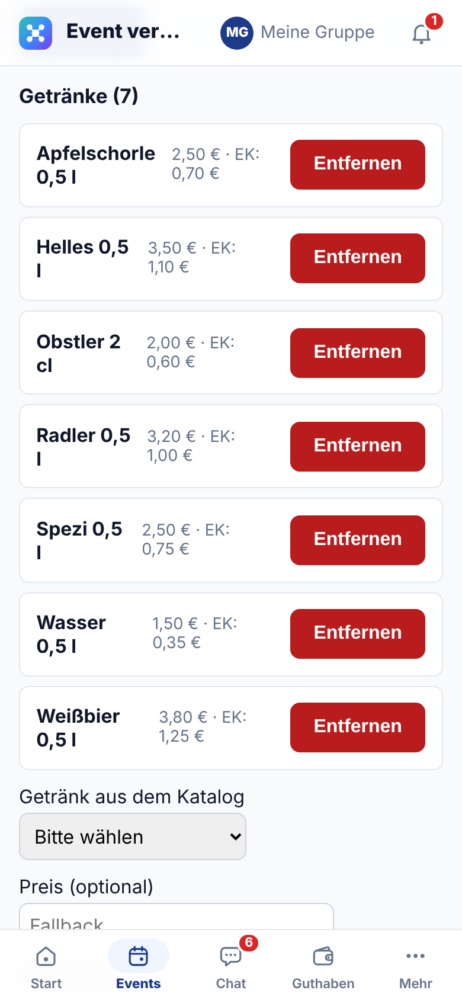

**Getränke** und **Speisen**: zeigen, was an diesem Abend an der Theke angeboten wird, mit Verkaufspreis und Einkaufspreis (EK). **Entfernen** nimmt einen Artikel aus dem Angebot.

Zum Hinzufügen unter **Getränk aus dem Katalog** ein Getränk wählen, optional einen abweichenden Preis und EK eintragen und **Getränk hinzufügen** tippen. Schneller geht es mit **Sublist**: eine Getränkeliste wählen und **Sublist zuweisen**. Speisen fügst du genauso unter **Speise aus dem Katalog** hinzu.

 

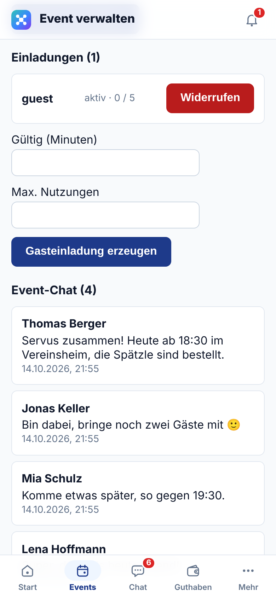

**Einladungen**: So holst du Gäste ohne Vereinskonto dazu.

1. **Gültig (Minuten)** und **Max. Nutzungen** eintragen, z. B. 10080 Minuten (eine Woche) und 5 Nutzungen.
2. **Gasteinladung erzeugen** tippen.
3. Den angezeigten Link kopieren und an die Gäste schicken. **Der Link wird nur einmal angezeigt.**

Die Liste zeigt jede Einladung mit Stand und Nutzungen, z. B. „aktiv · 0 / 5“. **Widerrufen** macht einen Link sofort ungültig. Was Gäste sehen, steht im [Leitfaden Gast](06-gast.md).

 

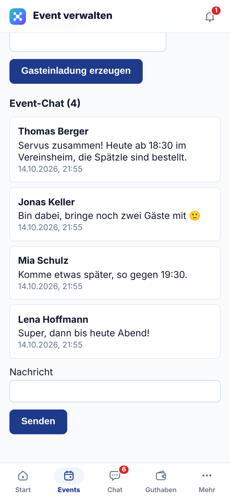

**Event-Chat**: Alle Nachrichten zu diesem Event, auch die der Gäste. Unten schreibst du unter **Nachricht** und tippst **Senden**.

 

## Getränkekatalog und Getränkelisten

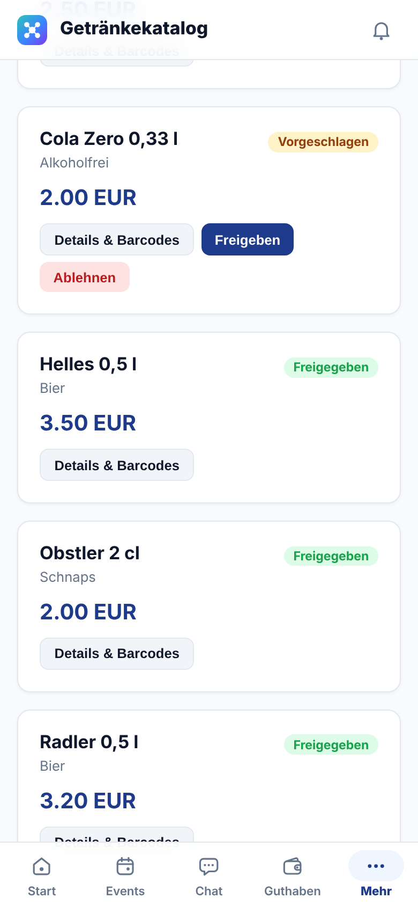

Im **Getränkekatalog** pflegst du alle Getränke des Vereins. Bei jedem Getränk steht neben dem Preis die **Marge**, also was der Verein pro Verkauf verdient. Mit **Alle Status** filterst du zum Beispiel nur Vorschläge.

**Vorschläge** von Mitgliedern stehen mit dem Kennzeichen **Vorgeschlagen** in der Liste:

- **Freigeben**: Das Getränk wird Teil des Katalogs.
- **Ablehnen**: Der Vorschlag wird verworfen.

**Getränk anlegen**: Getränke, die der Vorstand anlegt, sind sofort freigegeben. Am schnellsten geht es mit **Barcode scannen**: Ist der Strichcode neu, öffnet sich das Formular mit dem Strichcode schon ausgefüllt. Kennt Vereint ihn, öffnet sich das vorhandene Getränk.

 

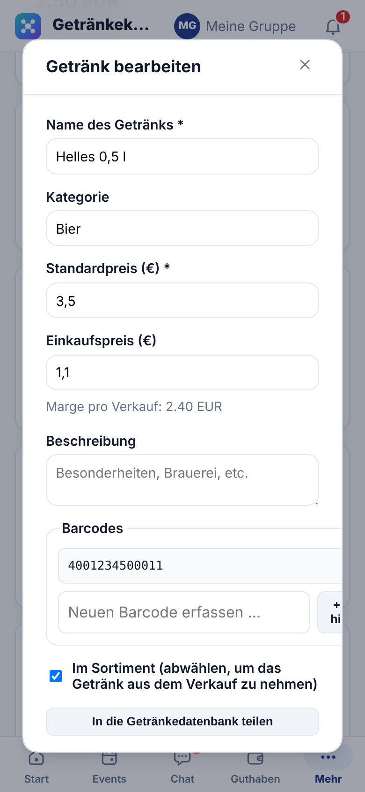

**Bearbeiten** öffnet dasselbe Formular wie beim Anlegen:

- **Name**, **Kategorie** und **Standardpreis** (Pflicht beim Preis),
- **Einkaufspreis**: Darunter rechnet Vereint die Marge pro Verkauf aus.
- **Barcodes**: einen oder mehrere Strichcodes per Kamera oder Eingabe hinzufügen. Erst mit Strichcode können Mitglieder das Getränk selbst bezahlen.
- **Im Sortiment**: Abwählen nimmt ein Getränk aus dem Verkauf, ohne es zu löschen. Alte Käufe behalten so ihren Namen und Preis.

Vereint warnt, wenn ein Name oder Strichcode schon vergeben ist. **Speichern** übernimmt die Änderung.

 

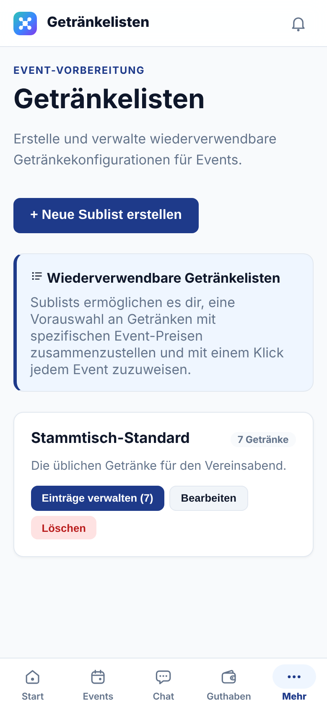

**Getränkelisten** sind Vorlagen, z. B. „Stammtisch-Standard“ mit den üblichen sieben Getränken. Statt jedes Getränk einzeln zu einem Event hinzuzufügen, weist du eine ganze Liste zu.

- **Neue Sublist erstellen** legt eine Liste an.
- **Einträge verwalten** fügt Getränke hinzu oder entfernt sie.
- **Bearbeiten** und **Löschen** ändern die Liste selbst.

 

## Kommunikation

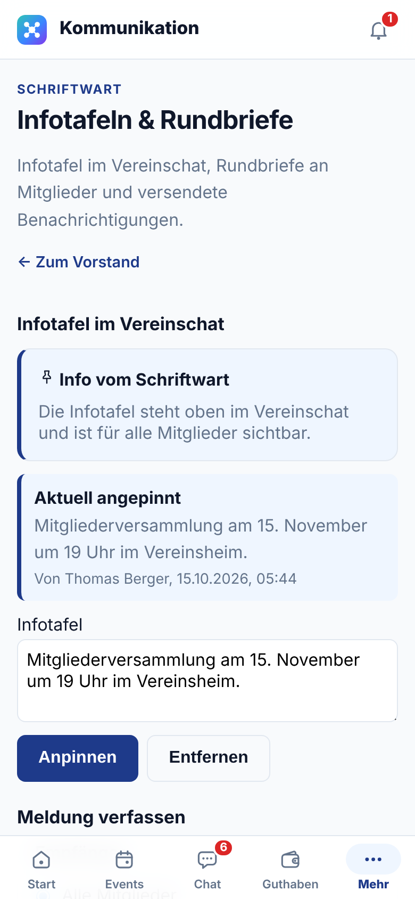

Hier verschickt der Schriftwart Rundbriefe und pflegt die Infotafel.

**Infotafel im Vereinschat**: ein kurzer Hinweis, der oben im Vereinschat für alle sichtbar bleibt, etwa der nächste wichtige Termin.

1. Text unter **Infotafel** eintragen.
2. **Anpinnen** tippen. Unter **Aktuell angepinnt** siehst du, was gerade oben steht.
3. **Entfernen** nimmt die Infotafel wieder ab.

 

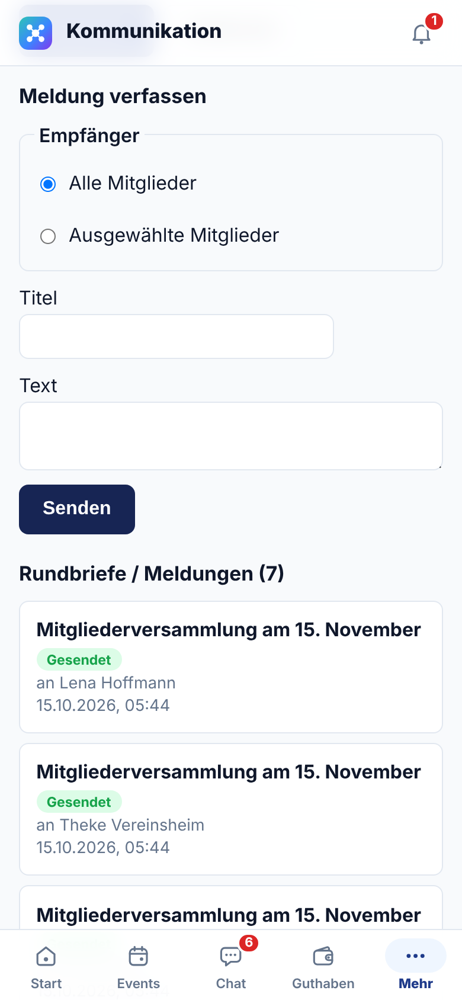

**Meldung verfassen**: ein Rundbrief, der bei den Empfängern unter der Glocke und, wenn eingeschaltet, als Push-Nachricht ankommt.

1. **Empfänger**: **Alle Mitglieder** oder **Ausgewählte Mitglieder**. Bei Auswahl Namen suchen und anhaken.
2. **Titel** und **Text** eingeben.
3. **Senden** tippen.

Unter **Rundbriefe / Meldungen** steht, was zuletzt verschickt wurde.

 

## Kiosk-Geräte

Ein Thekenterminal im Kiosk-Modus lässt sich am Gerät nur mit seiner PIN verlassen (siehe [Leitfaden Thekenterminal](05-thekenterminal.md#kiosk-modus)). Ist die PIN vergessen oder nach zu vielen Fehlversuchen gesperrt:

1. **Vorstand** → **Kiosk-Geräte** öffnen. Dort stehen alle Geräte, auf denen gerade der Kiosk-Modus läuft, mit Gerätename, wer ihn wann gestartet hat und ob die PIN-Eingabe gerade gesperrt ist.
2. Beim richtigen Gerät **Entsperren** tippen.

Das Gerät verlässt den Kiosk-Modus innerhalb weniger Sekunden. Start, Fernentsperrung und PIN-Sperren stehen in **Letzte Aktionen**.

## Moments: Typen & Reaktionen

Unter **Vorstand** → **Moments · Typen & Reaktionen** legt ihr fest, welche Arten von Moments Mitglieder starten können (z. B. Anstoßen, Jubeln) und mit welchen Reaktionen sie antworten.

- **Neuer Typ** bzw. **Neue Reaktion**: Emoji und Name eintragen, beim Typ optional eine Beschreibung. Beim Typ wählst du, ob **alle aktiven Reaktionen** erlaubt sind oder nur eine Auswahl.
- **Bearbeiten** ändert einen Eintrag. Schaltest du **Mitglieder können diesen Typ starten** bzw. **… diese Reaktion verwenden** aus, ist der Eintrag ausgemustert: Für neue Moments ist er nicht mehr wählbar, bestehende Moments behalten ihn.

Als Vorstand kannst du außerdem Bilder und Videos aus Beiträgen anderer entfernen, zum Beispiel wenn jemand etwas Unpassendes geteilt hat. Das steht ebenfalls in **Letzte Aktionen**.
