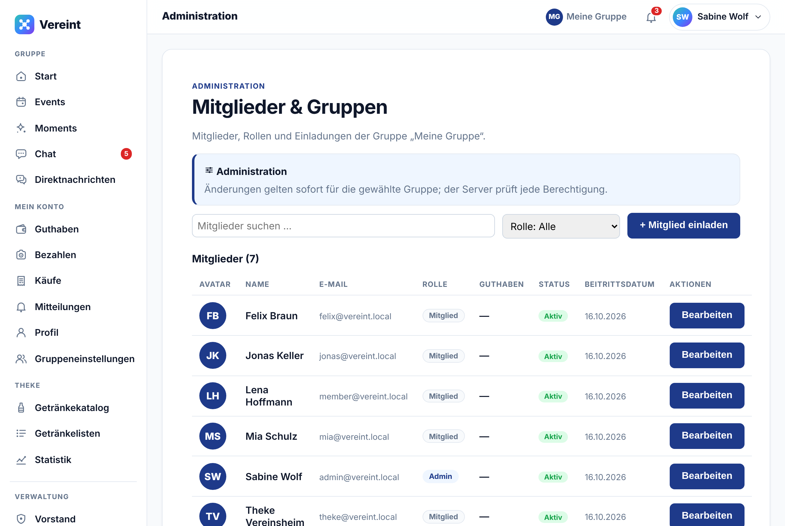
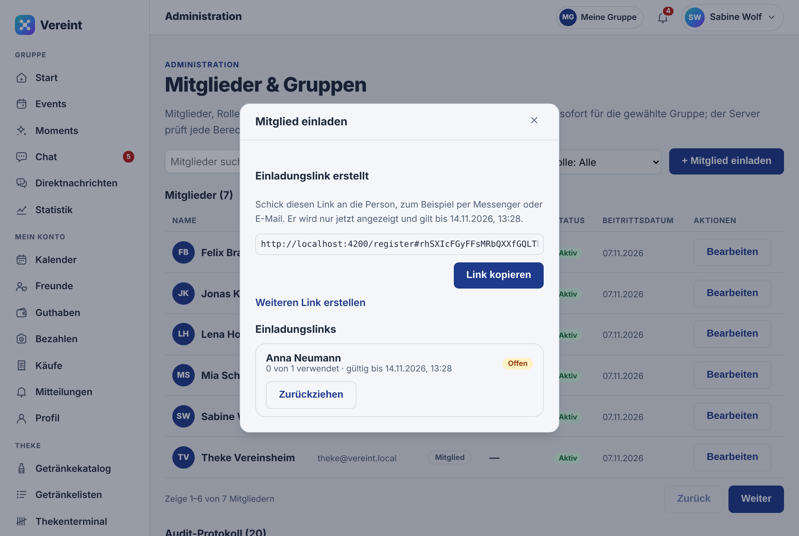
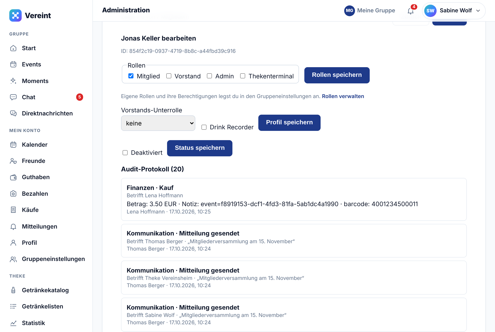
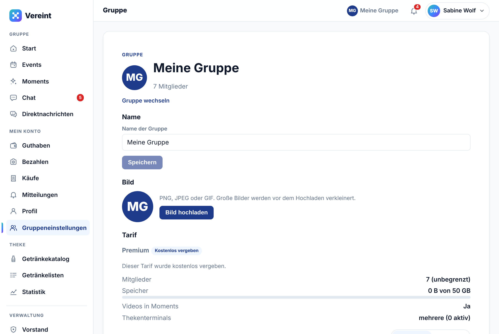
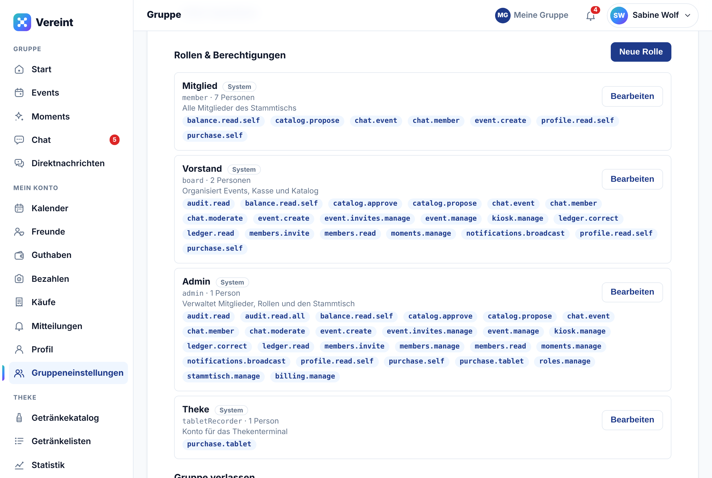

# Leitfaden Administration

Für Administratorinnen und Administratoren einer Gruppe. Du hast alle Rechte des Vorstands (siehe [Leitfaden Vorstand](03-vorstand.md)) und zusätzlich die **Administration** und die **Gruppeneinstellungen**. Alles hier gilt nur für die Gruppe, die gerade offen ist. Diese Arbeit erledigst du am besten am Rechner; die Bilder zeigen deshalb die Rechneransicht.

## Mitgliederliste

Unter **Administration** (am Rechner links unter **Verwaltung**, am Handy unter **Mehr**) stehen alle Mitglieder der Gruppe mit E-Mail, Rolle, Status und Beitrittsdatum. Die Einleitung oben nennt die Gruppe, die gerade offen ist.

- Das **Suchfeld** filtert nach Namen, **Rolle: Alle** nach einer Rolle. Im Rollenfilter stehen auch die eigenen Rollen der Gruppe.
- In der Spalte **Rolle** stehen die Hauptrolle (z. B. Admin, Vorstand, Kassenwart) und dahinter die eigenen Rollen der Person, etwa „Mitglied · Kasse“.
- **Aktiv** heißt: Das Mitglied kann sich anmelden und die App nutzen.
- **Bearbeiten** öffnet die Einstellungen eines Mitglieds.

Neue Mitglieder lädst du per Link ein (siehe unten). Nach ihrer Registrierung oder ihrem Beitritt erscheinen sie in dieser Liste.

Unter der Liste steht das **Audit-Protokoll**: wer wann Rollen, Status, Profile, Buchungen oder Mitteilungen geändert hat, mit Namen.

## Neue Mitglieder einladen

Neue Mitglieder registrieren sich selbst über einen Einladungslink. Links erstellen Administration und Vorstand, entweder hier mit **+ Mitglied einladen** oder unter **Vorstand** → **Mitglied einladen**.

1. **Für wen?**: optional ein Name, damit du den Link später wiedererkennst.
2. **Gültig für**: wie lange der Link gilt, z. B. 7 Tage.
3. **Anzahl Personen**: wie viele mit diesem Link beitreten dürfen, meist 1.
4. **Link erstellen** tippen.
5. **Link kopieren** (am Handy **Teilen**) und an die Person schicken, etwa per Messenger oder E-Mail. Der Link wird nur dieses eine Mal angezeigt. Mit **Weiteren Link erstellen** geht es gleich weiter.

Unter **Einladungslinks** siehst du jeden Link mit Stand (**Offen**, **Verwendet**, **Abgelaufen**, **Zurückgezogen**), wie oft er schon genutzt wurde und wer sich damit registriert hat. **Zurückziehen** macht einen Link sofort ungültig.

Wer sich über den Link registriert oder mit einem bestehenden Konto beitritt, ist danach normales Mitglied mit der Rolle `member`. Weitere Rollen vergibst du anschließend unter **Bearbeiten**. Wie die Registrierung für die eingeladene Person aussieht, steht in den [Ersten Schritten](01-erste-schritte.md#mit-einem-einladungslink-registrieren).

## Ein Mitglied bearbeiten

Nach **Bearbeiten** erscheint unter der Liste der Bereich „… bearbeiten“ mit der Mitglieds-ID. Jede Einstellung speicherst du mit ihrem eigenen Knopf.

**Rollen**, dann **Rollen speichern**. Hier stehen die vier Systemrollen der Gruppe und alle eigenen Rollen, die in den [Gruppeneinstellungen](#rollen--berechtigungen) angelegt sind. Der Link **Rollen verwalten** darunter führt dorthin. Die Systemrollen bedeuten:

| Rolle | Bedeutung |
| :--- | :--- |
| **Mitglied** (`member`) | Termine, Chat, Guthaben, Käufe, Moments, Getränke vorschlagen |
| **Vorstand** (`board`) | Kasse, Events moderieren, Getränke freigeben, Rundbriefe, Mitglieder einladen, Kiosk-Geräte |
| **Admin** (`admin`) | Alles vom Vorstand, dazu Mitglieder und Rollen verwalten, Gruppe, Datenexport und das Thekenterminal |
| **Thekenterminal** (`tabletRecorder`) | Striche für alle Mitglieder erfassen |

**Vorstands-Unterrolle** und **Drink Recorder**, dann **Profil speichern**. Zur Auswahl stehen **Vorsitz**, **Kassenwart**, **Schriftwart** und **Beisitzer**; sie sind eine Kennzeichnung und geben keine eigenen Rechte. Drink Recorder schaltet das Thekenterminal für dieses Mitglied frei, etwa für den Thekendienst am eigenen Handy. Das ist dasselbe wie die Rolle **Thekenterminal** unter **Rollen**.

**Deaktiviert**, dann **Status speichern**: beendet die Mitgliedschaft in dieser Gruppe. Die Person sieht die Gruppe nicht mehr, ihre Rollen hier entfallen, ihre Buchungen bleiben erhalten. Ihr Konto und ihre anderen Gruppen bleiben unberührt. Zum Entsperren den Haken wieder entfernen. Die Person ist dann wieder Mitglied mit der Rolle `member`; weitere Rollen vergibst du neu.

Gut zu wissen:

- Rollen gelten nur in dieser Gruppe. In einer anderen Gruppe kann dieselbe Person andere Rollen haben.
- Die **Menüpunkte** für Vorstand und Administration richten sich nach den Rechten der Rollen in dieser Gruppe. Rollen im Anmeldesystem (Keycloak) spielen dafür keine Rolle mehr.
- Deine eigenen Rollen kannst du nicht ändern. Das muss eine andere Person mit Verwaltungsrechten tun.
- Rollen und ihre Berechtigungen legst du in den [Gruppeneinstellungen](#rollen--berechtigungen) an; Änderungen gelten sofort für die gewählte Gruppe.

## Gruppeneinstellungen

Unter **Mehr → Gruppeneinstellungen** (am Rechner links unter **Mein Konto**) steht alles, was die Gruppe als Ganzes betrifft. Alle Mitglieder sehen diese Seite. Was du dort ändern darfst, hängt von deinen Rechten ab.

**Name**: **Name der Gruppe** ändern und **Speichern** tippen. Den Namen sehen alle Mitglieder oben in der App.

**Bild**: Mit **Bild hochladen** (später **Bild ändern**) wählst du ein Bild im Format PNG, JPEG oder GIF. Große Bilder verkleinert Vereint vor dem Hochladen. **Bild entfernen** nimmt es wieder weg. Das Bild sehen nur Mitglieder der Gruppe.

Name und Bild ändern darf, wer das Recht `stammtisch.manage` hat. Beim Eröffnen einer Gruppe ist das die eröffnende Person.

## Rollen & Berechtigungen

Jede Gruppe hat eigene Rollen. Beim Anlegen bekommt sie vier **Systemrollen**: Mitglied (`member`), Vorstand (`board`), Admin (`admin`) und Theke (`tabletRecorder`). Systemrollen tragen das Kennzeichen **System**.

Im Abschnitt **Rollen & Berechtigungen** der Gruppeneinstellungen steht jede Rolle mit Name, Code, Anzahl der Personen und ihren Berechtigungen. Ändern darf das, wer das Recht `roles.manage` hat. Wer nur `members.read` hat, sieht die Liste ohne Knöpfe. Einfache Mitglieder sehen diesen Abschnitt nicht.

- **Neue Rolle**: **Name** und optional eine **Beschreibung** eintragen, die gewünschten **Berechtigungen** anhaken und **Speichern** tippen. Die Berechtigungen sind nach Bereichen gruppiert, etwa **Buchungen**, **Katalog** oder **Gruppe**.
- **Bearbeiten**: Name, Beschreibung und Berechtigungen einer Rolle anpassen. Das geht auch bei Systemrollen.
- **Löschen**: entfernt eine eigene Rolle. Personen mit dieser Rolle verlieren ihre Berechtigungen. Systemrollen lassen sich nicht löschen.

Ein Beispiel: Eine eigene Rolle „Kasse“ mit `ledger.read` sieht die Kasse, aber nicht die Administration.

**Schutz vor Aussperren**: Mindestens eine Person muss Mitglieder und Rollen verwalten können. Eine Änderung, die der letzten solchen Person diese Rechte nimmt, lehnt Vereint ab. Diese Person kann die Gruppe auch nicht verlassen. Gib die Rolle vorher jemand anderem.

Zuweisen: Eigene Rollen gibst du einer Person unter **Administration** → **Bearbeiten** → **Rollen** (siehe oben). Sie erscheinen dort auch im Rollenfilter und in der Mitgliedertabelle.

## Daten exportieren

**Daten exportieren** in den Gruppeneinstellungen lädt alle Daten der Gruppe als JSON-Datei herunter: Rollen, Mitglieder, Events, Katalog, Buchungen, Chats und Moments. Bilder und Videos sind nicht enthalten. Dafür brauchst du `stammtisch.manage`.

Vereint ist kostenlos. Es gibt keine Tarife und keine Grenzen für Mitglieder, Speicher, Videos oder Thekenterminals.

## Thekentablet einrichten

1. Ein eigenes Konto für die Theke anlegen, z. B. „Theke Vereinsheim“: per Einladungslink registrieren und danach unter **Bearbeiten** die Rolle **Thekenterminal** (`tabletRecorder`) geben.
2. Am Tablet mit diesem Konto anmelden und **Angemeldet bleiben** anhaken.
3. **Thekenterminal** öffnen (unter **Verwaltung**) und **Kiosk-Modus starten**, damit das Tablet auf der Strichliste bleibt. Der Rest steht im [Leitfaden Thekenterminal](05-thekenterminal.md).

Ein eigenes Thekenkonto ist besser als ein persönliches: So erscheint auf dem Tablet kein privates Guthaben, und im Protokoll ist klar, welche Striche vom Tablet kamen.

## Passwort vergessen

Vereint verschickt keine E-Mails, deshalb gibt es keinen Link zum Zurücksetzen. Hat jemand sein Passwort vergessen, hilft, wer Zugang zur Keycloak-Verwaltung hat, meist der Betreiber der Installation. Dort unter Realm `vereint` → *Users* → Person → *Credentials* → *Reset password* ein neues Passwort mit **Temporary** setzen. Die Person muss es beim nächsten Anmelden ändern.

## Plattform-Administration

Die Seite **Plattform** (`/plattform`) ist nur für das Vereint-Team, das die Installation betreibt. Dort werden alle Gruppen angelegt, umbenannt und archiviert. Als Admin einer Gruppe brauchst du sie nicht.
