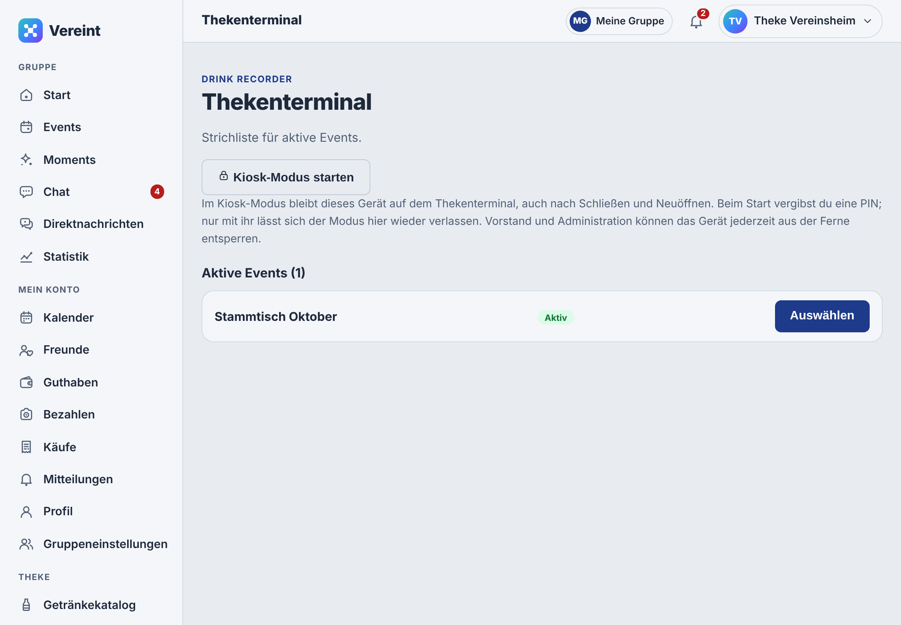
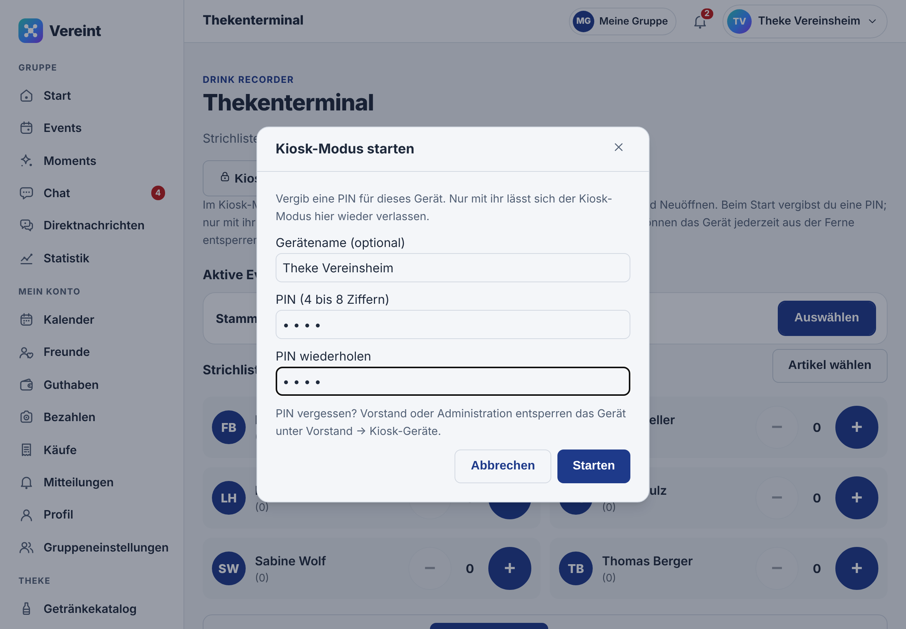
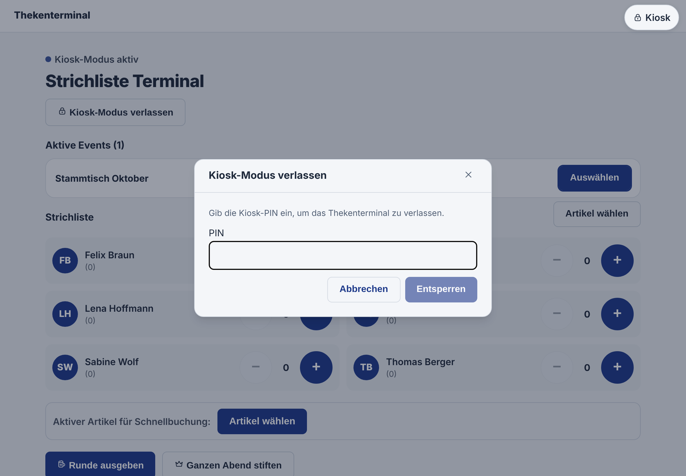
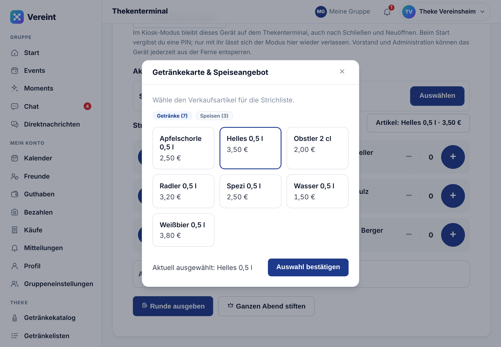
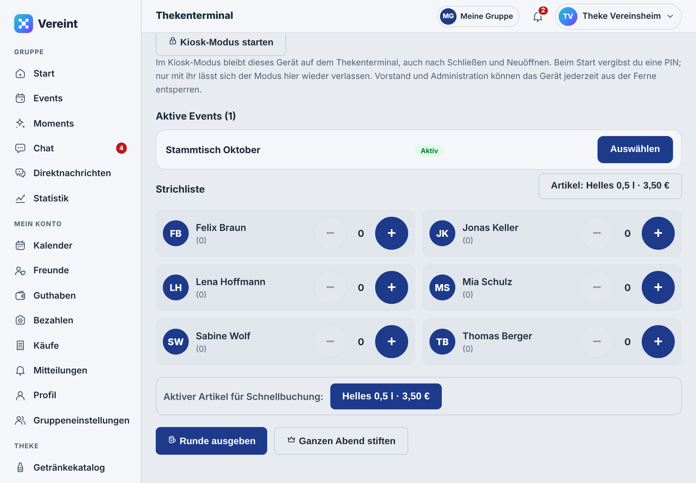
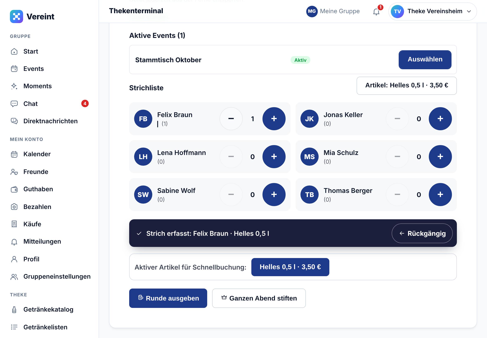
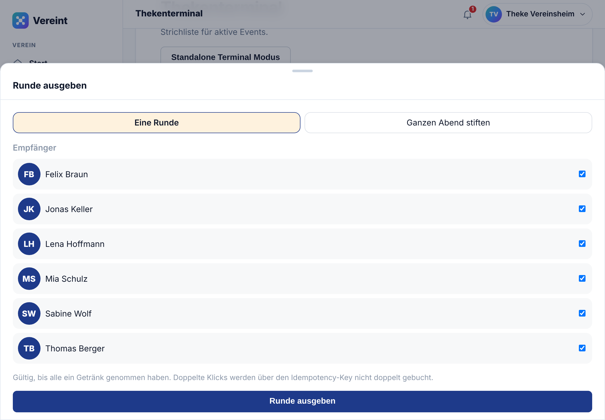

# Leitfaden Thekenterminal

Für den Thekendienst. Das Thekenterminal ist die digitale Strichliste: Ein Tablet liegt an der Theke, und wer ausschenkt, tippt für jedes Getränk einen Strich beim richtigen Namen. Der Betrag wird automatisch vom Guthaben des Mitglieds abgebucht.

Voraussetzung: Das Tablet ist mit dem Thekenkonto angemeldet (siehe [Thekentablet einrichten](04-administration.md#thekentablet-einrichten)), und der Vorstand hat das Event auf **Aktiv** gestellt.

## Abend auswählen

Öffne **Thekenterminal** (am Handy unter **Mehr**, Abschnitt **Verwaltung**; am Rechner links unter **Verwaltung**). Unter **Aktive Events** stehen alle Abende, die gerade laufen. Tippe beim richtigen Abend auf **Auswählen**.

Erscheint kein Event, ist der Abend noch nicht auf **Aktiv** gestellt. Bitte den Vorstand oder Gastgeber darum.

## Kiosk-Modus

Im **Kiosk-Modus** bleibt das Tablet auf der Strichliste: Menü, Mitteilungen und Abmelden sind ausgeblendet, und auch nach Neuladen oder Schließen und Öffnen der App landet es wieder hier, beim zuletzt gewählten Abend.

1. **Kiosk-Modus starten** tippen.
2. Optional einen **Gerätenamen** eintragen, z. B. „Theke links“.
3. Eine **PIN** aus 4 bis 8 Ziffern vergeben und wiederholen, dann **Starten**.

Zum Verlassen oben rechts auf das Schloss (**Kiosk entsperren**) oder auf **Kiosk-Modus verlassen** tippen und die PIN eingeben. Nach 5 falschen Eingaben ist die PIN-Eingabe eine Weile gesperrt. PIN vergessen? Vorstand oder Administration entsperren das Gerät unter **Vorstand → Kiosk-Geräte** (siehe [Leitfaden Vorstand](03-vorstand.md#kiosk-geräte)).

## Getränk wählen

Vor dem ersten Strich legst du fest, was ausgeschenkt wird:

1. Auf **Artikel wählen** tippen.
2. Oben zwischen **Getränke** und **Speisen** wechseln.
3. Den Artikel antippen, z. B. „Helles 0,5 l · 3,50 €“.
4. **Auswahl bestätigen** tippen.

Der gewählte Artikel bleibt aktiv, bis du einen anderen wählst. Er steht oben rechts und unten bei **Aktiver Artikel für Schnellbuchung**.

## Striche erfassen

Für jedes Mitglied am Event gibt es eine Zeile mit Namen, Minus, Zähler und Plus.

- **+** bucht einen Strich des aktiven Artikels für diese Person.
- Der Zähler zeigt, wie viele Striche an diesem Tablet in dieser Sitzung für die Person erfasst wurden.

Für ein anderes Getränk zwischendurch erst den Artikel wechseln, dann **+** tippen.

## Vertippt? Rückgängig machen

Nach jedem Strich erscheint unten ein dunkler Balken, z. B. „Strich erfasst: Felix Braun · Helles 0,5 l“.

- **Rückgängig** nimmt diesen letzten Strich sofort zurück.
- **−** in einer Zeile nimmt den letzten Strich dieser Person zurück.

Zurücknehmen geht nur für Striche, die mit diesem Thekenkonto gebucht wurden, und nur **innerhalb von 10 Minuten**. Das Geld wird dabei per Gegenbuchung zurückgebucht; beide Buchungen bleiben im Protokoll. Ältere Fehler korrigiert der Kassenwart.

## Runde ausgeben oder ganzen Abend stiften

Wenn jemand eine Runde ausgibt:

1. **Runde ausgeben** tippen.
2. Oben zwischen **Eine Runde** und **Ganzen Abend stiften** wählen.
3. Unter **Empfänger** die Personen anhaken, die etwas bekommen.
4. Unten bestätigen.

Eine Runde wird als Einnahme der Kasse gebucht und nicht vom Guthaben der Empfänger abgezogen. Wie der Spender bezahlt, regelt ihr an der Theke, zum Beispiel bar. Versehentliches Doppeltippen auf den Bestätigen-Knopf bucht nicht doppelt.

## Tipps für den Abend

- Tablet quer aufstellen, dann passen zwei Spalten Namen nebeneinander.
- Zum Schichtwechsel nicht abmelden; das Terminal läuft im Kiosk-Modus einfach weiter.
- Ist das WLAN kurz weg, erscheint eine Fehlermeldung und der Strich wurde nicht gebucht. Nach dem Wiederverbinden noch einmal tippen und auf den Balken „Strich erfasst“ achten.
