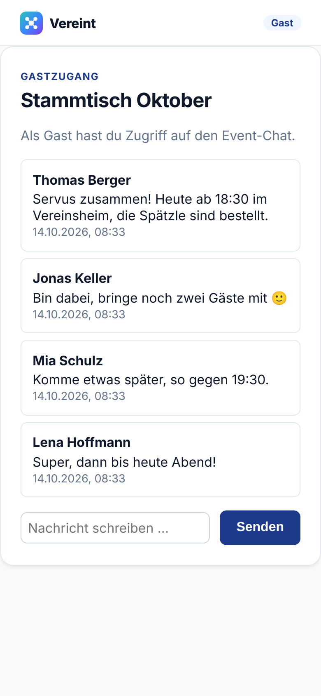

# Leitfaden Gast

Für Gäste ohne Vereinskonto, zum Beispiel Freunde, Familie oder Mitglieder eines befreundeten Vereins. Du brauchst nichts zu installieren und kein Konto anzulegen.

## So kommst du rein

1. Du bekommst vom Gastgeber einen **Einladungslink**, etwa per Messenger.
2. Öffne den Link am Handy oder Rechner.
3. Vereint löst die Einladung sofort ein und zeigt dir das Event. Oben steht **Gast**.

Als Gast siehst du den Titel des Events und den **Event-Chat**:

- Alle Nachrichten der Teilnehmenden, mit Name, Text und Uhrzeit.
- Unten schreibst du in **Nachricht schreiben …** und tippst **Senden**.

 

## Gut zu wissen

- Der Link gilt nur für dieses eine Event und nur für eine begrenzte Zeit. Wie lange und wie oft er genutzt werden darf, legt der Gastgeber fest.
- Jedes Öffnen des Links zählt als eine Nutzung. Lass die Seite deshalb einfach offen, statt den Link immer wieder neu anzutippen.
- Funktioniert der Link nicht mehr, ist er abgelaufen, aufgebraucht oder wurde widerrufen. Bitte den Gastgeber um einen neuen.
- Guthaben, Käufe und andere Vereinsbereiche sind nur für Mitglieder.
