# Die App Bildschirm für Bildschirm

Dieses Kapitel geht jeden Bildschirm von Vereint einzeln durch: was du darauf siehst, wozu die einzelnen Bereiche da sind, was ein Tipp auslöst und wohin es von dort weitergeht. Die Leitfäden der einzelnen Rollen erklären die Abläufe; hier steht das Nachschlagewerk zu jedem Screen.

> **Entwurf / Vorlage.** Dieses Kapitel ist die Vorlage für das Aussehen der App, kein Leitfaden. Alles ohne den Hinweis „Neu im Entwurf“ ist in der App umgesetzt (PR #84) und wird mit echten Bildern in den Leitfäden erklärt: [Erste Schritte](01-erste-schritte.md), [Mitglied](02-mitglied.md), [Vorstand](03-vorstand.md), [Administration](04-administration.md), [Thekenterminal](05-thekenterminal.md) und [Gast](06-gast.md).

**Woher die Bilder stammen.** Die Bilder in diesem Kapitel sind keine Aufnahmen der laufenden App. Sie stammen aus dem **Design-Entwurf** von Vereint, der alle Bildschirme mit Beispieldaten zeigt. Die Quelldateien liegen unter [`docs/design/screens`](../design/screens/README.md). Aufbau und Funktionen entsprechen der App, einzelne Beschriftungen, Abstände und Farben können aber abweichen. Echte Aufnahmen der App stehen in den Leitfäden der Rollen.

**Neu im Entwurf.** Einige Bildschirme zeigen Funktionen, die es in der App noch nicht gibt. Sie sind mit diesem Hinweis markiert:

> **Neu im Entwurf**: Beschreibt geplantes Verhalten. Bis es umgesetzt ist, gilt der jeweilige Leitfaden.

Das betrifft vor allem **Runden nur über das eigene Handy** und die **Statistiken** zu Getränken, Kalorien, Events und Zusagen.

## Inhalt

- [Grundaufbau jeder Seite](#grundaufbau-jeder-seite)
- [Einstieg und Konto](#einstieg-und-konto): Anmelden, Registrieren, Gruppe eröffnen, Einladung als Gast, Gruppe wählen, Abmelden, Fehlerseiten, Impressum
- [Mitglied](#mitglied): Start, Mehr, Mitteilungen, Profil, Events, Chat, Moments, Kalender, Freunde, Guthaben, Bezahlen, Käufe, Katalog, Runde ausgeben, Statistiken
- [Vorstand](#vorstand): Vorstandsübersicht, Events verwalten, Abrechnung, Kasse, Kommunikation, Moments, Katalog, Getränkedatenbank, Getränkelisten, Strich-Kategorien, Kiosk-Geräte
- [Thekenterminal](#thekenterminal): Strichliste, Rückgängig, Laufende Runden, Kiosk-Modus
- [Administration](#administration): Mitglieder und Rollen, Mitglied bearbeiten, Einladen, Gruppeneinstellungen, Rollen und Berechtigungen, Plattform
- [Welcher Bildschirm wofür?](#welcher-bildschirm-wofür)

## Grundaufbau jeder Seite

Am **Handy** hat jede Seite drei feste Teile:

- **Kopfzeile** oben: links das Vereint-Logo und der Seitenname, auf Unterseiten stattdessen ein Pfeil **Zurück**. Rechts stehen Kürzel und Name der offenen Gruppe (antippen führt zu **Gruppe wählen**) und die **Glocke** mit der Zahl ungelesener Mitteilungen.
- **Inhalt** in der Mitte. Er scrollt, Kopfzeile und Leiste bleiben stehen.
- **Untere Leiste** mit **Start**, **Events**, **Chat**, **Guthaben** und **Mehr**. Der aktive Bereich ist hinterlegt. Am **Chat** zeigt eine rote Zahl ungelesene Nachrichten.

Am **Rechner** ersetzt eine **Seitenleiste** links die untere Leiste. Sie gliedert alle Bereiche in **Gruppe**, **Mein Konto**, **Theke** und **Verwaltung**; ungelesene Mitteilungen und Chats tragen rote Zahlen. Das **Thekenterminal** läuft quer auf dem Tablet und hat einen eigenen Aufbau (siehe [Thekenterminal](#thekenterminal)).

Was jemand sieht, hängt von den Rollen in der offenen Gruppe ab. Bereiche ohne Berechtigung erscheinen nicht. Ruft jemand eine solche Seite trotzdem auf, erscheint [Kein Zugriff](#kein-zugriff-und-nicht-gefunden).

---

## Einstieg und Konto

### Anmelden

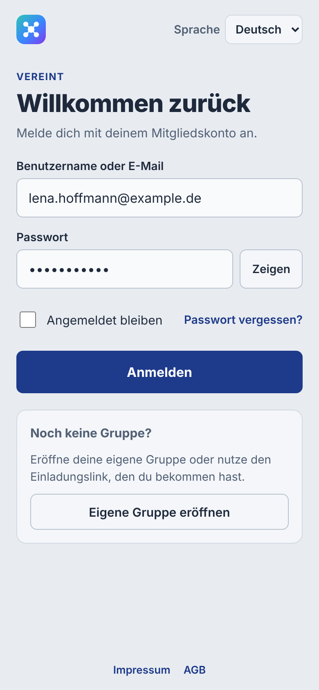

Die erste Seite für alle mit Konto.

- **Sprache** oben: **Deutsch** oder **English**, gilt sofort für die Anmeldeseite.
- **Benutzername oder E-Mail** und **Passwort**. **Zeigen** blendet das Passwort im Klartext ein, um Tippfehler zu finden.
- **Angemeldet bleiben**: Das Gerät merkt sich die Anmeldung. Nur auf dem eigenen Gerät anhaken.
- **Anmelden** führt zur Startseite, bei mehreren Gruppen vorher zu [Gruppe wählen](#gruppe-wählen).
- **Noch keine Gruppe?** erklärt die zwei Wege hinein: per Einladungslink oder mit **Eigene Gruppe eröffnen**.
- Unten: **Impressum** und **AGB**.

Der Entwurf zeigt einen Link **Passwort vergessen?**. In der App gibt es ihn derzeit nicht, weil Vereint keine E-Mails verschickt; ein vergessenes Passwort setzt der Admin über den Betreiber zurück (siehe [Erste Schritte](01-erste-schritte.md#anmelden)).

 

### Registrieren mit Einladungslink

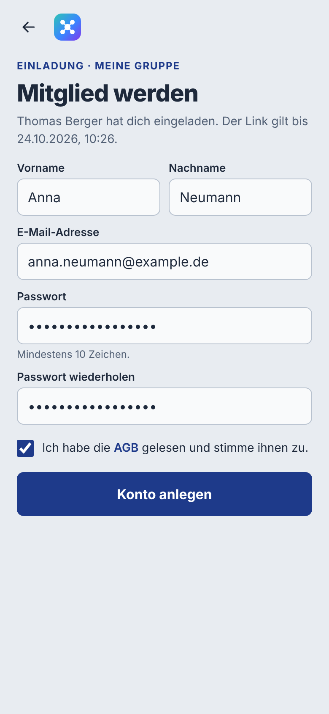

Diese Seite öffnet sich, wenn jemand einen Einladungslink der Gruppe antippt.

- Oben stehen **Gruppe**, **wer eingeladen hat** und **bis wann der Link gilt**. So erkennt man sofort, ob der Link echt und noch gültig ist.
- **Vorname**, **Nachname**, **E-Mail-Adresse**: daraus entsteht das Konto. Der Name ist für die anderen sichtbar und lässt sich später im Profil als Anzeigename ändern.
- **Passwort** (mindestens 10 Zeichen) und **Passwort wiederholen**.
- **AGB**-Haken: ohne Zustimmung kein Konto.
- **Konto anlegen** legt Konto und Mitgliedschaft in einem Schritt an. Danach meldet man sich wie gewohnt an.

Wer schon ein Konto hat, braucht diese Seite nicht: anmelden und den Link noch einmal öffnen.

 

### Gruppe eröffnen

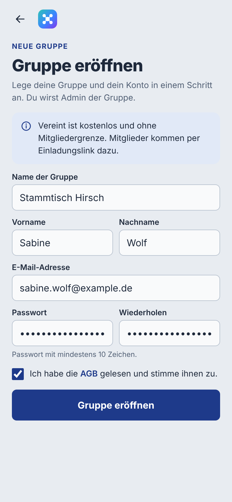

Für alle, die eine eigene Gruppe gründen wollen. Die Person wird **Admin** der neuen Gruppe.

- **Name der Gruppe**, dazu Vorname, Nachname, E-Mail und Passwort (zweimal). Wer schon angemeldet ist, sieht nur das Feld für den Gruppennamen.
- Der Hinweiskasten erinnert: Vereint ist kostenlos und ohne Mitgliedergrenze. Mitglieder kommen per Einladungslink dazu.
- **Gruppe eröffnen** legt Konto und Gruppe zusammen an. Danach geht es weiter in die **Gruppeneinstellungen**.

Pro Person sind höchstens drei eigene Gruppen möglich.

 

### Einladung annehmen (Gast)

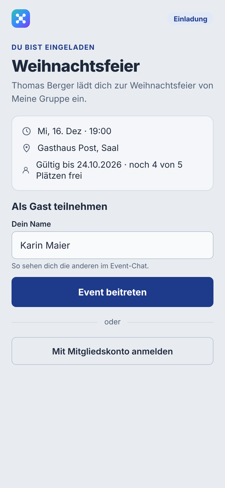

Gäste ohne Konto kommen über einen **Gastlink** zu einem einzelnen Event.

- Oben stehen **Event**, **Gastgeber**, **Datum und Uhrzeit** und **Ort**.
- Darunter, wie lange der Link gilt und wie viele **Plätze** noch frei sind. Der Gastgeber legt beides beim Erzeugen fest.
- **Dein Name**: So erscheint der Gast im Event-Chat.
- **Event beitreten** öffnet die [Gast-Ansicht](#gast-ansicht-eines-events).
- **Mit Mitgliedskonto anmelden** ist für alle, die doch ein Konto haben.

 

### Gast-Ansicht eines Events

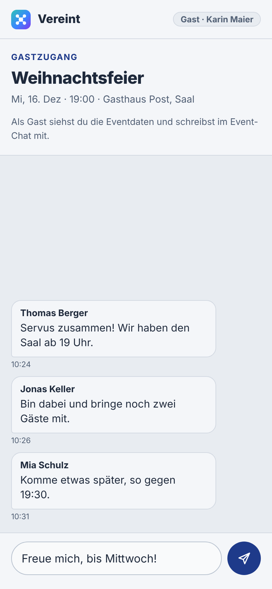

Was ein Gast nach dem Beitritt sieht:

- Kopfzeile mit **Gast · Name**, damit klar ist, in welcher Rolle man unterwegs ist.
- **Eventdaten**: Titel, Datum, Uhrzeit, Ort.
- Darunter der **Event-Chat** mit allen Eingeladenen. Unten **Nachricht** eintippen und senden.

Mehr sehen Gäste nicht: kein Guthaben, keine Strichliste, keine anderen Events.

 

### Gruppe wählen

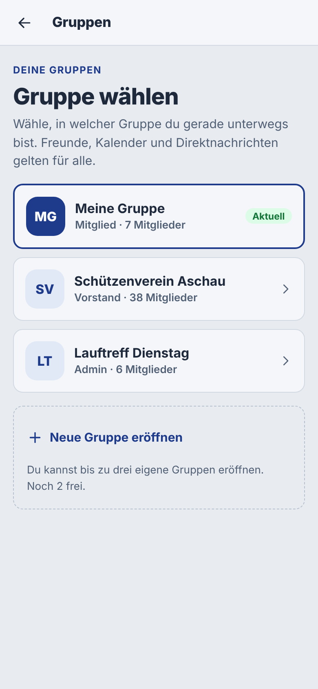

Erscheint nach der Anmeldung, wenn jemand in mehreren Gruppen ist, und jederzeit über den Gruppennamen oben rechts.

- Jede Gruppe steht mit **Kürzel**, **Name**, **deiner Rolle** und **Mitgliederzahl** in einer Zeile.
- **Aktuell** markiert die gerade offene Gruppe. Ein Tipp auf eine andere wechselt hinein; Events, Chat, Guthaben und Katalog zeigen danach deren Daten.
- **Freunde**, **Kalender** und **Direktnachrichten** gelten über alle Gruppen, sie ändern sich beim Wechsel nicht.
- **Neue Gruppe eröffnen** unten zeigt, wie viele der drei eigenen Gruppen noch frei sind.

 

### Abgemeldet

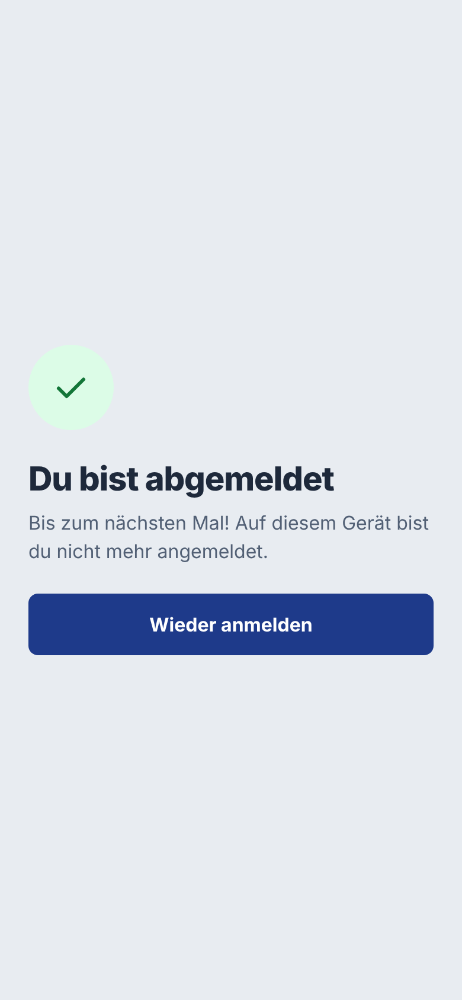

Bestätigt die Abmeldung über **Mehr → Abmelden**. Auf diesem Gerät ist niemand mehr angemeldet. **Wieder anmelden** führt zurück zur Anmeldeseite.

 

### Kein Zugriff und Nicht gefunden

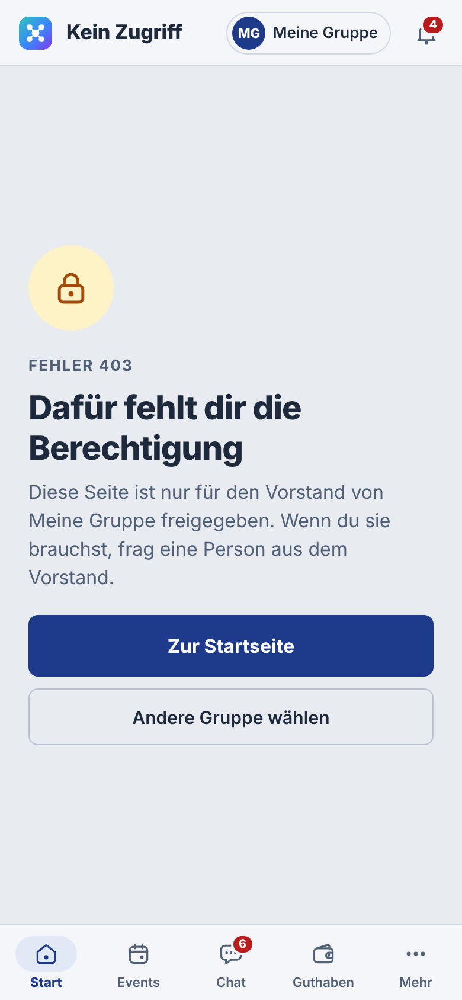

**Fehler 403 – Kein Zugriff** erscheint, wenn eine Seite Rechte braucht, die die eigene Rolle in der offenen Gruppe nicht hat, zum Beispiel ein Link auf die Vorstandsseite.

- Der Text nennt, für wen die Seite freigegeben ist, und wen man fragen kann.
- **Zur Startseite** und **Andere Gruppe wählen**: Oft ist man nur in der falschen Gruppe.

 

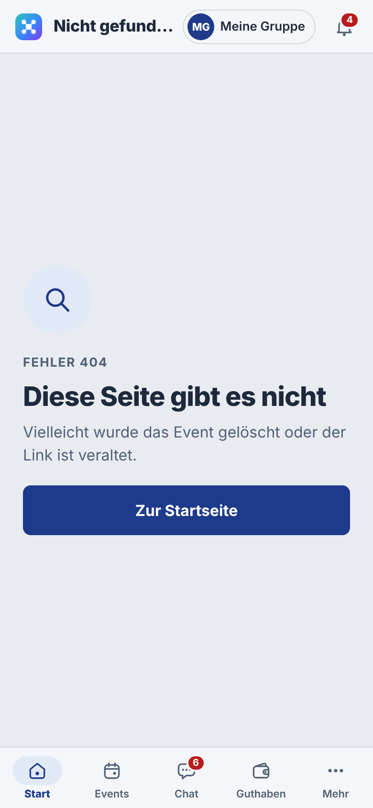

**Fehler 404 – Nicht gefunden** erscheint bei veralteten oder falschen Links, etwa zu einem gelöschten Event. **Zur Startseite** führt zurück.

 

### Impressum und AGB

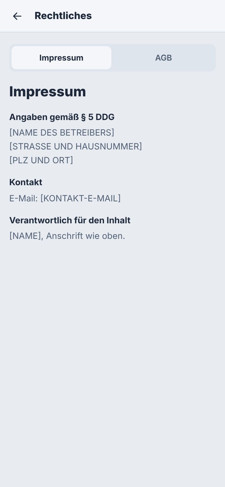

Erreichbar von der Anmeldeseite und ganz unten im Mehr-Menü. Oben wechseln zwei Reiter zwischen **Impressum** und **AGB**. Platzhalter in eckigen Klammern füllt der Betreiber aus; solange sie fehlen, zeigt die App einen Hinweis „Entwurf“.

 

---

## Mitglied

### Start

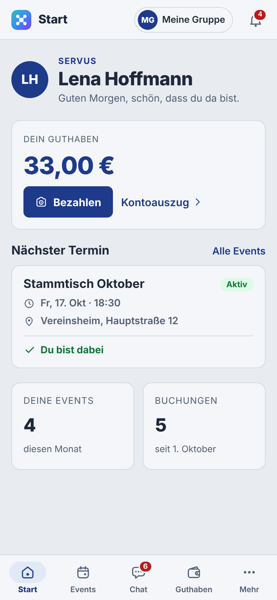

Die Startseite beantwortet die drei häufigsten Fragen: Wie viel Guthaben habe ich? Wann ist das nächste Treffen? Was ist neu?

- **Begrüßung** mit Kürzel und Namen.
- **Dein Guthaben** mit dem aktuellen Stand. **Bezahlen** startet den [Strichcode-Scan](#bezahlen), **Kontoauszug** öffnet das [Guthaben](#guthaben) mit allen Buchungen.
- **Nächster Termin**: Titel, Status (z. B. **Aktiv**), Datum, Uhrzeit, Ort und deine Antwort („Du bist dabei“). Ein Tipp öffnet das [Event](#event). **Alle Events** führt zur Liste.
- **Deine Events** (Anzahl in diesem Monat) und **Buchungen** (seit Monatsbeginn) als Kennzahlen.

 

### Mehr

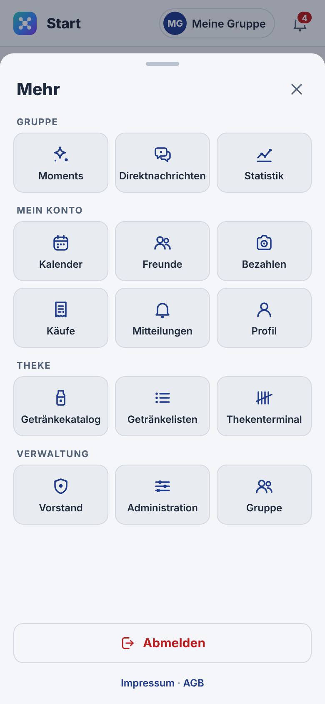

Alles, was nicht in die untere Leiste passt, sortiert nach Bereichen:

- **Gruppe**: [Moments](#moments), [Direktnachrichten](#direktnachrichten), [Statistik](#statistik)
- **Mein Konto**: [Kalender](#kalender), [Freunde](#freunde), [Bezahlen](#bezahlen), [Käufe](#käufe), [Mitteilungen](#mitteilungen), [Profil](#profil)
- **Theke**: [Getränkekatalog](#getränkekatalog), [Getränkelisten](#getränkelisten), [Thekenterminal](#strichliste)
- **Verwaltung**, nur mit den Rechten dazu: [Vorstand](#vorstandsübersicht), [Administration](#mitglieder-und-rollen), [Gruppe](#gruppeneinstellungen)

Ganz unten **Abmelden**, darunter **Impressum · AGB**. Am Handy öffnet sich das Menü als Blatt von unten; nach unten wischen oder daneben tippen schließt es.

 

### Mitteilungen

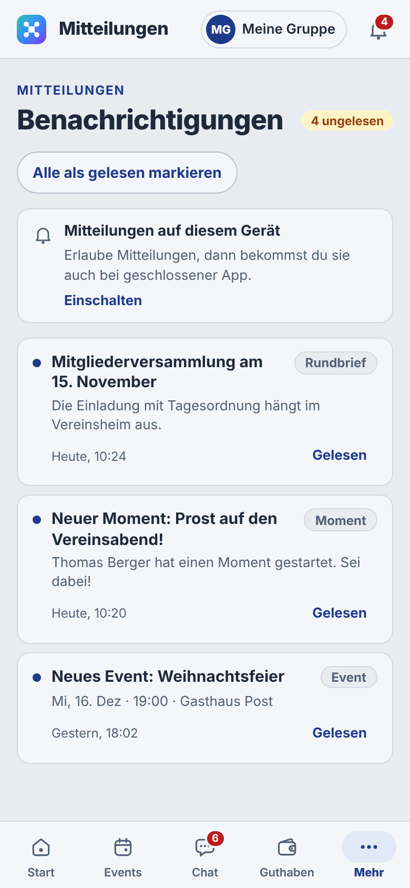

Die Glocke sammelt alles, was die Gruppe dir mitteilt.

- Oben die Zahl **ungelesen** und **Alle als gelesen markieren**.
- **Mitteilungen auf diesem Gerät**: **Einschalten** aktiviert Push, damit Mitteilungen auch bei geschlossener App ankommen. Die Einstellung gilt je Gerät.
- Jede Mitteilung trägt eine **Art** (**Rundbrief**, **Moment**, **Event**), einen kurzen Text und die Zeit. Ungelesene sind hervorgehoben; **Gelesen** markiert eine einzelne.
- Ein Tipp auf die Mitteilung führt zum Inhalt, etwa zum Event oder zum Moment.

 

### Profil

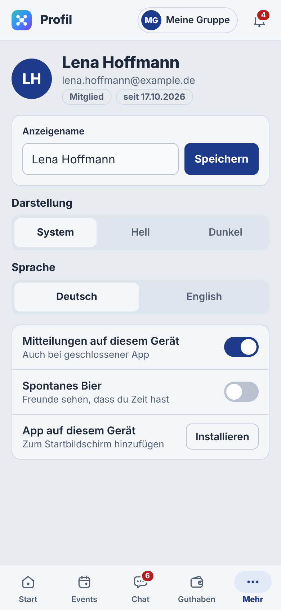

Kontodaten und persönliche Einstellungen.

- Kopf mit Kürzel, Name, E-Mail, **Rolle** und **Mitglied seit**.
- **Anzeigename**: So sehen dich die anderen in Chat, Teilnehmerlisten und an der Theke. **Speichern** übernimmt ihn.
- **Darstellung**: **System**, **Hell** oder **Dunkel**.
- **Sprache**: **Deutsch** oder **English**, gilt sofort für die ganze App.
- **Mitteilungen auf diesem Gerät**: Push ein- oder ausschalten.
- **Spontanes Bier**: Freunde sehen, dass du gerade Zeit hast. In der App heißt das derzeit „BeerWithMe Status“ und ist noch eine Vorschau.
- **App auf diesem Gerät**: **Installieren** legt Vereint auf den Startbildschirm.

 

### Events

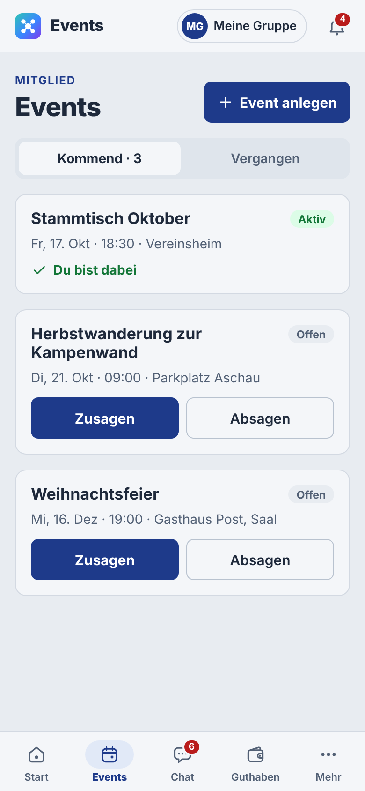

Alle Events der Gruppe, zu denen du eingeladen bist oder die du selbst angelegt hast.

- **Event anlegen** oben rechts (siehe [Event anlegen](#event-anlegen)).
- Reiter **Kommend** (mit Anzahl) und **Vergangen**.
- Jede Karte zeigt Titel, Status, Datum, Uhrzeit und Ort:
  - **Aktiv**: Der Abend läuft, die Theke ist offen. Hast du zugesagt, steht „Du bist dabei“.
  - **Offen**: Du hast noch nicht geantwortet. **Zusagen** und **Absagen** stehen direkt in der Karte.
- Ein Tipp auf die Karte öffnet das [Event](#event).

 

### Event

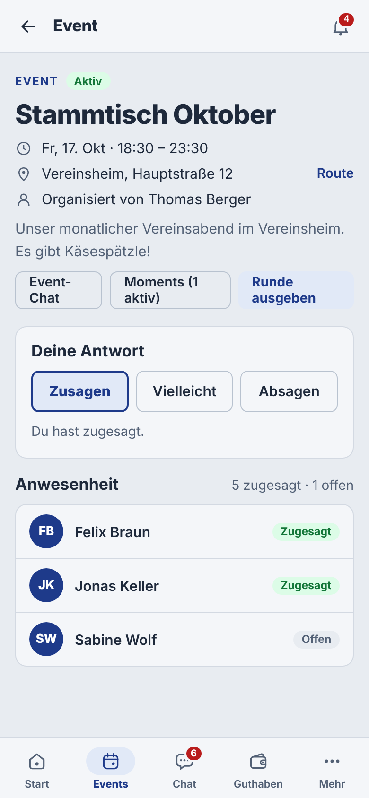

Alles zu einem Termin auf einer Seite.

- **Status**, **Titel**, **Datum mit Beginn und Ende**, **Ort** mit **Route** (öffnet die Navigation) und **Gastgeber**.
- **Beschreibung** des Gastgebers.
- Drei Schnellzugänge:
  - **Event-Chat** mit allen Eingeladenen,
  - **Moments** mit der Zahl laufender Moments,
  - **Runde ausgeben** (siehe [Runde ausgeben](#runde-ausgeben)).
- **Deine Antwort**: **Zusagen**, **Vielleicht** oder **Absagen**. Die aktuelle Wahl ist hervorgehoben und lässt sich bis zum Event ändern.
- **Anwesenheit**: Zusammenfassung („5 zugesagt · 1 offen“) und die Liste der Eingeladenen mit ihrer Antwort.

 

### Event anlegen

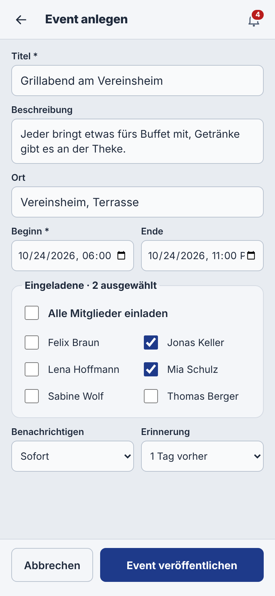

Jedes Mitglied kann ein Event anlegen und ist dann Gastgeber.

- **Titel** und **Beginn** sind Pflicht (mit Stern markiert). **Beschreibung**, **Ort** und **Ende** sind freiwillig.
- **Eingeladene**: Mitglieder einzeln anhaken oder **Alle Mitglieder einladen**. Oben steht, wie viele ausgewählt sind.
- **Benachrichtigen**: **Sofort** beim Veröffentlichen oder **Zu einem Zeitpunkt**, etwa eine Woche vorher.
- **Erinnerung**: **1 Tag vorher**, **1 Woche vorher** oder **Keine**.
- **Event veröffentlichen** verschickt die Einladungen. **Abbrechen** verwirft alles.

Danach verwaltest du das Event unter [Event verwalten](#event-verwalten).

 

### Event-Chat

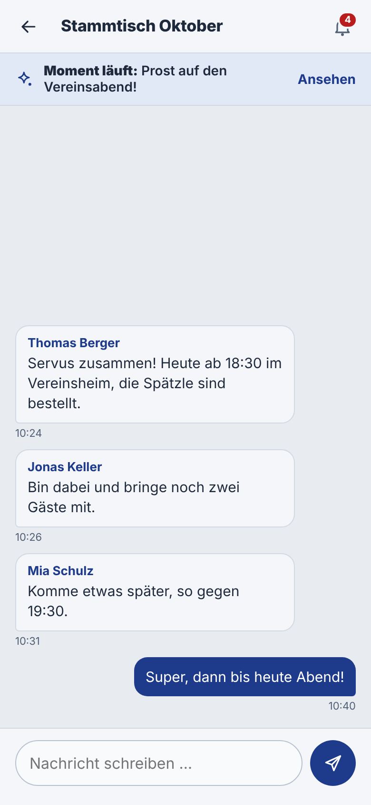

Der Chat aller Eingeladenen eines Events, etwa für Fahrgemeinschaften oder Absprachen.

- Kopfzeile mit dem Eventnamen.
- Läuft gerade ein Moment, steht oben ein Hinweis („Moment läuft: …“) mit **Ansehen**.
- Nachrichten anderer stehen links mit Name und Uhrzeit, eigene rechts.
- Unten **Nachricht** eintippen und senden.

 

### Chat

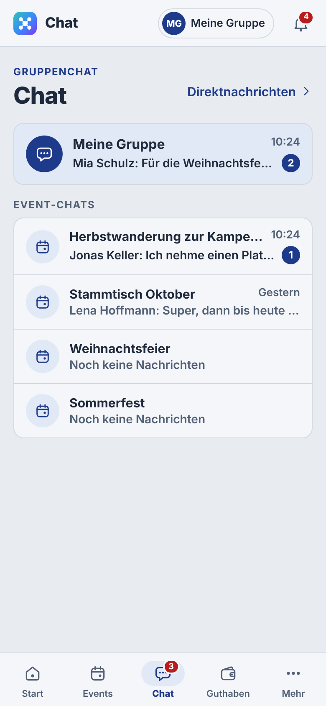

Die Übersicht aller Unterhaltungen der Gruppe.

- **Direktnachrichten** oben rechts wechselt zu den [Gesprächen zu zweit](#direktnachrichten).
- **Gruppenchat**: eine Zeile für die ganze Gruppe mit letzter Nachricht, Uhrzeit und Zahl ungelesener Nachrichten.
- **Event-Chats**: ein Chat je Event, ebenfalls mit letzter Nachricht. Steht dort „Noch keine Nachrichten“, hat noch niemand geschrieben.

 

### Gruppenchat

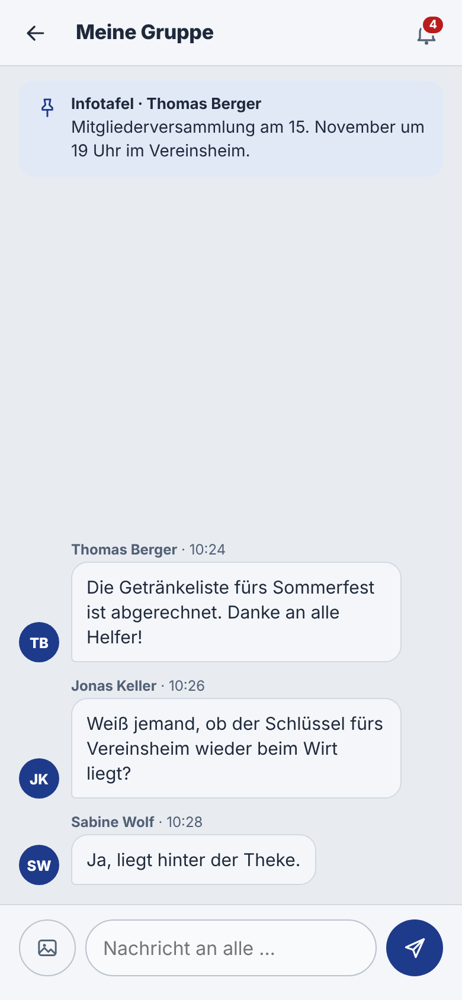

Der Chat aller Mitglieder.

- Oben die **Infotafel**: ein vom Vorstand angehefteter Hinweis, etwa ein wichtiger Termin. Sie bleibt stehen, auch wenn weiter geschrieben wird (siehe [Kommunikation](#kommunikation)).
- Darunter die Nachrichten mit Kürzel, Name und Uhrzeit.
- Unten **Nachricht** eintippen und senden.

 

### Direktnachrichten

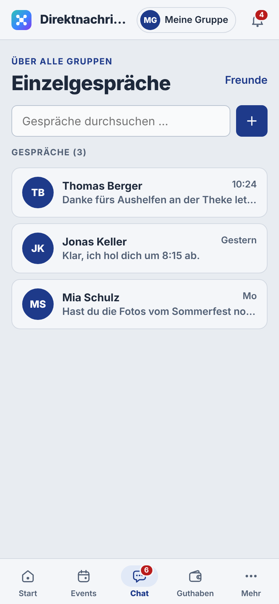

Gespräche zu zweit, **über alle Gruppen**: Mit jeder Person gibt es genau ein Gespräch.

- **Freunde** oben rechts führt zur [Freundesliste](#freunde).
- **Gespräche durchsuchen** filtert nach Namen.
- **Gespräche** mit Zahl: jede Zeile mit Kürzel, Name, Zeit und letzter Nachricht.

 

### Freunde

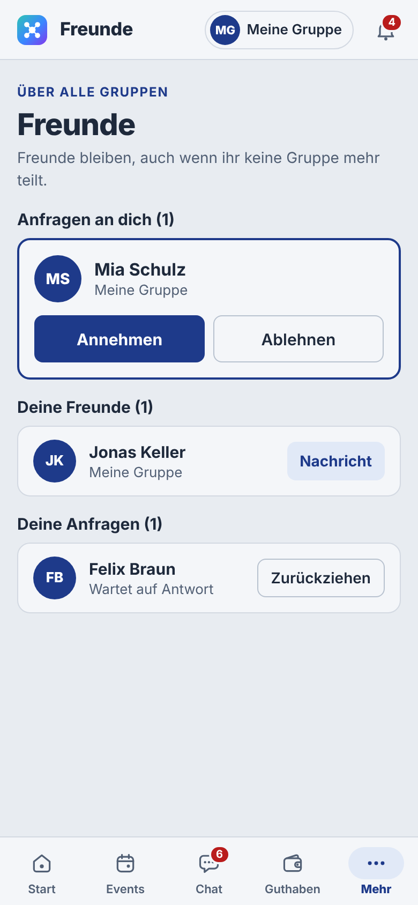

Die Freundesliste gilt über alle Gruppen. Freunde bleiben, auch wenn ihr keine Gruppe mehr teilt.

- **Anfragen an dich**: **Annehmen** oder **Ablehnen**.
- **Deine Freunde**: mit der gemeinsamen Gruppe und **Nachricht** für das Direktgespräch.
- **Deine Anfragen**: gestellte Anfragen mit „Wartet auf Antwort“ und **Zurückziehen**.

 

### Kalender

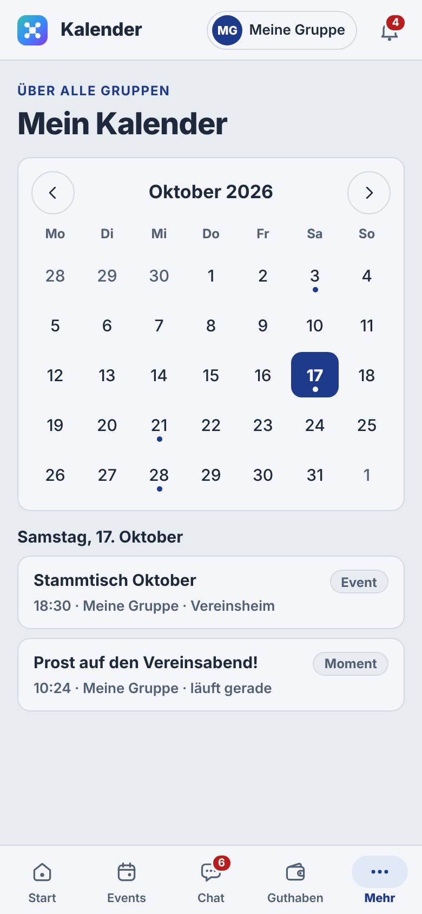

Alle Termine aus allen Gruppen an einem Ort.

- Monatsansicht mit **Wochentagen**; Tage mit Einträgen sind markiert, der gewählte Tag ist hervorgehoben.
- Darunter die **Einträge des gewählten Tags**: Events und Moments, jeweils mit Uhrzeit, **Gruppe** und Ort bzw. Stand („läuft gerade“).
- Ein Tipp auf einen Eintrag öffnet das Event oder den Moment; gehört er zu einer anderen Gruppe, wechselt die App vorher dorthin.

 

### Moments

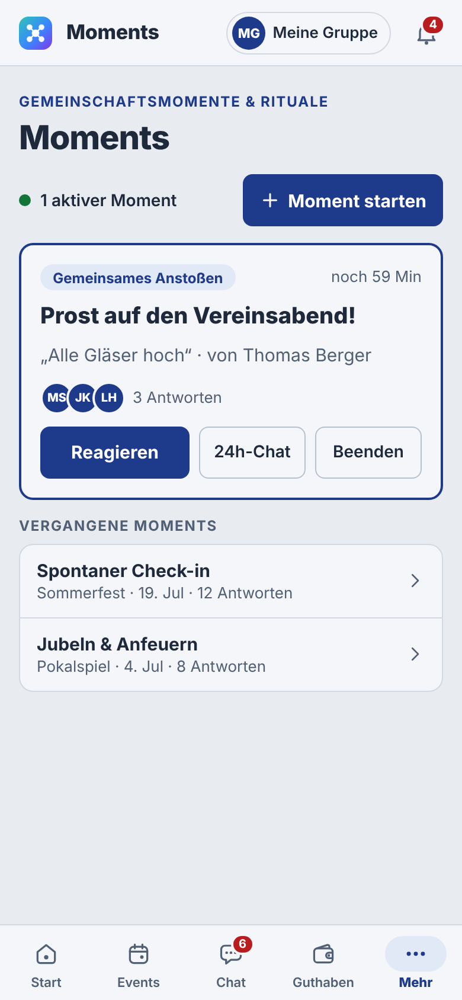

Ein Moment ist eine kurze gemeinsame Aktion während eines Events, zum Beispiel gemeinsames Anstoßen.

- Oben die Zahl aktiver Moments und **Moment starten**.
- **Laufender Moment** als große Karte: **Typ**, verbleibende Zeit („noch 59 Min“), Titel, Nachricht und wer ihn gestartet hat. Kürzel zeigen, wer schon reagiert hat, daneben die Zahl der Antworten.
- Aktionen: **Reagieren**, **24h-Chat** (ein Chat nur zu diesem Moment) und **Beenden** für die Person, die ihn gestartet hat.
- **Vergangene Moments** mit Typ, Event, Datum und Zahl der Antworten.

Welche Typen und Reaktionen es gibt, legt der Vorstand fest (siehe [Moments: Typen und Reaktionen](#moments-typen-und-reaktionen)).

 

### Moment

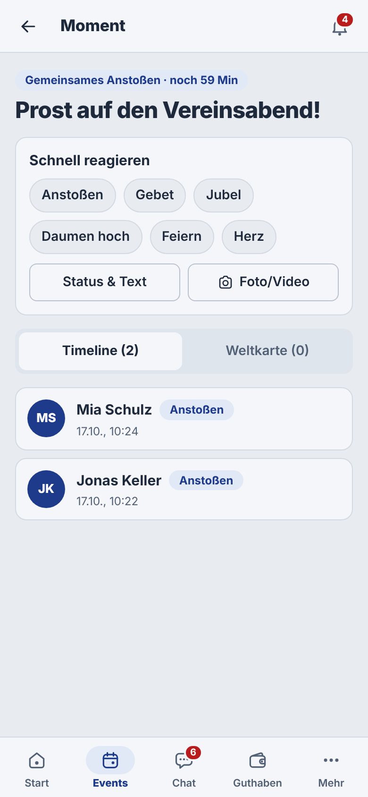

Die Detailseite eines Moments.

- Kopf mit Typ, Restzeit und Titel.
- **Schnell reagieren**: ein Tipp auf **Anstoßen**, **Gebet**, **Jubel**, **Daumen hoch**, **Feiern** oder **Herz** reagiert sofort.
- **Status & Text**: eine Reaktion mit eigenem Satz.
- **Foto/Video**: bis zu vier Bilder oder Videos anhängen. Standort- und Gerätedaten werden entfernt.
- **Timeline** zeigt alle Reaktionen mit Name und Zeit; **Weltkarte** zeigt, wer den Standort freiwillig geteilt hat.

 

### Guthaben

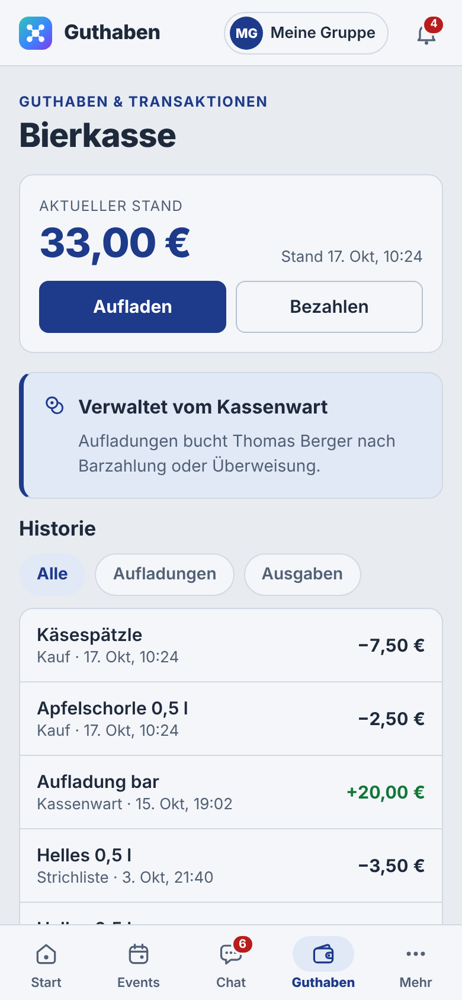

Dein Konto in der Bierkasse der Gruppe.

- **Aktueller Stand** mit Datum und Uhrzeit. Ein Minus erscheint in Rot.
- **Aufladen** erklärt, wie Geld aufs Konto kommt; **Bezahlen** startet den Scan.
- **Verwaltet vom Kassenwart**: Aufladungen bucht der Kassenwart nach Barzahlung oder Überweisung. Selbst aufladen geht nicht.
- **Historie** mit Filtern **Alle**, **Aufladungen**, **Ausgaben**. Jede Zeile nennt Artikel, Art (Kauf, Strichliste, Aufladung), Zeit und Betrag; Abbuchungen mit Minus, Aufladungen mit Plus.

 

### Bezahlen

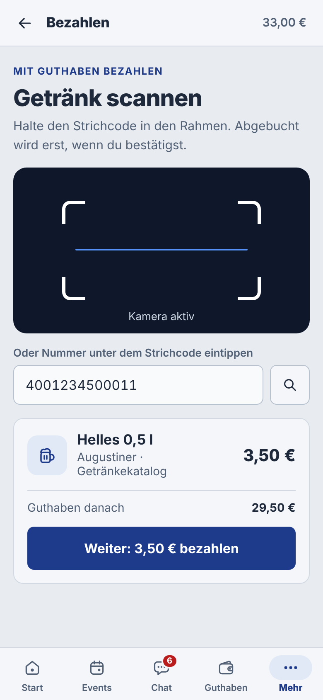

Ein Getränk selbst mit Guthaben bezahlen, etwa am Kühlschrank ohne Thekendienst. Das geht während eines laufenden Events, zu dem du gehörst.

- Oben rechts steht dein **Guthaben**.
- **Kamerafenster**: Strichcode in den Rahmen halten. Die Kamera fragt beim ersten Mal nach Erlaubnis.
- **Oder Nummer unter dem Strichcode eintippen**, falls der Scan nicht klappt.
- Nach dem Erkennen erscheinen **Getränk**, Herkunft im Katalog, **Preis** und **Guthaben danach**.
- **Weiter: … bezahlen** führt zur Bestätigung. Abgebucht wird noch nicht.

 

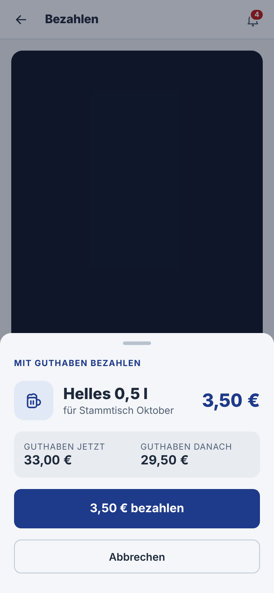

**Bestätigen**: Getränk, **für welches Event**, Preis, **Guthaben jetzt** und **Guthaben danach** stehen noch einmal untereinander. Erst **… bezahlen** bucht ab; **Abbrechen** bucht nichts. Laufen mehrere Events, wählst du hier das richtige.

 

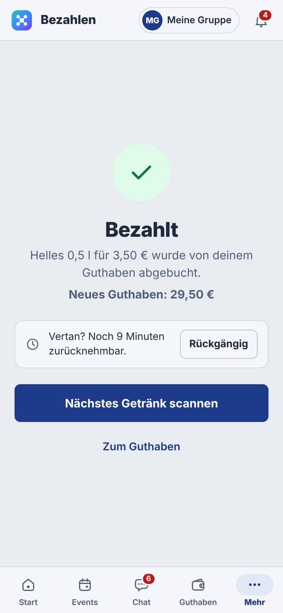

**Bezahlt**: Bestätigung mit Getränk, Betrag und **neuem Guthaben**.

- **Rückgängig** nimmt den Kauf zurück, solange die angezeigte Frist läuft (insgesamt 10 Minuten).
- **Nächstes Getränk scannen** startet gleich den nächsten Kauf.
- **Zum Guthaben** zeigt die Buchung in der Historie.

 

### Käufe

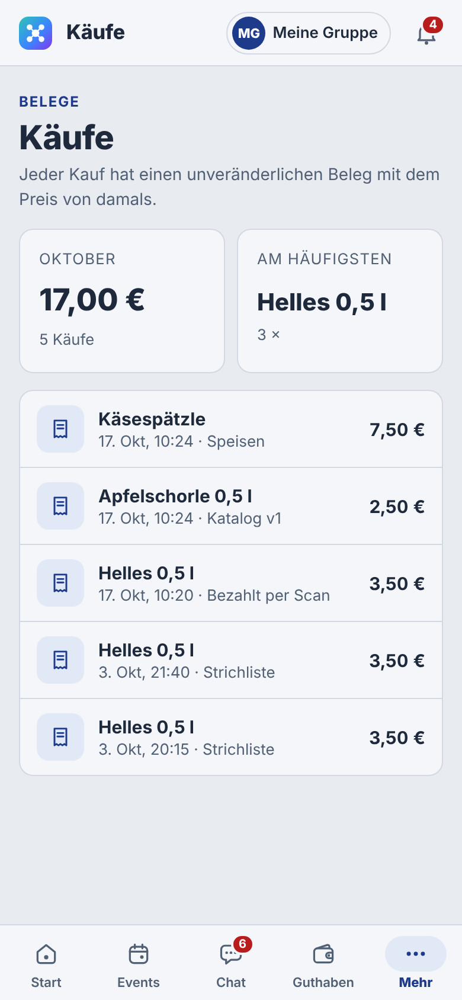

Jeder Kauf als Beleg, egal ob über die Strichliste, per Scan oder als Speise.

- Kennzahlen des Monats: **Summe** und **Anzahl Käufe**, dazu **Am häufigsten** gekauft.
- Liste aller Käufe mit Artikel, Zeit, **Herkunft** (Strichliste, Bezahlt per Scan, Speisen, Katalog-Version) und Preis.

Ein Beleg ist unveränderlich: Der Preis bleibt der von damals, auch wenn sich der Katalog später ändert.

 

### Getränkekatalog

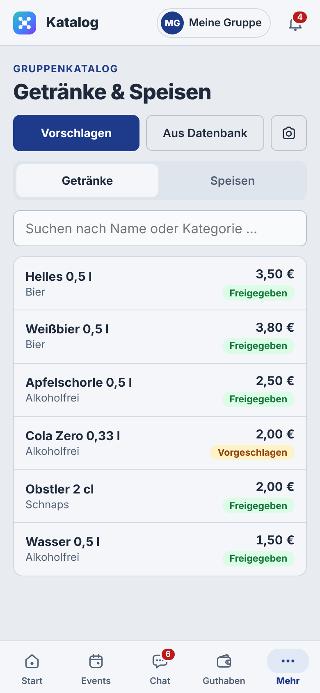

Alle Getränke und Speisen der Gruppe.

- **Vorschlagen**: ein fehlendes Getränk mit Name, Kategorie, Preis und Strichcode vorschlagen.
- **Aus Datenbank**: ein Getränk aus der gemeinsamen [Getränkedatenbank](#getränkedatenbank) übernehmen.
- Reiter **Getränke** und **Speisen**, darunter **Suchen**.
- Jede Zeile: Name, **Kategorie**, Preis und Status. **Freigegeben** ist im Verkauf; **Vorgeschlagen** wartet auf die [Freigabe durch den Vorstand](#katalog-freigabe).

 

### Runde ausgeben

> **Neu im Entwurf**: In der App wird eine Runde derzeit am Thekenterminal gebucht (siehe [Leitfaden Thekenterminal](05-thekenterminal.md#runde-ausgeben-oder-ganzen-abend-stiften)).

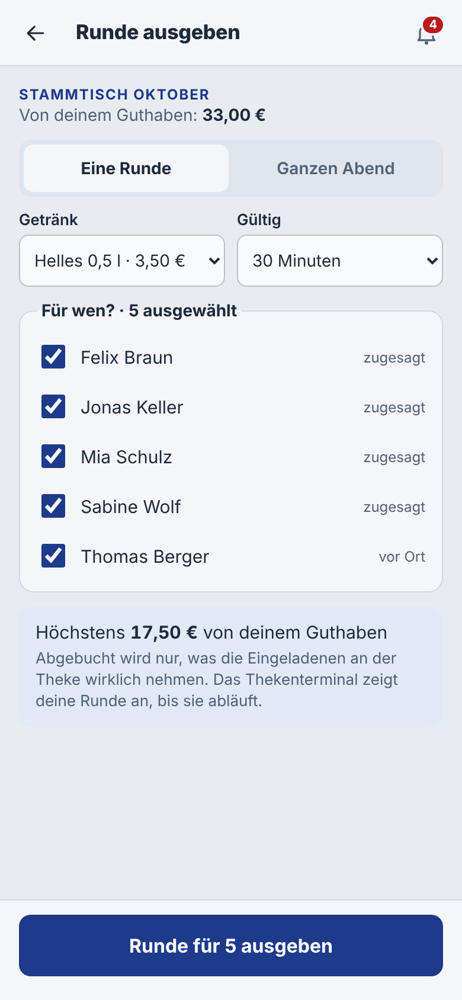

Eine Runde gibt jede Person **nur am eigenen Handy** und **mit dem eigenen Guthaben** aus. Erreichbar über **Runde ausgeben** im [Event](#event).

- Oben: das Event und **Von deinem Guthaben** mit dem aktuellen Stand.
- **Eine Runde** (ein Getränk je Person) oder **Ganzen Abend** (alles bis zum Ende).
- **Getränk**: ein bestimmtes Getränk mit Preis oder **Alle Getränke**.
- **Gültig**: **30 Minuten**, **1 Stunde** oder **Bis Event-Ende**.
- **Für wen?**: Personen anhaken; neben dem Namen steht, ob sie zugesagt haben oder vor Ort sind.
- Unten die **Höchstsumme**, die vom Guthaben abgehen kann, und der Hinweis: Abgebucht wird nur, was die Eingeladenen an der Theke wirklich nehmen.
- **Runde für … ausgeben** startet die Runde. Das Thekenterminal zeigt sie an, bis sie abläuft.

 

### Statistik

> **Neu im Entwurf**: Die Links zur Getränkestatistik und zur Übersicht sowie die Zeitraum-Auswahl gibt es in der App noch nicht.

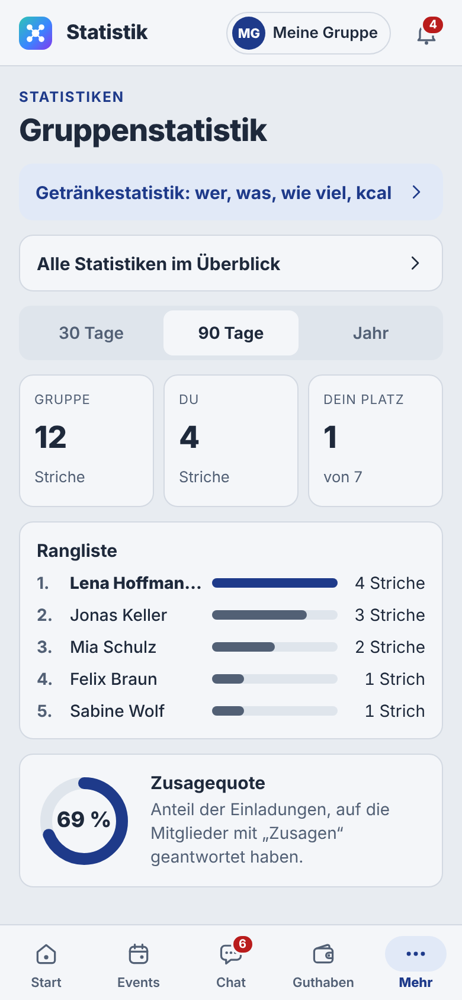

Der Einstieg in die Auswertungen der Gruppe. Alle Statistiken sind **für alle Mitglieder sichtbar**.

- **Getränkestatistik: wer, was, wie viel, kcal** und **Alle Statistiken im Überblick** führen zu den ausführlichen Auswertungen.
- **Zeitraum**: **30 Tage**, **90 Tage** oder **Jahr**.
- Kennzahlen: Striche der **Gruppe**, **deine** Striche und **dein Platz**.
- **Rangliste** mit Balken; dein Eintrag ist hervorgehoben.
- **Zusagequote**: Anteil der Einladungen, auf die mit „Zusagen“ geantwortet wurde.

 

### Getränkestatistik

> **Neu im Entwurf**

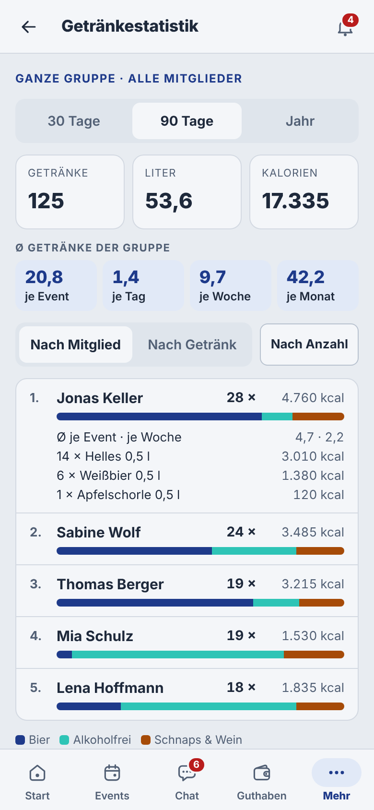

Wer hat wie viel von was getrunken, über die ganze Gruppe.

- **Zeitraum**: 30 Tage, 90 Tage oder Jahr.
- Kennzahlen: **Getränke**, **Liter** und **Kalorien** der Gruppe.
- **Ø Getränke der Gruppe** **je Event**, **je Tag**, **je Woche** und **je Monat**.
- Ansicht **Nach Mitglied** oder **Nach Getränk**, sortiert **Nach Anzahl** oder nach Kalorien.
- Je Mitglied: Platz, Anzahl, Kalorien, Durchschnitt je Event und je Woche und aufgeklappt die einzelnen Getränke mit Menge und Kalorien.
- Die Kalorien je Portion stammen aus der Getränkedatenbank.

 

### Statistik-Übersicht

> **Neu im Entwurf**

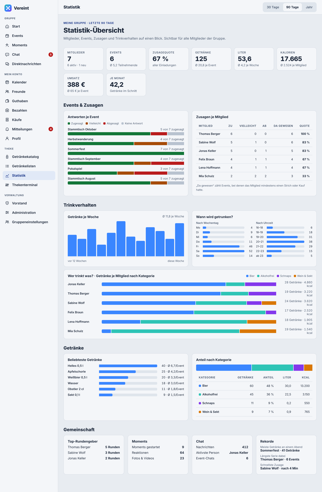

Alle Kennzahlen der Gruppe auf einer Seite, gedacht für den Rechner. Sichtbar für alle Mitglieder. Oben rechts der **Zeitraum** (30 Tage, 90 Tage, Jahr).

**Kennzahlen**: **Mitglieder** (aktiv und neu), **Events** mit Ø Teilnehmenden, **Zusagequote**, **Getränke** mit Ø je Event, **Liter** mit Ø je Woche, **Kalorien** mit Ø je Mitglied, **Umsatz** mit Ø je Event und **Getränke je Monat**.

**Events & Zusagen**

- **Antworten je Event**: ein Balken pro Event, aufgeteilt in **Zugesagt**, **Vielleicht**, **Abgesagt** und **Keine Antwort**, daneben „x von y zugesagt“.
- **Zusagen je Mitglied**: Tabelle mit **Zu**, **Vielleicht**, **Ab**, **Da gewesen** und **Quote**. „Da gewesen“ zählt Events, bei denen das Mitglied mindestens einen Strich oder Kauf hatte. So sieht man, wer zusagt und auch kommt.

**Trinkverhalten**

- **Getränke je Woche** als Säulen; mit der Maus auf eine Säule zeigt den Wert der Woche, sonst steht dort der Wochendurchschnitt.
- **Wann wird getrunken?**: Verteilung **nach Wochentag** und **nach Uhrzeit**.
- **Wer trinkt was?**: je Mitglied ein Balken nach Kategorie (**Bier**, **Alkoholfrei**, **Schnaps**, **Wein & Sekt**) mit Gesamtzahl und Kalorien.

**Getränke**

- **Beliebteste Getränke** mit Anzahl und Ø je Event.
- **Anteil nach Kategorie**: Balken und Tabelle mit Getränken, Anteil, Litern und Kalorien.

**Gemeinschaft**: **Top-Rundengeber**, **Moments** (gestartet, Reaktionen, Fotos und Videos), **Chat** (Nachrichten, aktivste Person, Event-Chats) und **Rekorde** (meiste Getränke an einem Abend, längste Serie dabei, schnellste Zusage).

---

## Vorstand

### Vorstandsübersicht

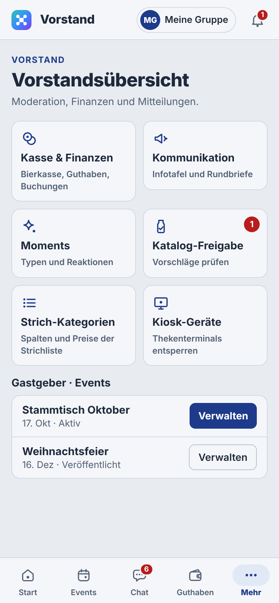

Der Einstieg für den Vorstand. Welche Kacheln erscheinen, hängt von den Rechten ab.

- **Kasse & Finanzen**: Bierkasse, Guthaben, Buchungen.
- **Kommunikation**: Infotafel und Rundbriefe.
- **Moments**: Typen und Reaktionen.
- **Katalog-Freigabe**: Vorschläge prüfen; die rote Zahl nennt offene Vorschläge.
- **Strich-Kategorien**: Spalten und Preise der Strichliste.
- **Kiosk-Geräte**: Thekenterminals entsperren.
- **Gastgeber · Events**: deine Events mit Datum und Status und **Verwalten**.

 

### Event verwalten

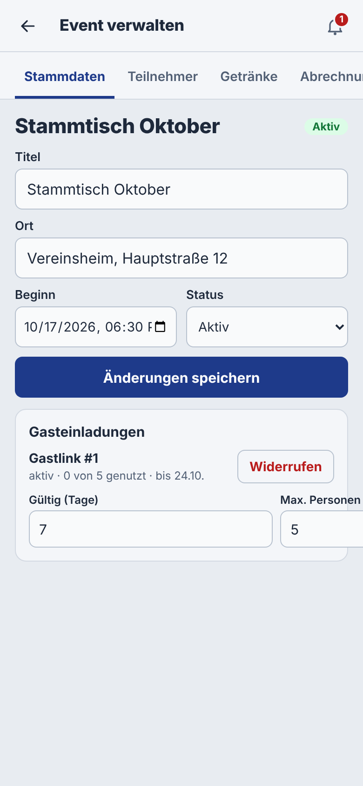

Für Gastgeber und Vorstand.

- **Titel**, **Ort** und **Beginn** ändern.
- **Status** setzen:
  - **Veröffentlicht**: Einladungen sind raus, die Theke ist noch zu.
  - **Aktiv**: Der Abend läuft, Thekenterminal und Bezahlen per Scan sind offen.
  - **Abgeschlossen**: vorbei, keine Buchungen mehr.
  - **Abgesagt**: fällt aus.
- **Änderungen speichern**.
- **Gasteinladungen**: bestehende **Gastlinks** mit Stand („0 von 5 genutzt · bis …“) und **Widerrufen**. Neue Links mit **Gültig (Tage)** und **Max. Personen** über **Erzeugen**.

 

### Teilnehmer und Getränke eines Events

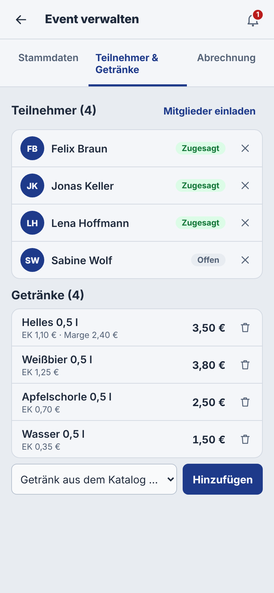

Der zweite Teil der Eventverwaltung.

- **Teilnehmer** mit Antwort und **Mitglieder einladen** für Nachzügler.
- **Getränke** des Abends: Verkaufspreis, **Einkaufspreis (EK)** und **Marge**. Nur diese Getränke stehen an der Theke zur Wahl.
- **Getränk aus dem Katalog** wählen und **Hinzufügen**. Eine ganze [Getränkeliste](#getränkelisten) lässt sich ebenfalls zuweisen.

 

### Eventabrechnung

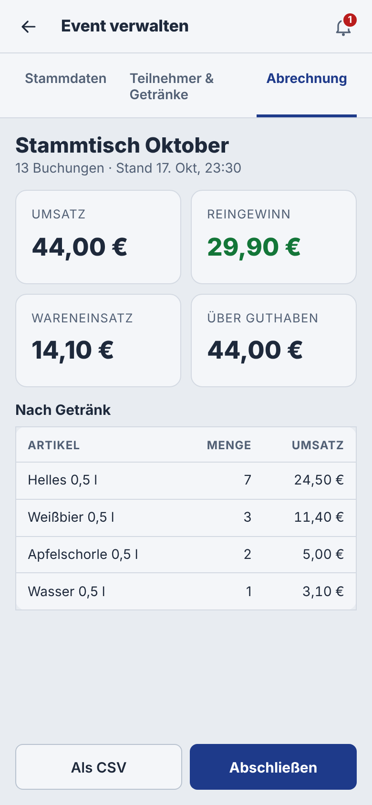

Was ein Abend eingebracht hat.

- Kopf: Event, Zahl der **Buchungen** und Stand.
- Kennzahlen: **Umsatz**, **Reingewinn**, **Wareneinsatz** (aus den Einkaufspreisen) und **über Guthaben** gebucht.
- **Nach Getränk**: Tabelle mit Menge und Umsatz je Artikel.
- **Als CSV** lädt die Abrechnung herunter, etwa für die Kassenprüfung. **Abschließen** setzt das Event auf abgeschlossen.

 

### Kasse und Finanzen

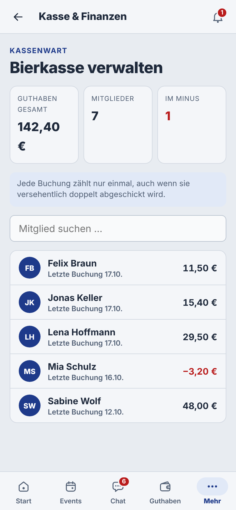

Der Arbeitsplatz des Kassenwarts.

- Kennzahlen: **Guthaben gesamt**, **Mitglieder**, **im Minus**.
- Hinweis: Jede Buchung zählt nur einmal, auch bei doppeltem Tippen.
- **Mitglied suchen** und die Liste aller Mitglieder mit **letzter Buchung** und Guthaben. Ein Minus steht in Rot.
- Ein Tipp auf ein Mitglied öffnet sein [Konto](#mitgliedskonto-buchen).

 

### Mitgliedskonto buchen

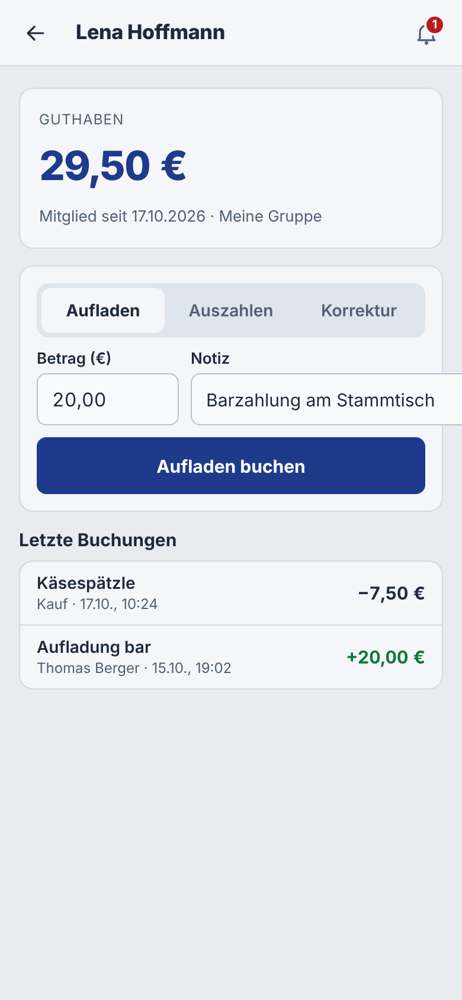

Das Konto einer Person.

- Kopf mit **Guthaben**, Mitglied seit und Gruppe.
- Art der Buchung:
  - **Aufladen**: Bargeld oder Überweisung einbuchen.
  - **Auszahlen**: Guthaben bar zurückgeben, etwa beim Austritt.
  - **Korrektur**: eine falsche Buchung per Gegenbuchung aufheben. Gelöscht wird nie etwas.
- **Betrag** und **Notiz**, dann **… buchen**.
- **Letzte Buchungen** des Mitglieds zur Kontrolle.

 

### Kommunikation

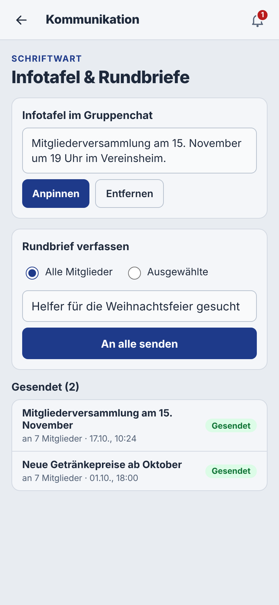

Der Arbeitsplatz des Schriftwarts.

- **Infotafel im Gruppenchat**: Text eingeben und **Anpinnen**; **Entfernen** nimmt ihn ab.
- **Rundbrief verfassen**: Empfänger **Alle Mitglieder** oder **Ausgewählte**, **Titel** und Text, dann **An alle senden**. Rundbriefe landen in den [Mitteilungen](#mitteilungen) und, wo eingeschaltet, als Push.
- **Gesendet**: frühere Rundbriefe mit Empfängerzahl und Zeit.

 

### Moments: Typen und Reaktionen

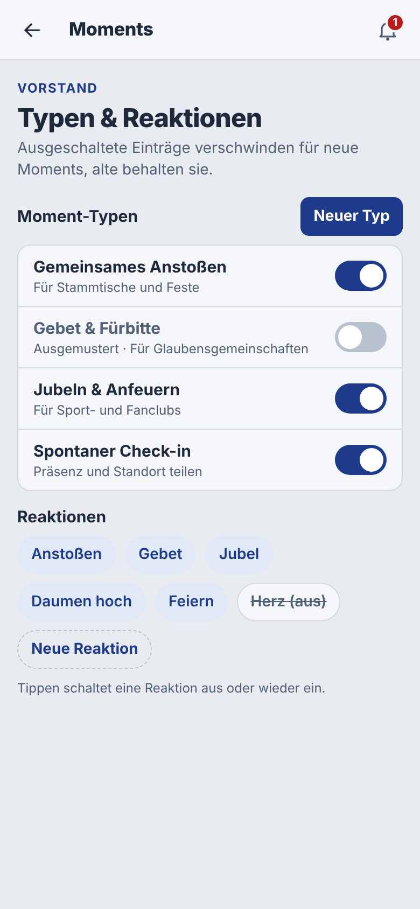

Legt fest, welche Moments und Reaktionen die Gruppe nutzt.

- **Moment-Typen** mit kurzer Beschreibung, etwa „Gemeinsames Anstoßen – für Stammtische und Feste“. **Neuer Typ** legt einen eigenen an. **Ausgemustert** heißt: für neue Moments nicht mehr wählbar.
- **Reaktionen** als Schalter: ein Tipp schaltet sie aus oder wieder ein. **Neue Reaktion** fügt eine hinzu.
- Ausgeschaltete Einträge verschwinden nur für neue Moments; alte behalten sie.

 

### Katalog-Freigabe

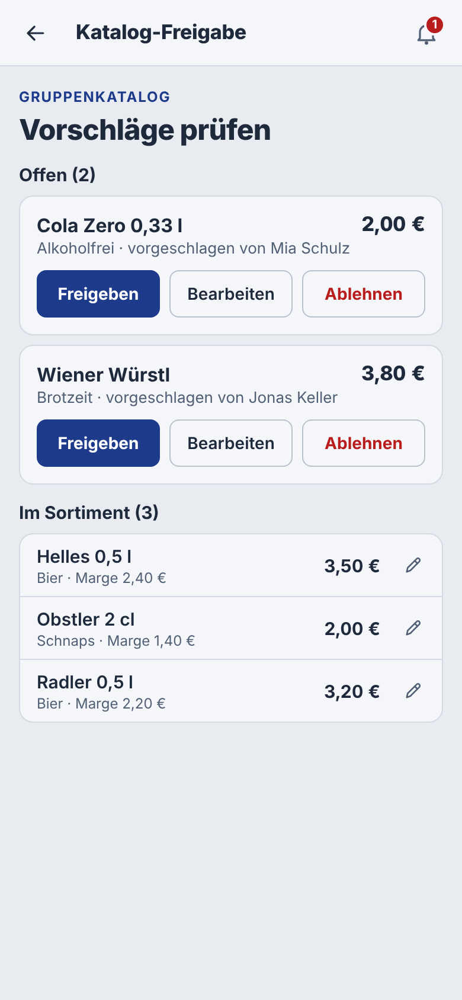

Vorschläge der Mitglieder prüfen.

- **Offen**: jeder Vorschlag mit Kategorie, wer ihn gemacht hat, und Preis. **Freigeben** nimmt ihn in den Katalog auf, **Bearbeiten** korrigiert ihn vorher, **Ablehnen** verwirft ihn.
- **Im Sortiment**: die freigegebenen Getränke mit Kategorie, **Marge** und Preis. Ein Tipp öffnet [Getränk bearbeiten](#getränk-bearbeiten).

 

### Getränk bearbeiten

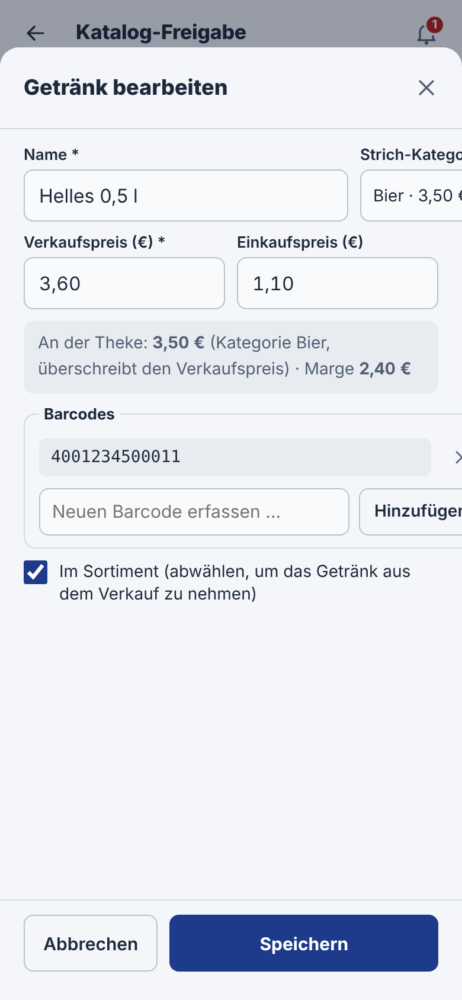

Ein Getränk anlegen oder ändern.

- **Name** (Pflicht).
- **Strich-Kategorie**: in welcher Spalte der Strichliste das Getränk gezählt wird, oder **Ohne**.
- **Verkaufspreis** (Pflicht) und **Einkaufspreis**. Darunter der Preis, der an der Theke wirklich gilt: Hat das Getränk eine Kategorie, **überschreibt der Kategoriepreis den Verkaufspreis**. Dazu die Marge.
- **Barcodes**: vorhandene Strichcodes und **Neuer Barcode** mit **Hinzufügen**. Damit funktioniert [Bezahlen per Scan](#bezahlen).
- **Im Sortiment**: abwählen, um das Getränk aus dem Verkauf zu nehmen, ohne es zu löschen.
- **Speichern** oder **Abbrechen**.

 

### Getränkedatenbank

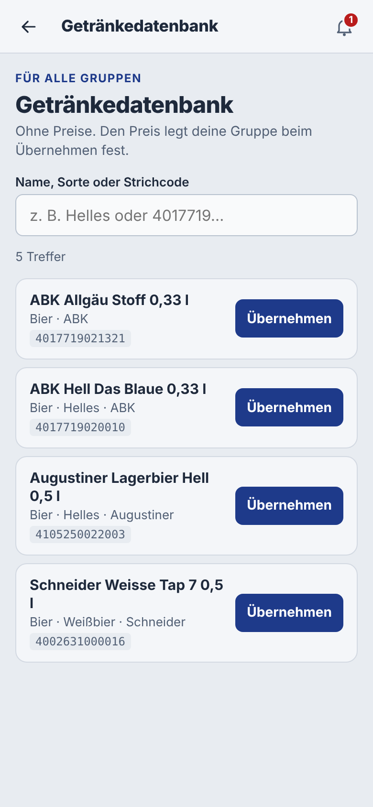

Eine gemeinsame Sammlung von Getränken **für alle Gruppen**, ohne Preise.

- Suche nach **Name, Sorte oder Strichcode**, darunter die Zahl der Treffer.
- Jeder Treffer mit Sorte, Marke und Strichcode.
- **Übernehmen** legt das Getränk im eigenen Katalog an; den Preis legt die Gruppe dabei selbst fest.

 

### Getränkelisten

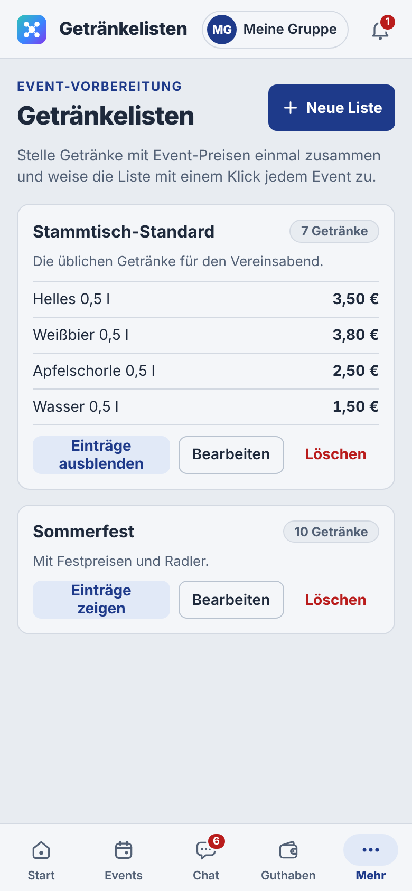

Für die Vorbereitung wiederkehrender Events.

- Eine Liste stellt Getränke mit **Event-Preisen** einmal zusammen, zum Beispiel „Stammtisch-Standard“ oder „Sommerfest“ mit Festpreisen.
- Jede Liste zeigt Name, Zahl der Getränke und Beschreibung. **Einträge zeigen** bzw. **ausblenden** klappt die Getränke auf.
- **Bearbeiten**, **Löschen** und **Neue Liste**.
- Beim Event weist man die Liste mit einem Klick zu, statt jedes Getränk einzeln hinzuzufügen.

 

### Strich-Kategorien

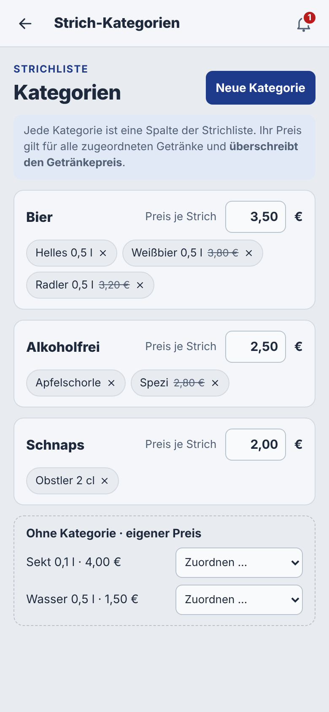

Der Vorstand legt die **Spalten der Strichliste** fest.

- Jede **Kategorie** (z. B. **Bier**, **Alkoholfrei**, **Schnaps**) ist eine Spalte am Thekenterminal.
- **Preis je Strich**: Er gilt für alle Getränke der Kategorie und **überschreibt deren eigenen Preis**. Getränke mit abweichendem Preis zeigen ihn durchgestrichen daneben.
- Unter jeder Kategorie die **zugeordneten Getränke**.
- **Ohne Kategorie · eigener Preis**: Getränke ohne Spalte. Über **Zuordnen …** kommen sie in eine Kategorie.
- **Neue Kategorie** legt eine weitere Spalte an; **Nach links** und **Nach rechts** ändern die Reihenfolge der Spalten.
- Der Kategoriepreis gilt **im Event**, am Terminal wie beim Bezahlen per Scan. Reihenfolge: Kategoriepreis, sonst Preis aus dem Event (Getränkeliste), sonst Preis des Getränks.

Mehr dazu im [Leitfaden Vorstand](03-vorstand.md#strich-kategorien).

 

### Kiosk-Geräte

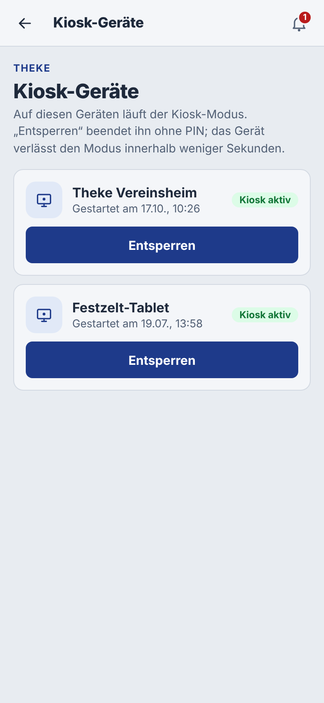

Alle Tablets, auf denen der Kiosk-Modus läuft, mit **Gerätename**, **Startzeit** und Stand **Kiosk aktiv**.

**Entsperren** beendet den Kiosk-Modus ohne PIN; das Gerät verlässt ihn innerhalb weniger Sekunden. Gedacht für den Fall, dass die PIN vergessen wurde.

 

---

## Thekenterminal

Das Thekenterminal läuft quer auf einem Tablet an der Theke, angemeldet mit dem Thekenkonto. Kopfzeile: **Strichliste**, das gewählte **Event** mit Status, der **Gerätename** mit „Kiosk-Modus“ und rechts das **Schloss** zum Verlassen.

### Strichliste

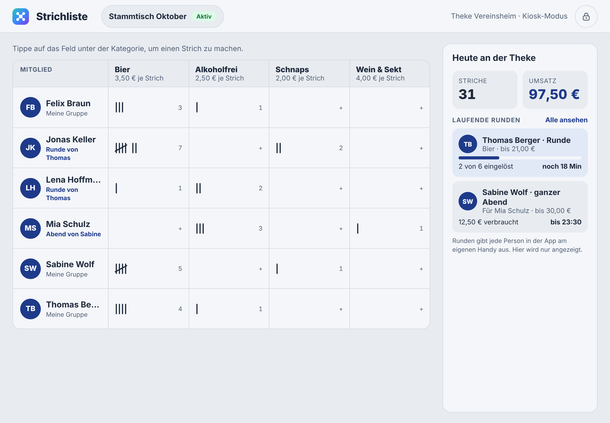

Die Strichliste sieht aus wie die auf Papier: eine Zeile je Mitglied, eine Spalte je [Strich-Kategorie](#strich-kategorien).

- **Spaltenkopf**: Name der Kategorie und **Preis je Strich**.
- **Zeilenkopf**: Kürzel und Name des Mitglieds. Darunter steht, auf wessen Kosten gerade getrunken wird: die eigene Rechnung oder eine laufende Runde („Runde von Thomas“, „Abend von Sabine“).
- **Ein Tipp in ein Feld** macht einen Strich. Striche erscheinen als Bündel: vier senkrechte, der fünfte quer. Rechts im Feld steht die Zahl. Leere Felder zeigen ein **+**.
- Enthält die Kategorie im Event mehrere Getränke, fragt das Terminal nach dem Tipp, **welches Getränk** es war; bei nur einem bucht es sofort. Gebucht werden Getränk und Kategorie zum Kategoriepreis.
- Die Spalte **Sonstiges** ganz rechts öffnet die Auswahl der Getränke ohne Kategorie und der Speisen, jeweils mit eigenem Preis.
- Der Betrag geht vom Guthaben des Mitglieds ab, oder vom Guthaben des Rundengebers, wenn die Person in einer laufenden Runde eingeladen ist.

Rechts die Spalte **Heute an der Theke**:

- **Striche** und **Umsatz** des Abends.
- **Laufende Runden**: Wer ausgibt, was (Getränk oder alles), bis zu welcher Summe, wie viele schon eingelöst haben und wie lange die Runde noch gilt. **Alle ansehen** öffnet die [Rundenübersicht](#laufende-runden).
- Hinweis: Runden gibt jede Person in der App am eigenen Handy aus. Am Terminal werden sie nur angezeigt.

> **Neu im Entwurf**: Die Zeile „Runde von …“ und der Bereich **Laufende Runden** kommen mit den Runden am eigenen Handy. Bis dahin wird eine Runde am Terminal gebucht (siehe [Leitfaden Thekenterminal](05-thekenterminal.md#runde-ausgeben-oder-ganzen-abend-stiften)).

### Strich rückgängig

Nach jedem Strich erscheint unten ein Balken mit dem letzten Strich, etwa „Strich: Felix Braun · Bier (Helles 0,5 l)“, und **Rückgängig**. Der Tipp darauf nimmt den Strich sofort zurück und bucht das Geld zurück. Das geht für Striche dieses Terminals **innerhalb von 10 Minuten**; ältere Fehler korrigiert der Kassenwart.

### Laufende Runden

> **Neu im Entwurf**

Die Rundenübersicht ist **nur eine Anzeige**. Am Terminal wird keine Runde ausgegeben.

- Jede Karte zeigt **wer ausgibt**, **was** (eine Runde eines Getränks oder ganzer Abend mit allen Getränken) und den Stand **Läuft**.
- **Gibt aus**: die Höchstsumme. **Verbraucht**: was bisher eingelöst wurde. **Gültig**: Restzeit oder Uhrzeit des Endes.
- Darunter die **Eingeladenen**; wer schon eingelöst hat, trägt ein Häkchen.
- Wer eingeladen ist, bekommt an der Theke einfach seinen Strich. Er geht automatisch auf die Runde, bis sie aufgebraucht oder abgelaufen ist.

### Kiosk-Modus starten

Im Kiosk-Modus bleibt das Tablet auf der Strichliste: Menü, Mitteilungen und Abmelden sind ausgeblendet, auch nach Neuladen.

- **Gerätename** (optional), damit der Vorstand das Gerät unter [Kiosk-Geräte](#kiosk-geräte) erkennt.
- **PIN** aus 4 bis 8 Ziffern und **PIN wiederholen**. Stimmen beide nicht überein, erscheint ein Hinweis.
- Hinweis für den Notfall: Bei vergessener PIN entsperren Vorstand und Administration das Gerät.
- **Starten** oder **Abbrechen**.

### Kiosk-Modus verlassen

Nach einem Tipp auf das Schloss: **Ziffernblock** mit **⌫** zum Löschen und **OK**. Die Punkte oben zeigen, wie viele Ziffern eingegeben sind. Nach mehreren falschen Eingaben ist die Eingabe eine Weile gesperrt. **×** schließt das Fenster, das Terminal bleibt gesperrt. Der Satz „In dieser Vorschau: 2468“ gehört nur zum Entwurf; die App verrät die PIN nicht.

---

## Administration

Die Administration ist für die Arbeit am Rechner gebaut. Links steht die Seitenleiste, rechts der Inhalt.

### Mitglieder und Rollen

- Hinweis oben: Änderungen gelten sofort für die offene Gruppe; der Server prüft jede Berechtigung.
- **Mitglieder suchen** und Filter **Rolle** (alle, Mitglied, Vorstand, Admin, Theke).
- **Mitglied einladen** öffnet den [Einladungsdialog](#mitglied-einladen).
- Tabelle mit **Name**, **E-Mail**, **Rolle**, **Guthaben**, **Status** (Aktiv, Deaktiviert), **Seit** und **Bearbeiten**. Auch das Thekenkonto steht hier.

### Mitglied bearbeiten

- Kopf mit Name, E-Mail und Mitglied seit.
- **Rollen** zum Anhaken, jeweils mit kurzer Erklärung:
  - **Mitglied**: Events, Chat, Guthaben.
  - **Vorstand**: Kasse, Katalog, Mitteilungen.
  - **Admin**: Mitglieder, Rollen, Gruppe.
  - **Thekenterminal**: Striche für andere buchen.
- Eigene Rollen verwaltet man in den [Gruppeneinstellungen](#rollen-und-berechtigungen).
- **Vorstandsamt**: keines, **Vorsitz**, **Kassenwart**, **Schriftwart** oder **Beisitzer**. Das Amt steht neben dem Namen.
- **Konto deaktivieren**: Die Person kann sich nicht mehr anmelden; Buchungen bleiben erhalten.
- **Speichern**.
- **Audit-Protokoll**: alles, was dieses Mitglied betrifft, mit Bereich (Finanzen, Kommunikation, Konto), Inhalt, Person und Zeit.

### Mitglied einladen

- **Für** (optional): ein Name, um den Link später wiederzuerkennen.
- **Gültig**: **24 Stunden**, **7 Tage** oder **30 Tage**.
- **Einladungslink erstellen** zeigt den Link **ein einziges Mal**. **Link kopieren** und per Messenger oder E-Mail verschicken. Jeder Link gilt für eine Person.
- **Offene Einladungen** mit Nutzung und Ablaufdatum; **Zurückziehen** macht einen Link sofort ungültig.

### Gruppeneinstellungen

- Kopf mit Gruppenname, Mitgliederzahl und **Gruppe wechseln**.
- **Name** der Gruppe ändern und **Speichern**.
- **Bild** hochladen (PNG, JPEG oder GIF; große Bilder werden verkleinert). Ohne Bild erscheint das Kürzel.
- **Daten exportieren**: alle Daten der Gruppe als JSON-Datei, mit Mitgliedern, Events, Katalog, Buchungen und Chats.
- **Rollen & Berechtigungen verwalten**.
- **Gruppe verlassen** mit Warnung. Ist man die letzte Person, die Mitglieder und Rollen verwalten darf, ist das Verlassen gesperrt, bis jemand anderes die Rolle hat.

### Rollen und Berechtigungen

- Links die **Rollen** mit Personenzahl und Zahl der Berechtigungen. **System**-Rollen (Mitglied, Vorstand, Admin, Theke) sind fest; für Abweichungen legt man mit **Neue Rolle** eine eigene an.
- Rechts die **Berechtigungen** der gewählten Rolle, gruppiert nach:
  - **Geld**: eigenes Guthaben sehen, selbst kaufen, am Terminal für andere buchen, alle Konten sehen, Buchungen korrigieren.
  - **Kommunikation**: Gruppenchat, Event-Chats, Chats moderieren, Rundbriefe senden.
  - **Events & Katalog**: Events anlegen, alle Events verwalten, Getränke vorschlagen und freigeben, Moments konfigurieren.
  - **Verwaltung**: Mitglieder sehen, einladen und verwalten, Rollen verwalten, Gruppe verwalten und exportieren, Kiosk-Geräte verwalten.
- Neben jeder Berechtigung steht ihr technischer Name (z. B. `ledger.correct`), wie er auch in [Rollen und Berechtigungen](../rollen-und-berechtigungen.md) beschrieben ist.

### Plattform

Nur für das Vereint-Team, das die Installation betreibt.

- Kennzahlen: **Gruppen** (davon archiviert), **Mitglieder** über alle Gruppen, belegter **Speicher**.
- **Neue Gruppe anlegen** mit Name und optional der E-Mail des Admins. Ein bestehendes Konto mit dieser E-Mail wird Admin, sonst man selbst.
- **Alle Gruppen** mit Mitgliedern, Speicher und Status. **Archivieren** macht eine Gruppe für ihre Mitglieder unerreichbar; **Wiederherstellen** holt sie zurück.

---

## Welcher Bildschirm wofür?

| Ich möchte … | Bildschirm | Rolle |
| :--- | :--- | :--- |
| mich anmelden | [Anmelden](#anmelden) | alle |
| einer Gruppe beitreten | [Registrieren](#registrieren-mit-einladungslink) | neu |
| eine eigene Gruppe gründen | [Gruppe eröffnen](#gruppe-eröffnen) | alle |
| die Gruppe wechseln | [Gruppe wählen](#gruppe-wählen) | alle |
| zu- oder absagen | [Events](#events), [Event](#event) | Mitglied |
| einen Termin planen | [Event anlegen](#event-anlegen) | Mitglied |
| schreiben | [Chat](#chat), [Gruppenchat](#gruppenchat), [Direktnachrichten](#direktnachrichten) | Mitglied |
| mein Guthaben sehen | [Guthaben](#guthaben), [Käufe](#käufe) | Mitglied |
| ein Getränk selbst bezahlen | [Bezahlen](#bezahlen) | Mitglied |
| eine Runde ausgeben | [Runde ausgeben](#runde-ausgeben) | Mitglied |
| Statistiken sehen | [Statistik](#statistik), [Getränkestatistik](#getränkestatistik), [Statistik-Übersicht](#statistik-übersicht) | alle Mitglieder |
| Guthaben einbuchen | [Kasse](#kasse-und-finanzen), [Konto buchen](#mitgliedskonto-buchen) | Vorstand |
| einen Abend abrechnen | [Eventabrechnung](#eventabrechnung) | Vorstand |
| allen etwas mitteilen | [Kommunikation](#kommunikation) | Vorstand |
| Getränke und Preise pflegen | [Katalog-Freigabe](#katalog-freigabe), [Getränk bearbeiten](#getränk-bearbeiten), [Strich-Kategorien](#strich-kategorien) | Vorstand |
| Striche machen | [Strichliste](#strichliste) | Theke |
| ein Tablet sperren oder entsperren | [Kiosk starten](#kiosk-modus-starten), [Kiosk verlassen](#kiosk-modus-verlassen), [Kiosk-Geräte](#kiosk-geräte) | Theke, Vorstand |
| Mitglieder und Rollen verwalten | [Mitglieder und Rollen](#mitglieder-und-rollen), [Mitglied bearbeiten](#mitglied-bearbeiten), [Rollen](#rollen-und-berechtigungen) | Admin |
| neue Mitglieder einladen | [Mitglied einladen](#mitglied-einladen) | Admin, Vorstand |
| die Gruppe umbenennen oder exportieren | [Gruppeneinstellungen](#gruppeneinstellungen) | Admin |
