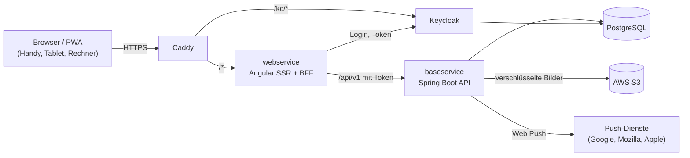

# Architektur

## Komponenten

| Komponente | Verzeichnis | Technik | Aufgabe |
| :--- | :--- | :--- | :--- |
| **webservice** | [`webservice/`](https://github.com/damaurer/vereint/tree/develop/webservice) | Angular 22 mit SSR, Express 5 als Backend-for-Frontend (BFF) | Oberfläche, PWA, Login per OIDC/PKCE, Sitzung im HttpOnly-Cookie, Weiterleitung von `/api/*` an den baseservice |
| **baseservice** | [`baseservice/`](https://github.com/damaurer/vereint/tree/develop/baseservice) | Kotlin, Spring Boot 4, Java 25, Liquibase | Fachlogik und REST-API, Rechteprüfung, Verschlüsselung, Dateien, Web Push |
| **Keycloak** | [`keycloak/`](https://github.com/damaurer/vereint/tree/develop/keycloak) | Keycloak 26.8.1 mit eigenem Login-Theme | Konten, Login, Rollen |
| **PostgreSQL** | – | PostgreSQL 17 | Datenbanken `vereint` und `keycloak` |
| **S3** | – | AWS S3 (lokal MinIO bzw. in E2E-Tests ein S3-Ersatz) | Bilder, verschlüsselt |
| **Caddy** | [`deploy/`](https://github.com/damaurer/vereint/tree/develop/deploy) | Caddy | HTTPS mit automatischem Zertifikat, Weiterleitung |
| **Infrastruktur** | [`infra/aws/`](https://github.com/damaurer/vereint/tree/develop/infra/aws) | Terraform | AWS-Server, Buckets, Secrets, Alarme |
| **E2E-Tests** | [`e2e/`](https://github.com/damaurer/vereint/tree/develop/e2e) | Playwright | Tests gegen den kompletten Stack |

## Wie eine Anfrage läuft

1. Der Browser spricht nur mit dem webservice. Er hält kein Token, sondern nur
   ein verschlüsseltes Sitzungs-Cookie.
2. Der BFF holt beim Login die Tokens von Keycloak, erneuert sie bei Bedarf und
   hängt das Access-Token an jede Anfrage an den baseservice.
3. Der baseservice prüft das JWT und die Rolle, führt die Fachlogik aus und
   verschlüsselt sensible Inhalte, bevor sie gespeichert werden.
4. Bilder liefert der baseservice nur über einen Endpunkt mit Rechteprüfung aus,
   nie über direkte S3-Links.

## Datenbank

Das Schema verwaltet Liquibase
([docs/operations/database-migrations.md](https://github.com/damaurer/vereint/blob/develop/docs/operations/database-migrations.md)).
Weil ein Rollback nur die Anwendung zurücksetzt, müssen Migrationen
rückwärtskompatibel sein: Spalten erst hinzufügen, später entfernen.

## Vertiefung

- [docs/architecture/system-overview.md](https://github.com/damaurer/vereint/blob/develop/docs/architecture/system-overview.md)
- [docs/architecture/data-model.md](https://github.com/damaurer/vereint/blob/develop/docs/architecture/data-model.md)
- [docs/baseservice/README.md](https://github.com/damaurer/vereint/blob/develop/docs/baseservice/README.md)
- [docs/backend-for-frontend/README.md](https://github.com/damaurer/vereint/blob/develop/docs/backend-for-frontend/README.md)
- [docs/api/rest-api-reference.md](https://github.com/damaurer/vereint/blob/develop/docs/api/rest-api-reference.md)
